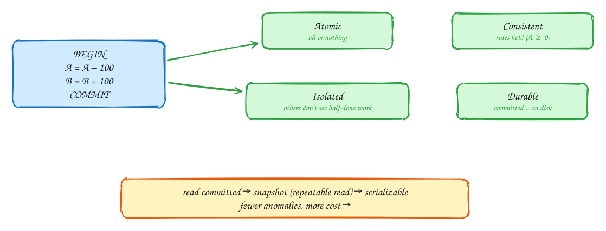

# ACID and isolation levels

Intermediate

A **transaction** groups several reads and writes into one unit. **ACID** names what it promises:

- **Atomic**: all of it happens, or none of it. No half-done transfer.
- **Consistent**: your rules (constraints like "balance ≥ 0") still hold afterwards.
- **Isolated**: concurrent transactions don't see each other's half-done work.
- **Durable**: once committed, it survives a crash.

Isolation comes in levels, because full isolation is expensive:

- **Read committed** (Postgres default): you never read uncommitted data, but two reads in one transaction can return different values.
- **Snapshot isolation / repeatable read**: the whole transaction sees one consistent snapshot. **Write skew** is still possible: two doctors each check "someone else is on call", then both go off call.
- **Serializable**: the result is as if transactions ran one at a time. It is the safest level, with retries when conflicts happen.

For hot spots like "decrement stock", a **conditional update** (`UPDATE … SET stock = stock - 1 WHERE stock > 0`) or `SELECT … FOR UPDATE` is often simpler than raising the level.

## When to use it

- Any time several rows must change together: money, bookings, inventory.
- Raise isolation, or lock explicitly, where a check-then-act race would be costly.

> [!TIP]
> **Say this in the interview:** "Reserving a seat is one transaction with a conditional update, `WHERE status = 'available'`. If zero rows changed, someone else got it. That avoids the check-then-act race without making everything serializable."

## Self-check

Try to answer before you open each one.

What does the A in ACID mean?

Atomic: all of the transaction's writes happen, or none do.

Give an example of write skew.

Two on-call doctors each check that the other is on call, then both go off call. Each transaction was valid alone, but together they break the rule. Snapshot isolation allows this; serializable doesn't.

How do you safely decrement stock without raising isolation?

A conditional update: UPDATE … SET stock = stock − 1 WHERE id = ? AND stock > 0, then check that one row changed.

## Related

- [Dealing with contention](../patterns/contention.md)
- [DDIA Ch 7: transactions](../ddia/07-transactions.md)
- [Ticketmaster](../problems/ticketmaster.md)
