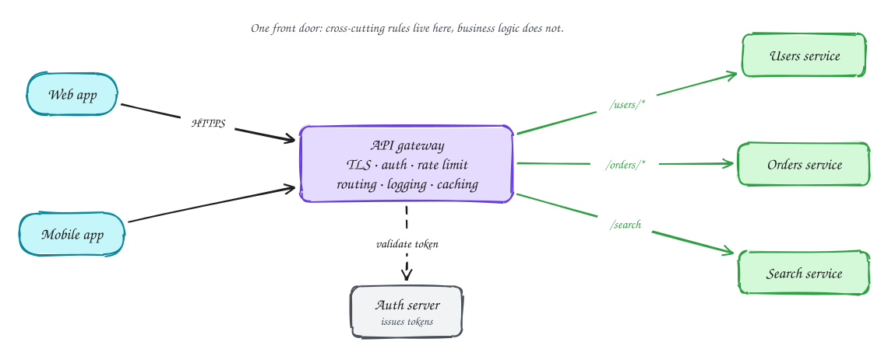

# API gateway

Beginner-friendly

An **API gateway** sits between clients and your services. Every request passes through it, so it is the natural place for the rules that apply to all of them:

- **TLS termination**: decrypt once at the edge.
- **Authentication**: check the token, then pass the user ID downstream.
- **Rate limiting** and quotas per user or API key.
- **Routing**: `/orders/*` goes to the orders service, and so on.
- **Logging, metrics and request IDs**, plus response caching and request size limits.

It should **not** contain business logic. Once the gateway knows what an order is, every team needs to change it, and it becomes the bottleneck you were trying to avoid.

Because all traffic flows through it, the gateway must be stateless and run as several instances behind a load balancer. Managed options include AWS API Gateway, Kong, Envoy and NGINX.

## When to use it

- Several services behind one public API.
- You need consistent auth, rate limits and logging without repeating them in every service.
- Skip it for a single service: a load balancer is enough.

> [!TIP]
> **Say this in the interview:** "Clients hit an API gateway that terminates TLS, validates the JWT, applies per-user rate limits and routes by path. It is stateless and horizontally scaled; business rules stay in the services."

## Self-check

Try to answer before you open each one.

Name four things an API gateway typically does.

TLS termination, authentication, rate limiting, routing, plus logging, metrics and request IDs.

Why shouldn't business logic live in the gateway?

Every team would need to change it, it becomes a deployment bottleneck and a single point of coupling. Keep it to cross-cutting rules.

When is a gateway unnecessary?

With a single service, where a load balancer already does the job.

## Related

- [Rate limiter](../problems/rate-limiter.md)
- [Choosing technologies](../technologies.md)
- [Sessions vs tokens](sessions-vs-tokens.md)
