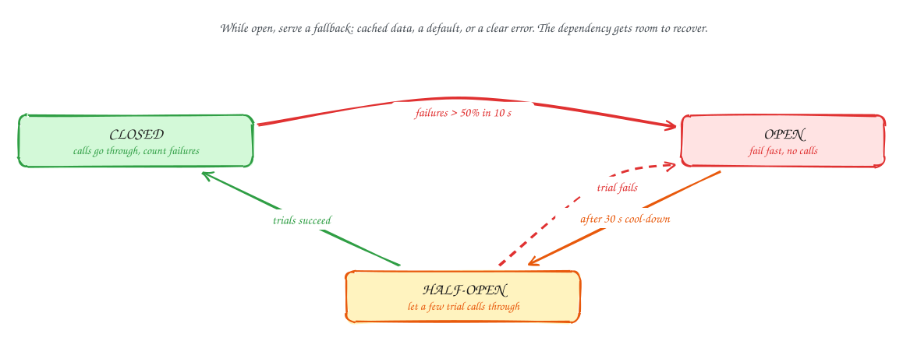

# Circuit breaker

Beginner-friendly

Retries help with brief failures. When a dependency is **really down**, every call still waits for its timeout, and your threads fill up waiting. A **circuit breaker** stops that.

- **Closed** (normal): calls go through, and the breaker counts failures.
- **Open**: once failures pass a threshold (say, half of calls in 10 seconds), the breaker **fails every call immediately** without touching the dependency. Your service stays responsive, and the dependency gets breathing room.
- **Half-open**: after a cool-down, a few trial calls go through. If they succeed the breaker closes; if not, it opens again.

While the breaker is open, return a **fallback**: cached data, a sensible default ("recommendations unavailable"), or a clear error. Pair it with **bulkheads**, separate connection pools per dependency, so one slow dependency can't use up the threads the others need.

## When to use it

- Calls to any dependency that can fail independently: other services, third-party APIs, a search cluster.
- Most service meshes and libraries (Envoy, Resilience4j, Polly) have one built in.

> [!TIP]
> **Say this in the interview:** "Calls to the recommendation service go through a circuit breaker with its own connection pool. If it opens, the home page renders without recommendations rather than timing out. Checkout never depends on it."

## Self-check

Try to answer before you open each one.

What are the three states of a circuit breaker?

Closed (calls pass, failures counted), open (fail fast without calling), half-open (a few trial calls decide whether to close or reopen).

What do you return while the breaker is open?

A fallback: cached or default data, a degraded feature, or a clear fast error.

What is a bulkhead?

Separate resource pools (threads, connections) per dependency, so one slow dependency can't exhaust capacity needed by the others.

## Related

- [Timeouts, retries and backoff](timeouts-and-retries.md)
- [Rate limiting and load shedding](load-shedding.md)
