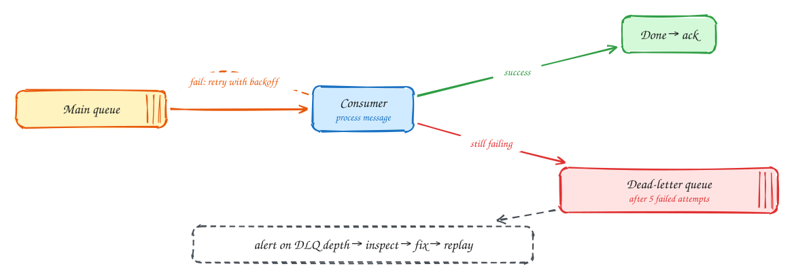

# Dead-letter queues

Beginner-friendly

Some messages will never succeed: bad data, a bug, a deleted record. A **poison message** like that gets retried forever, wastes capacity, and in an ordered stream it **blocks every message behind it**.

A **dead-letter queue (DLQ)** is where such messages go after a set number of attempts:

1. The consumer fails and the message is retried with **backoff**.
2. After, say, five attempts, it moves to the DLQ, keeping the original message plus the error and attempt count.
3. The main queue keeps flowing.
4. An **alert on DLQ depth** tells someone to look. They fix the bug or the data, then **replay** the messages from the DLQ.

Separate errors that might pass on a retry (a timeout, a `503`) from errors that never will (invalid data). Send the second kind to the DLQ immediately rather than retrying.

SQS and RabbitMQ have DLQs built in. With Kafka you usually build them: a retry topic and a dead-letter topic.

## When to use it

- Every queue or stream consumer in production.
- Pair with alerting: a DLQ nobody watches is just a slower way to lose data.

> [!TIP]
> **Say this in the interview:** "Messages that fail five times go to a dead-letter queue with the error attached, so one bad event can't stall the partition. We alert when the DLQ is non-empty and replay after the fix."

## Self-check

Try to answer before you open each one.

What is a poison message?

One that fails every time it is processed, for example because of bad data or a bug, and would otherwise be retried forever or block the messages behind it.

What should be stored with a dead-lettered message?

The original message plus the error, the number of attempts and timestamps, so someone can diagnose and replay it.

Which failures should skip retries and go straight to the DLQ?

Errors that will never succeed on retry, such as validation errors or malformed data. Retry only transient ones like timeouts and 503s.

## Related

- [Timeouts, retries and backoff](timeouts-and-retries.md)
- [Message queue vs event stream](queue-vs-stream.md)
- [Job scheduler](../problems/job-scheduler.md)
