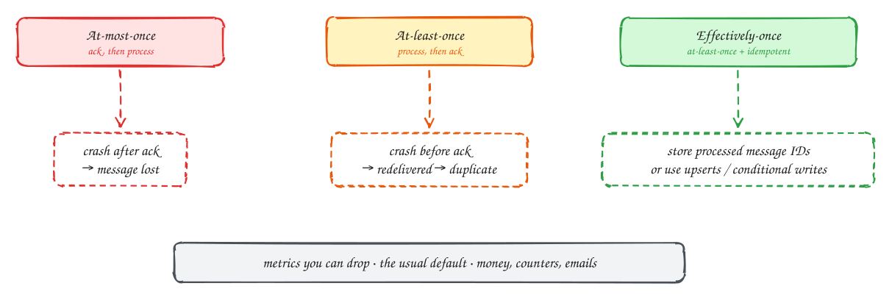

# Delivery guarantees

Intermediate

When a consumer crashes, what happens to the message it was handling? It depends on **when it acknowledges**.

- **At-most-once**: acknowledge first, then process. A crash after the ack loses the message. That is acceptable only for data you can afford to drop, like some metrics.
- **At-least-once**: process first, then acknowledge. A crash before the ack means the message is delivered again, so you get **duplicates**. This is the usual default.
- **Exactly-once**: across a network, a message can't be guaranteed to be delivered exactly once. What you can build is **effectively-once**: at-least-once delivery plus a consumer that makes duplicates harmless.

Ways to make a consumer **idempotent**:

- Record processed message IDs in the same transaction as the work, and skip any ID already seen.
- Use **upserts** and absolute values ("set balance to 90") instead of increments ("subtract 10").
- Use conditional writes keyed by the event, such as "insert payment where event_id is new".

Kafka's "exactly-once" feature covers reading and writing within Kafka. Side effects outside Kafka, such as sending an email, still need idempotency.

## When to use it

- **At-least-once + idempotent consumer**: almost everything, especially money, counters and notifications.
- **At-most-once**: high-volume telemetry where a small loss is fine.

> [!TIP]
> **Say this in the interview:** "Delivery is at-least-once, so the consumer is idempotent: it writes the ledger entry and the event ID in one transaction with a unique constraint on the event ID. A redelivered event hits the constraint and is skipped."

## Self-check

Try to answer before you open each one.

Why is at-least-once the usual default?

Losing messages is usually worse than duplicates, and duplicates can be neutralised with idempotent consumers.

Name two ways to make a consumer idempotent.

Store processed message IDs in the same transaction as the work (with a unique constraint), or use upserts and absolute values instead of increments.

Does Kafka exactly-once make sending an email exactly-once?

No. It covers reads and writes within Kafka. External side effects still need idempotency, for example an email-sent record keyed by event ID.

## Related

- [Message queue vs event stream](queue-vs-stream.md)
- [Transactional outbox](outbox.md)
- [Payment system](../problems/payment-system.md)
