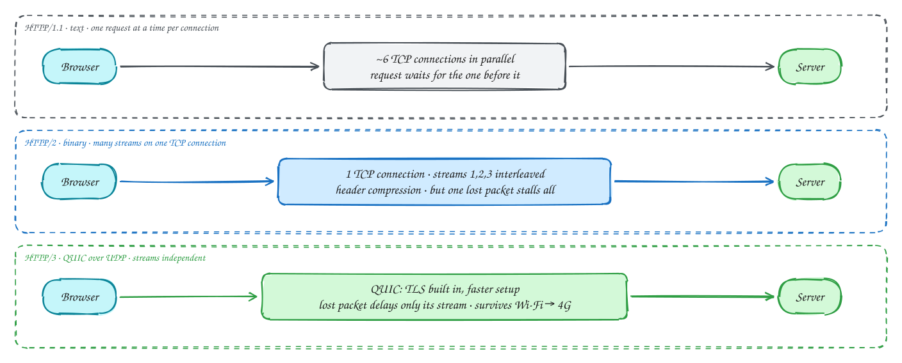

# HTTP/1.1 vs HTTP/2 vs HTTP/3

Beginner-friendly

**HTTP/1.1** sends one request at a time on a connection; the next request waits for the previous response. Browsers work around this by opening about six connections per site.

**HTTP/2** uses one TCP connection and splits it into many **streams**, so dozens of requests travel at once, interleaved. Headers are compressed. The catch: TCP delivers bytes in order, so **one lost packet stalls every stream** until it is resent (head-of-line blocking at the TCP level).

**HTTP/3** runs on **QUIC** over UDP. Each stream is delivered independently, so a lost packet only delays its own stream. TLS is built in, so a new connection takes one round trip (zero on a repeat visit), and connections survive switching from Wi-Fi to mobile data.

The API you write doesn't change: methods, headers and status codes are the same in all three.

## When to use it

- **HTTP/1.1**: still fine for simple internal calls and anything behind a proxy that speaks it.
- **HTTP/2**: the default for browsers and the transport under gRPC.
- **HTTP/3**: mobile users and lossy networks; most CDNs turn it on for you.

> [!TIP]
> **Say this in the interview:** "Between the browser and the CDN we get HTTP/2 or HTTP/3 for free. Internally, services talk gRPC over HTTP/2, so one connection carries many calls."

## Self-check

Try to answer before you open each one.

What problem does HTTP/2 solve, and what problem does it leave?

It multiplexes many requests over one connection instead of one at a time. But because it runs on TCP, one lost packet still stalls every stream (TCP head-of-line blocking).

Why does HTTP/3 use UDP?

It runs on QUIC over UDP so each stream is delivered independently, connection setup is faster with TLS built in, and connections survive network changes.

Do you need to change your API to move from HTTP/1.1 to HTTP/2?

No. Methods, headers, status codes and URLs are the same. Only the wire format changes.

## Related

- [TCP vs UDP](tcp-vs-udp.md)
- [REST vs GraphQL vs gRPC](rest-graphql-grpc.md)
