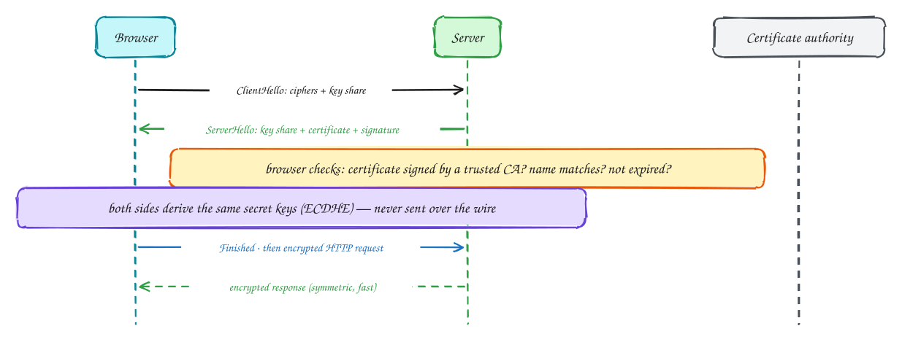

# How HTTPS works

Beginner-friendly

HTTPS is HTTP inside a **TLS** connection. TLS gives you three things: **encryption** (no one in the middle can read it), **integrity** (no one can change it unnoticed) and **authentication** (you are really talking to that domain).

1. The browser says hello: which ciphers it supports, plus its half of a key exchange.
2. The server replies with its half of the key exchange, its **certificate**, and a signature proving it holds the certificate's private key.
3. The browser checks the certificate: signed by a **certificate authority** it trusts, for this domain name, not expired.
4. Both sides combine the two halves (ECDHE) into the same secret keys. The keys themselves never cross the network.
5. Everything after that is encrypted with fast **symmetric** encryption.

With TLS 1.3 this takes one round trip. Asymmetric cryptography is only used to agree on keys, because it is slow.

## When to use it

- Always, for anything public. Free certificates (Let's Encrypt) removed the cost excuse.
- Terminate TLS at the load balancer or gateway; use **mTLS** between services when they must prove their identity to each other.

> [!TIP]
> **Say this in the interview:** "TLS terminates at the load balancer, so the app servers don't do crypto. Service-to-service traffic uses mTLS from the service mesh, so a compromised pod can't pretend to be the payments service."

## Self-check

Try to answer before you open each one.

What three things does TLS provide?

Encryption (privacy), integrity (tamper detection) and authentication (you are talking to the real domain).

How does the browser know the server's certificate is genuine?

It is signed by a certificate authority the browser trusts, the name matches the domain, and it hasn't expired.

Why switch to symmetric encryption after the handshake?

Asymmetric cryptography is slow; it is used only to agree on keys. Bulk data uses fast symmetric ciphers with those keys.

## Related

- [What happens when you type a URL](type-a-url.md)
- [Sessions vs tokens](sessions-vs-tokens.md)
