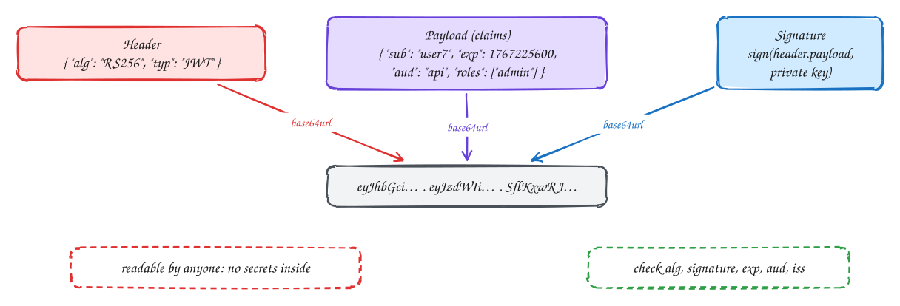

# JWT

Intermediate

A **JSON Web Token** is three base64url parts joined by dots: `header.payload.signature`.

- The **header** names the signing algorithm.
- The **payload** holds **claims**: `sub` (who), `exp` (expiry), `aud` (which API it's for), `iss` (who issued it), plus anything else such as roles.
- The **signature** covers the header and payload. With RS256 or ES256 the issuer signs with a private key and anyone can verify with the public key.

Base64 is encoding, not encryption: **anyone can read the payload**. A JWT proves *who issued it and that it wasn't changed*; it does not hide anything. So never put secrets or personal data in it.

When verifying, check the signature with the algorithm *you* expect (never accept `alg: none`), then `exp`, `aud` and `iss`. And remember you can't take a JWT back once issued: keep them short-lived.

## When to use it

- Access tokens and OIDC ID tokens passed between services.
- Avoid JWTs as long-lived browser sessions: you lose instant logout.

> [!TIP]
> **Say this in the interview:** "The access token is a JWT signed with RS256. Services verify it locally with the public key from the auth server's JWKS endpoint, check exp and aud, and read the user ID from sub. It expires in 10 minutes."

## Self-check

Try to answer before you open each one.

Is the payload of a JWT secret?

No. It is base64url-encoded, not encrypted; anyone can read it. The signature only proves who issued it and that it wasn't changed.

Which claims should you check when verifying a JWT?

The signature with the expected algorithm, then exp (expiry), aud (audience) and iss (issuer).

What is the "alg: none" mistake?

Accepting the algorithm named in the token header. An attacker sets it to none (or switches algorithms) and the signature check is skipped. Always enforce the algorithm you expect.

## Related

- [Sessions vs tokens](sessions-vs-tokens.md)
- [OAuth 2.0](oauth.md)
