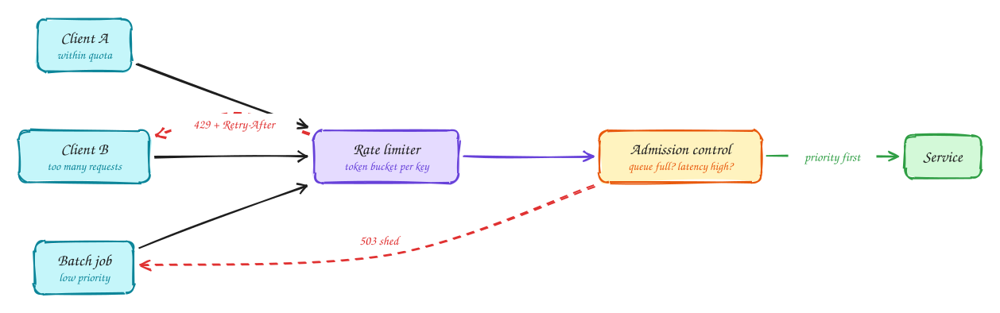

# Rate limiting and load shedding

Beginner-friendly

Every service has a limit. Past it, latency climbs for **everyone**, until nothing finishes in time. Two tools keep you on the safe side of that cliff.

**Rate limiting** protects you from **one caller** sending too much. Each user or API key gets a quota, usually a **token bucket**: tokens refill at a steady rate, each request spends one, and short bursts are allowed. Over the limit, reply `429 Too Many Requests` with a `Retry-After` header.

**Load shedding** protects you when the **total** is too much, even if every caller is within quota. When queues are full or latency passes a threshold, reject some work early with `503`, and **choose what to drop**: background jobs before user requests, browsing before checkout. A fast "no" is much better than a slow timeout.

Related idea: **backpressure**. A consumer that can't keep up signals the producer to slow down, instead of buffering until it runs out of memory.

## When to use it

- **Rate limits**: every public API, login endpoints, anything a bot could hammer.
- **Load shedding**: any service that can see traffic spikes (sales, launches, retry storms).

> [!TIP]
> **Say this in the interview:** "At the gateway each API key has a token bucket of 100 requests a second. Behind it, services shed low-priority traffic when the queue is too deep, so during a spike checkout stays fast and only recommendations degrade."

## Self-check

Try to answer before you open each one.

What is the difference between rate limiting and load shedding?

Rate limiting caps each caller's quota. Load shedding drops work when total load is too high, even if every caller is within quota.

Which status codes do you return for each?

429 Too Many Requests (with Retry-After) for rate limits; 503 Service Unavailable when shedding.

Why is a fast rejection better than accepting everything?

Past capacity, latency climbs for all requests until none finish in time. Rejecting some early keeps the rest fast.

## Related

- [Rate limiter (full design)](../problems/rate-limiter.md)
- [API gateway](api-gateway.md)
- [Circuit breaker](circuit-breaker.md)
