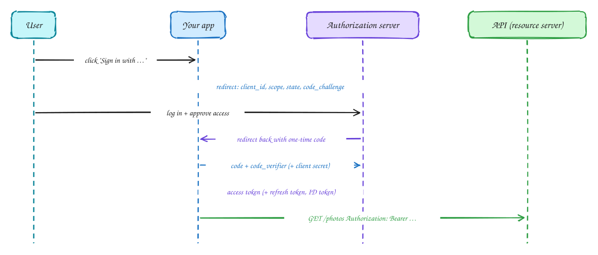

# OAuth 2.0

Intermediate

**OAuth 2.0** answers: *how does app X get access to my photos at service Y without my Y password?* The answer is a scoped, expiring **access token**.

The standard flow for web and mobile apps is the **authorization code flow with PKCE**:

1. The app redirects the user to the **authorization server**, asking for specific **scopes** (for example `photos.read`) and sending a hash of a random secret (PKCE).
2. The user logs in *there* and approves the access.
3. The authorization server redirects back with a one-time **code**.
4. The app exchanges the code, plus the original secret, for an **access token** (and usually a **refresh token**).
5. The app calls the API with `Authorization: Bearer <token>`.

OAuth is about **authorization** (what an app may do). For login (*who* the user is), **OpenID Connect** adds an **ID token** on top. "Sign in with Google" is OIDC.

## When to use it

- Letting third-party apps access your API on a user's behalf.
- "Sign in with…" buttons (OIDC).
- Service-to-service access uses the simpler client-credentials grant.

> [!TIP]
> **Say this in the interview:** "Third-party apps use the authorization code flow with PKCE and get narrowly scoped, short-lived access tokens plus a refresh token the user can revoke from their settings page."

## Self-check

Try to answer before you open each one.

What problem does OAuth 2.0 solve?

Letting an app act on a user's behalf at another service with a scoped, expiring token, without the app ever seeing the user's password.

What is PKCE for?

It binds the code exchange to the app that started the flow: without the original secret (code verifier), a stolen authorization code is useless.

What is the difference between OAuth and OpenID Connect?

OAuth is about authorization (what the app may do). OIDC adds authentication: an ID token saying who the user is.

## Related

- [JWT](jwt.md)
- [Single sign-on](sso.md)
- [Sessions vs tokens](sessions-vs-tokens.md)
