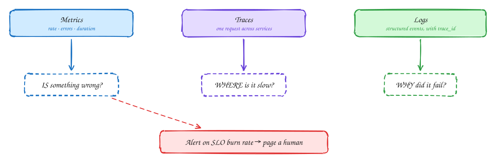

# Metrics, logs and traces

Beginner-friendly

You can't fix what you can't see. **Observability** is being able to answer new questions about production without shipping new code. It rests on three signals:

- **Metrics**: cheap numbers over time. For every service track **rate, errors and duration** (the RED method), plus saturation of CPU, memory, queues and connections. They tell you **that** something is wrong.
- **Traces**: one request followed across every service it touches, with the time spent in each. They tell you **where**.
- **Logs**: structured events (JSON, not free text) with the details. They tell you **why**.

Tie them together with a **trace ID** passed in every request and written into every log line.

Alert on what users feel, not on CPU. Alert on **SLO burn rate**, for example "at this error rate we'll use the month's error budget in two days", so you page a human for real problems only.

## When to use it

- Every production system. In interviews, mention it in the wrap-up.
- Common stack: Prometheus and Grafana, OpenTelemetry for traces, a log store such as Loki or Elasticsearch.

> [!TIP]
> **Say this in the interview:** "I'd track request rate, error rate and p99 latency per endpoint, propagate a trace ID with OpenTelemetry, and alert on SLO burn rate rather than CPU. For the queue I'd also alert on consumer lag."

## Self-check

Try to answer before you open each one.

Metrics, traces, logs: which answers "where is it slow"?

Traces: they show one request across services and the time spent in each.

What is the RED method?

For each service track request Rate, Errors and Duration (latency).

Why alert on SLO burn rate rather than CPU?

Users feel errors and latency, not CPU. Burn-rate alerts page only when the error budget is actually being used up fast.

## Related

- [Non-functional requirements](../foundations/nfrs.md)
- [Metrics monitoring (full design)](../problems/metrics-monitoring.md)
