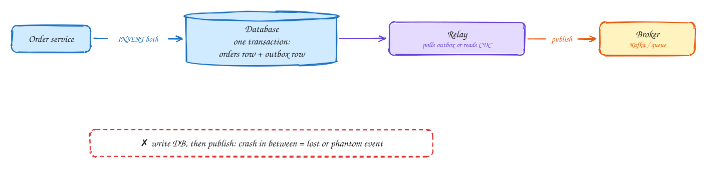

# Transactional outbox

Intermediate

A service often needs to **update its database and publish an event**: save the order, then tell everyone "order placed". Doing those as two separate steps is the **dual-write problem**:

- If the service crashes after the database write, the event is never sent and other systems never hear about the order.
- If you publish first and the database write then fails, others react to an order that doesn't exist.

The **outbox pattern** fixes it with the one thing you do have, a local transaction. In the **same transaction** that writes the order, insert a row into an `outbox` table describing the event. Either both rows commit or neither does.

A separate **relay** then reads the outbox and publishes each event to Kafka or a queue. It does this by polling the table, or better, by reading the database's change log (**CDC**, for example Debezium). It marks events as sent, and retries if publishing fails.

Publishing is **at-least-once**, because the relay can crash after publishing but before marking an event sent. So consumers must be idempotent.

## When to use it

- Any service that writes to its database and must reliably emit an event about it.
- The building block for sagas and event-driven microservices.

> [!TIP]
> **Say this in the interview:** "The order service writes the order and an outbox row in one transaction. Debezium tails the outbox and publishes to Kafka, so an event exists if and only if the order does. Consumers dedupe by event ID."

## Self-check

Try to answer before you open each one.

What is the dual-write problem?

Writing to the database and publishing to a broker as two separate steps: a crash between them leaves one done without the other.

Why does the outbox pattern work?

The business row and the event row commit in one local transaction, so an event exists if and only if the data does.

Why must consumers still be idempotent?

The relay can publish an event and crash before marking it sent, so it publishes it again: delivery is at-least-once.

## Related

- [Delivery guarantees](delivery-guarantees.md)
- [Multi-step processes](../patterns/multi-step-processes.md)
- [DDIA Ch 11: stream processing](../ddia/11-stream-processing.md)
