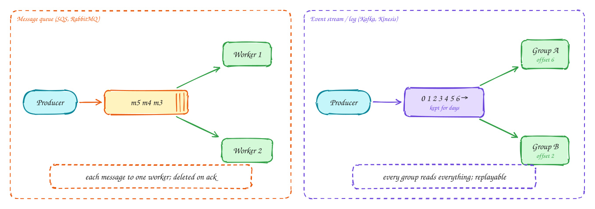

# Message queue vs event stream

Beginner-friendly

Both decouple the producer from the consumers, so a spike or a slow consumer doesn't break the producer. They differ in what happens to a message after it is read.

**Message queue** (SQS, RabbitMQ): each message is a task delivered to **one** worker. Once the worker acknowledges it, it is deleted. Add workers to go faster. If a worker dies mid-task, the message becomes visible again and another worker takes it.

**Event stream** (Kafka, Kinesis, Pulsar): messages are appended to an ordered **log** and kept for days. Each **consumer group** tracks its own **offset**, so many independent consumers (search indexing, analytics, notifications) read the same events, and any of them can **rewind and replay**. Order is guaranteed within a **partition**, so choose the partition key (for example user ID) to keep related events in order.

Rule of thumb: **queue for jobs, stream for facts**. "Resize this image" is a job; "order 42 was placed" is a fact that several systems care about.

## When to use it

- **Queue**: background jobs, emails, image processing, anything one worker should do once.
- **Stream**: event-driven systems, many consumers, replay, ordered event history, high throughput.

> [!TIP]
> **Say this in the interview:** "Order events go to Kafka, partitioned by order ID, so inventory, email and analytics each consume them at their own pace and we can replay after a bug. Thumbnail generation is a plain job, so it goes on SQS."

## Self-check

Try to answer before you open each one.

A message has been processed. What happens to it in a queue vs a stream?

Queue: it is deleted once acknowledged. Stream: it stays in the log until retention expires; the consumer group just advances its offset.

How do you keep events for one user in order in Kafka?

Use the user ID as the partition key. Order is guaranteed only within a partition.

Image resizing or "order placed": which goes on a queue and which on a stream?

Resizing is a job for one worker: queue. "Order placed" is a fact several systems consume: stream.

## Related

- [Delivery guarantees](delivery-guarantees.md)
- [Long-running tasks](../patterns/long-running-tasks.md)
- [DDIA Ch 11: stream processing](../ddia/11-stream-processing.md)
