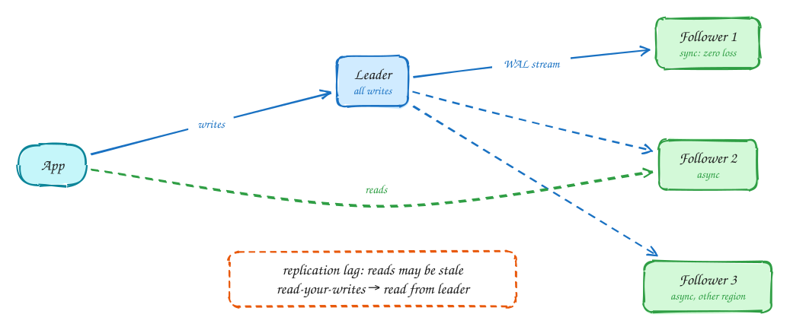

# Database replication

Intermediate

**Replication** keeps copies of the same data on several machines, for three reasons: survive a machine failing, serve more reads, and put data near users.

The common setup is **leader-follower**. All writes go to the **leader**, which streams its change log to the **followers**. Reads can go to any of them.

- **Synchronous** followers confirm before the write commits: no data loss on failover, but slower writes. **Asynchronous** followers are faster but can be a little behind. Most setups use one synchronous follower and the rest asynchronous.
- That delay is **replication lag**. A user who updates their profile and reads it back from a lagging follower sees the old value. Fix it with **read-your-writes**: send that user's reads to the leader for a short while after they write.
- If the leader dies, a follower is **promoted** (failover). Watch out for two nodes both thinking they are leader (**split brain**). Real systems use fencing or consensus to prevent it.

Other models: **multi-leader** (writes in every region, conflicts to resolve) and **leaderless** (Cassandra, DynamoDB: write to several nodes, read from several, use quorums).

## When to use it

- Almost every production database: at least one follower for failover.
- Read replicas when reads outgrow one server and can tolerate a little lag.

> [!TIP]
> **Say this in the interview:** "Postgres has one synchronous standby in another zone for failover and two async read replicas. Feed reads go to replicas; right after a user posts, their own reads go to the leader for a few seconds so they see their post."

## Self-check

Try to answer before you open each one.

What is replication lag and when does it hurt users?

Followers apply changes slightly after the leader. A user who writes then reads from a lagging follower sees stale data.

How do you give a user read-your-writes consistency?

Route that user's reads to the leader (or a caught-up replica) for a short time after they write.

Synchronous vs asynchronous followers: what is the trade-off?

Synchronous means no data loss on failover but slower writes and dependence on the follower; asynchronous is faster but can lose the latest writes.

## Related

- [Scaling reads](../patterns/scaling-reads.md)
- [DDIA Ch 5: replication](../ddia/05-replication.md)
- [CAP theorem](../core-concepts/cap-theorem.md)
