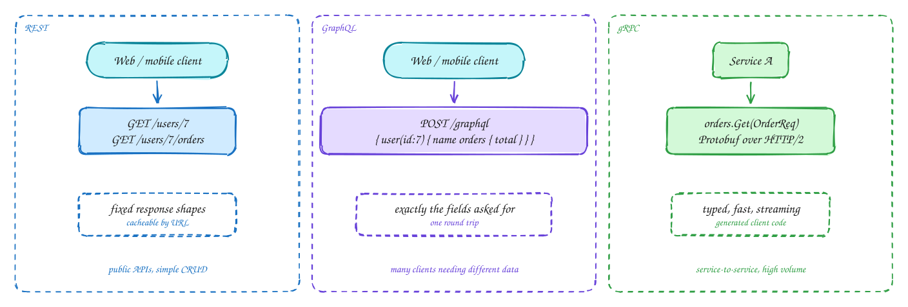

# REST vs GraphQL vs gRPC

Beginner-friendly

**REST** models your data as resources with URLs (`/users/7/orders`) and uses HTTP verbs on them. Responses have a fixed shape, so they cache well by URL and every tool understands them. The cost: a screen may need several calls, or get more fields than it uses.

**GraphQL** exposes one endpoint and a typed schema. The client sends a query naming exactly the fields it wants, across related objects, and gets them in one response. Great when many clients (web, iOS, Android) need different slices of the same data. The costs: HTTP caching is harder, and one innocent-looking query can be very expensive, so you need depth and cost limits.

**gRPC** is remote function calls with a **Protobuf** contract compiled into client code. Messages are small and binary, it runs on HTTP/2, and it supports streaming. Browsers can't call it directly without a proxy, so it is mostly used **between services**.

## When to use it

- **REST**: public APIs and the default in interviews.
- **GraphQL**: a backend-for-frontend serving several apps with different data needs.
- **gRPC**: internal, high-volume, latency-sensitive service-to-service calls.

> [!TIP]
> **Say this in the interview:** "The public API is REST: simple, cacheable, and what partners expect. Internally the services talk gRPC for typed contracts and lower overhead. I'd only add GraphQL if many clients need very different views of the same data."

## Self-check

Try to answer before you open each one.

When would you pick GraphQL over REST?

When several clients need different shapes of the same related data and you want to avoid many round trips or over-fetching, typically behind a backend-for-frontend.

Why is gRPC mostly used between services and not from browsers?

Browsers can't speak gRPC's HTTP/2 framing directly without a proxy. Between services its typed Protobuf contracts, small binary messages and streaming are a big win.

What is a risk of GraphQL that REST doesn't have?

One query can be very expensive (deep nesting, huge fan-out), and HTTP caching by URL is harder. You need depth and cost limits and persisted queries.

## Related

- [API design](../core-concepts/api-design.md)
- [HTTP versions](http-versions.md)
