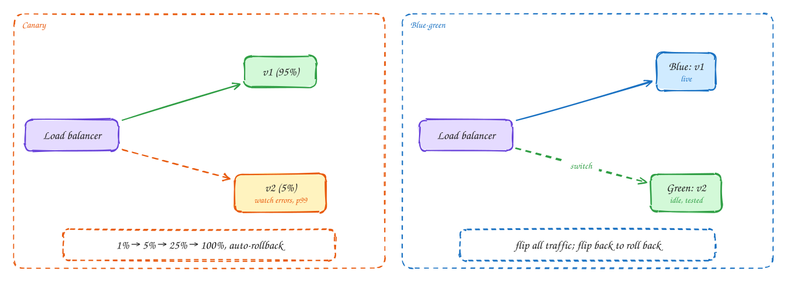

# Deploying safely

Beginner-friendly

Most outages start with a change. Safe deployment makes every change **small, observable and quick to undo**.

- **Rolling deploy**: replace instances a few at a time. Simple, but old and new versions run side by side for a while.
- **Canary**: send 1% of traffic to the new version, compare its error rate and latency with the old one, then go to 5%, 25%, 100%. Roll back automatically if the numbers get worse.
- **Blue-green**: run two full environments and switch all traffic from blue (old) to green (new) at the load balancer. Rolling back is one switch, but you pay for double capacity.
- **Feature flags**: deploy code switched off, then turn the feature on for staff, then 10% of users, then everyone. This separates **deploy** from **release**, and the flag is an instant kill switch.

Database changes need the same care: **expand, then contract**. Add the new column, deploy code that writes both, backfill, switch reads, and only then drop the old column. Every step stays compatible with the version before it.

## When to use it

- **Canary + feature flags**: the default for services with real traffic.
- **Blue-green**: when you need an instant, all-at-once switch and can afford two environments.

> [!TIP]
> **Say this in the interview:** "Deploys go out as canaries: 1% of traffic, automatic rollback if error rate or p99 regresses against the baseline. Risky features ship dark behind a flag, and schema changes follow expand-and-contract so old and new code both work."

## Self-check

Try to answer before you open each one.

How does a canary deploy decide to roll back?

It compares the new version's error rate and latency against the old version on the same traffic, and rolls back automatically if they get worse.

What do feature flags separate?

Deploying code from releasing a feature. Code ships switched off and is turned on gradually, with an instant kill switch.

How do you rename a database column without downtime?

Expand and contract: add the new column, write both, backfill, switch reads, then drop the old column. Each step works with the previous code version.

## Related

- [Metrics, logs and traces](observability.md)
- [DDIA Ch 4: encoding and evolution](../ddia/04-encoding-and-evolution.md)
