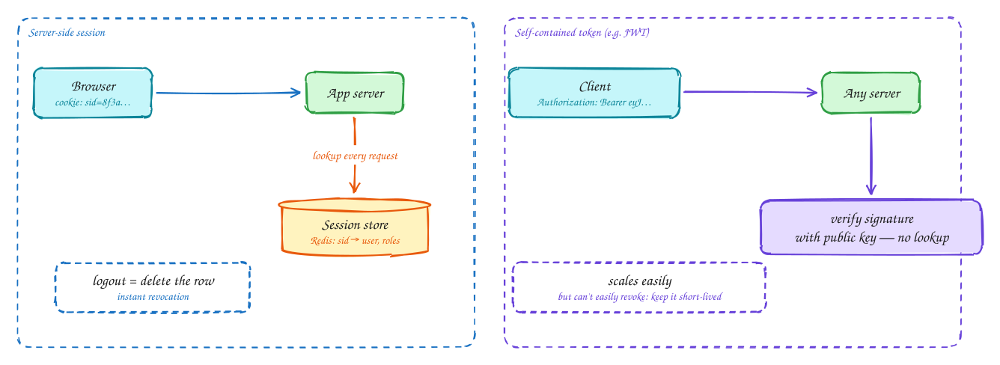

# Sessions vs tokens

Intermediate

After login, every request has to say who it comes from. There are two ways to do it.

**Server-side session.** The server creates a random session ID, stores `session ID → user` in a store such as Redis, and sends the ID in a cookie. Each request costs a lookup, but **logout and revocation are instant**: delete the row.

**Self-contained token** (usually a JWT). The server signs a token holding the user ID, roles and expiry. Any server can verify it with the public key, with **no lookup**, which suits many services and regions. The catch is that a valid token stays valid until it expires. So keep **access tokens short-lived** (5–15 minutes) and pair them with a **refresh token** that is checked against a store and can be revoked.

Browsers: put either in an `HttpOnly`, `Secure`, `SameSite` cookie, not in `localStorage`, where any injected script can read it.

## When to use it

- **Sessions**: a classic web app with one backend, or where instant logout matters (banking, admin tools).
- **Tokens**: many services or regions, mobile apps and third-party APIs. Short access tokens plus revocable refresh tokens.

> [!TIP]
> **Say this in the interview:** "The gateway validates a short-lived JWT locally, so services don't hit a session store on every call. Refresh tokens live in a database so we can revoke them; worst case, a stolen access token works for 10 minutes."

## Self-check

Try to answer before you open each one.

What is the main advantage of a server-side session?

Instant revocation: logging out or banning a user just deletes the session row.

Why keep JWT access tokens short-lived?

They can't easily be revoked; any server will accept them until they expire. Short lifetimes limit the damage of a stolen token.

Where should a browser keep its session ID or token?

In an HttpOnly, Secure, SameSite cookie, not localStorage, where injected scripts can read it.

## Related

- [JWT](jwt.md)
- [OAuth 2.0](oauth.md)
- [API gateway](api-gateway.md)
