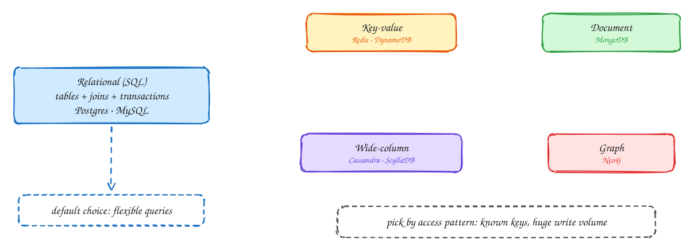

# SQL vs NoSQL

Beginner-friendly

**Relational (SQL)** databases such as Postgres and MySQL store data in tables, enforce a schema, join tables in queries and run multi-row **transactions**. You can ask questions you didn't plan for. One well-tuned server handles a lot, and read replicas help with reads.

**NoSQL** is a family of databases, each built around one access pattern:

- **Key-value** (Redis, DynamoDB): get and put by key, very fast, easy to shard.
- **Document** (MongoDB): store a whole JSON object, with flexible fields.
- **Wide-column** (Cassandra, ScyllaDB): huge write volumes, rows partitioned by key and sorted inside a partition.
- **Graph** (Neo4j): relationships first, such as "friends of friends".

The trade: NoSQL scales out more easily, but you design tables **around your queries** up front and give up joins and, often, cross-key transactions.

**Pick SQL by default.** Switch when you can name the reason, for example "50k writes a second by device ID, always read by key and time".

## When to use it

- **SQL**: most products, anything with money, inventory or complex queries.
- **NoSQL**: a known, simple access pattern at a scale or write rate one SQL server can't handle.

> [!TIP]
> **Say this in the interview:** "Orders and payments go in Postgres: we need transactions and ad-hoc queries. The click events are write-heavy, append-only and always read by ad ID and time, so they go in Cassandra, partitioned by ad ID and day."

## Self-check

Try to answer before you open each one.

What do you give up when moving from SQL to a key-value or wide-column store?

Joins, ad-hoc queries and usually multi-key transactions. Tables must be designed around known queries.

When is Cassandra a good fit?

Very high write volume with a simple, known access pattern, such as events read by key and time range.

What is a good default for a new product?

A relational database such as Postgres, until you can name a specific scale or access-pattern reason to switch.

## Related

- [Data modeling](../core-concepts/data-modeling.md)
- [Choosing technologies](../technologies.md)
- [DDIA Ch 2: data models](../ddia/02-data-models.md)
