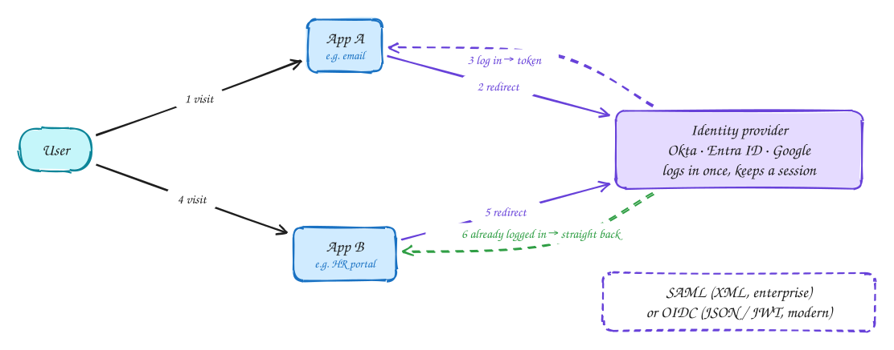

# Single sign-on (SSO)

Intermediate

With **single sign-on**, apps stop handling passwords. They all trust one **identity provider** (IdP) such as Okta, Microsoft Entra ID or Google.

1. You open app A. It has no session for you, so it redirects you to the IdP.
2. You log in at the IdP, with MFA. The IdP now has a session for you.
3. The IdP sends you back to app A with a signed statement of who you are: a **SAML assertion** or an **OIDC ID token**. App A creates its own session.
4. Later you open app B. It also redirects to the IdP, which sees your existing session and sends you straight back. No password prompt.

**SAML** is the older XML-based standard, still common in enterprise software. **OIDC** is the modern JSON/JWT one, built on OAuth 2.0.

The payoff: one place for MFA and password policy, and when someone leaves the company, disabling one account locks them out of everything.

## When to use it

- Any B2B product: enterprise customers will ask for SSO with their own IdP.
- Internal tools within a company.
- Consumer apps offering "Sign in with Google / Apple".

> [!TIP]
> **Say this in the interview:** "For enterprise customers we support SAML and OIDC SSO, so they manage users in their own IdP and offboarding is instant. Our app maps the IdP identity to a tenant and creates its own short session."

## Self-check

Try to answer before you open each one.

Why doesn't the user see a password prompt the second time?

The identity provider already has a session for them, so it immediately redirects back with a new assertion or ID token.

SAML or OIDC: which is newer and what format does it use?

OIDC, built on OAuth 2.0, using JSON and JWTs. SAML is older and XML-based.

Why do enterprise customers insist on SSO?

Central control: one place for MFA and password policy, and disabling one account removes access to every app when someone leaves.

## Related

- [OAuth 2.0](oauth.md)
- [Storing passwords](storing-passwords.md)
