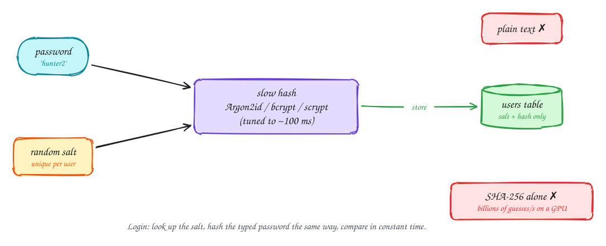

# Storing passwords

Beginner-friendly

**Never store passwords**, not even encrypted: whoever has the key has every password. Store a **hash**, a one-way fingerprint, and compare fingerprints at login.

But a fast hash like SHA-256 is the wrong tool. A GPU can try billions of guesses a second, so a stolen table of fast hashes is cracked quickly. Two fixes:

- **A salt**: a random value generated for each user and stored next to the hash. Two people with the same password get different hashes, and precomputed tables are useless.
- **A slow, memory-hard hash**: **Argon2id** (recommended), **bcrypt** or **scrypt**, tuned so one hash takes around 100 ms. Unnoticeable at login; ruinous for someone trying billions of guesses.

At login, look up the user's salt and settings, hash the typed password the same way, and compare in constant time. Better still, add **MFA** or passkeys, so a leaked password alone isn't enough.

## When to use it

- Any system that stores its own passwords.
- Or avoid storing them at all: delegate login to an identity provider with SSO or "Sign in with…".

> [!TIP]
> **Say this in the interview:** "Passwords are hashed with Argon2id and a per-user salt; we never log them. We add MFA, rate-limit login attempts per account and per IP, and for enterprise customers we'd delegate to their identity provider."

## Self-check

Try to answer before you open each one.

Why is SHA-256 a bad way to store passwords?

It is designed to be fast, so a GPU can try billions of guesses a second against a stolen table.

What does a salt protect against?

Identical passwords producing identical hashes, and precomputed (rainbow) tables. Each user's hash must be cracked separately.

How does login work if you only store a hash?

Read the user's salt and parameters, hash the typed password the same way, and compare the two hashes in constant time.

## Related

- [Sessions vs tokens](sessions-vs-tokens.md)
- [Single sign-on](sso.md)
- [Rate limiter](../problems/rate-limiter.md)
