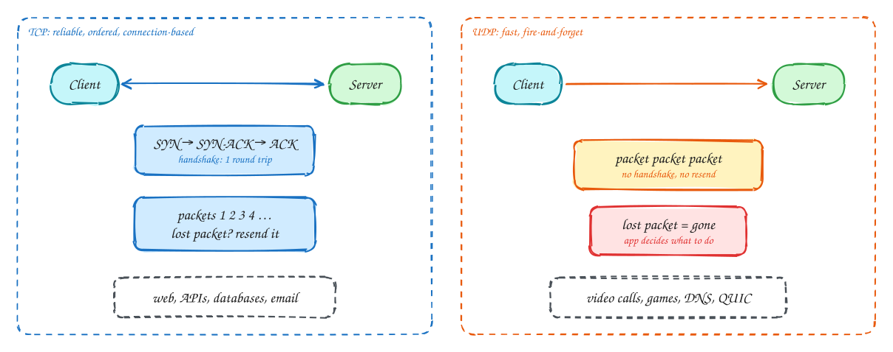

# TCP vs UDP

Beginner-friendly

**TCP** opens a connection with a handshake, numbers every byte, resends anything lost and hands data to the application in order. You get a reliable stream, at the cost of a round trip to start and stalls when a packet goes missing.

**UDP** just sends packets. There is no connection, no ordering and no resending. A lost packet is gone, and the application decides whether it matters.

That makes UDP the right choice when **late data is useless**: a video call would rather skip a frame than freeze waiting for it, and a game only cares about the newest position. DNS uses UDP because one small question and answer doesn't need a connection.

Modern protocols build their own reliability on UDP when TCP's rules get in the way. **QUIC**, which carries HTTP/3, is the best-known example.

## When to use it

- **TCP**: web pages, APIs, database connections, file transfer, anything where every byte must arrive.
- **UDP**: live voice and video, multiplayer games, DNS, metrics where a lost sample is fine, and QUIC.

> [!TIP]
> **Say this in the interview:** "Chat messages go over TCP, through a WebSocket, because every message must arrive in order. The voice call itself uses UDP via WebRTC, because a late audio packet is worse than a missing one."

## Self-check

Try to answer before you open each one.

Why do video calls use UDP rather than TCP?

A late packet is useless for live audio and video. TCP would stall everything to resend it; with UDP the app skips it and carries on.

What does the TCP handshake cost?

One round trip (SYN, SYN-ACK, ACK) before any data is sent, plus TLS on top for HTTPS.

Name a protocol that adds reliability on top of UDP.

QUIC, which carries HTTP/3. It adds its own retransmission and ordering per stream.

## Related

- [HTTP/1.1 vs HTTP/2 vs HTTP/3](http-versions.md)
- [Networking essentials](../core-concepts/networking.md)
- [Chat app](../problems/chat-app.md)
