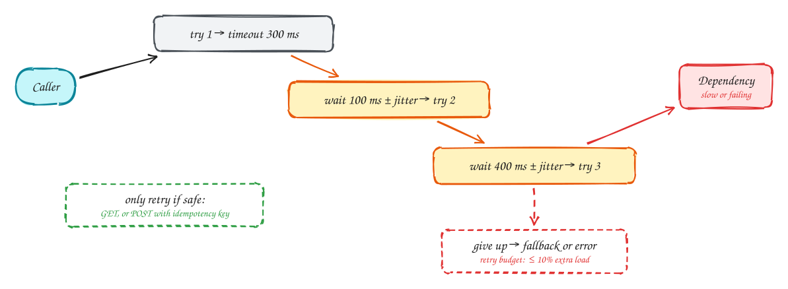

# Timeouts, retries and backoff

Beginner-friendly

Every network call can hang, so **every call needs a timeout**. Without one, slow requests pile up, threads and connections run out, and one slow dependency takes your whole service down.

When a call fails, a **retry** often fixes it: most failures are brief. But retries done badly cause outages:

- **Only retry what is safe.** Reads, or writes that carry an **idempotency key** so a repeat does nothing. Never blindly retry "charge the card".
- **Back off exponentially**: wait 100 ms, then 200, 400, 800…, so a struggling service gets room to recover.
- **Add jitter** (randomness) to each wait. Otherwise thousands of clients retry in the same instant, a *thundering herd*.
- **Cap it**: a few attempts, and a **retry budget** (say, retries may add at most 10% extra load). Retrying at every layer multiplies: 3 layers × 3 tries = 27 calls.

Set timeouts from the dependency's real p99 plus some headroom, and make the total fit inside the caller's own deadline.

## When to use it

- Every remote call: databases, caches, other services, third-party APIs.
- Retries for transient errors (timeouts, 503, connection reset), not for 400-type errors that will fail again.

> [!TIP]
> **Say this in the interview:** "Calls to the pricing service have a 200 ms timeout and up to two retries with exponential backoff and jitter. Writes carry an idempotency key so a retry can't double-apply, and a retry budget stops us from amplifying an outage."

## Self-check

Try to answer before you open each one.

Why add jitter to retry delays?

Without randomness, many clients retry at exactly the same moments and hit the recovering service in synchronized waves (a thundering herd).

Which calls are safe to retry?

Reads and idempotent writes, for example a POST carrying an idempotency key. Not non-idempotent writes like a plain "charge card".

How can retries make an outage worse?

Each layer multiplies attempts (3 layers × 3 tries = 27 calls), piling extra load on a struggling service. Cap attempts and use a retry budget.

## Related

- [Circuit breaker](circuit-breaker.md)
- [Payment system](../problems/payment-system.md)
- [DDIA Ch 8: trouble with distributed systems](../ddia/08-trouble-with-distributed-systems.md)
