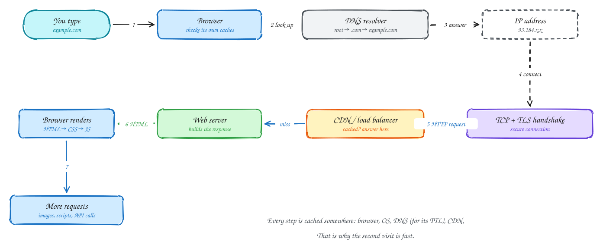

# What happens when you type a URL

Beginner-friendly

1. **The browser checks its caches.** If it has the page or the IP address already, steps are skipped.
2. **DNS turns the name into an IP address.** The resolver asks the root servers, then `.com`, then the domain's own name servers, and caches the answer for its TTL.
3. **TCP opens a connection** to that IP (one round trip), and **TLS** sets up encryption (one more round trip with TLS 1.3).
4. **The HTTP request** goes out. It usually reaches a CDN or load balancer first; a CDN may answer from its cache without touching your servers.
5. **The server builds the response**, often reading a cache or database.
6. **The browser renders** the HTML, then requests the CSS, JavaScript, images and API data the page refers to, reusing the same connection.

Most of the time on a first visit is spent in round trips (DNS, TCP, TLS), not in your code. That is why CDNs, connection reuse and HTTP/3 help so much.

## When to use it

- As the warm-up "explain the web" question.
- When you need to explain where latency comes from before adding a CDN or edge cache.
- To show where each component in a design sits on the request path.

> [!TIP]
> **Say this in the interview:** "DNS gives the IP, TCP and TLS cost one to two round trips, then the request hits a CDN or load balancer. On a slow mobile link those round trips dominate, so I'd put static content and TLS termination at the edge."

## Self-check

Try to answer before you open each one.

Why is the first visit to a site slower than the second, even if the server is equally fast?

The first visit pays for DNS lookup, the TCP handshake and the TLS handshake, several round trips before any content. On later visits the DNS answer, connection and often the content itself are cached.

Where can a request be answered without reaching your servers?

The browser cache, and the CDN edge. Static files and shared responses should be served from the CDN.

What does DNS return, and how long is the answer reused?

An IP address for the name. It is cached by browsers, operating systems and resolvers for the record's TTL.

## Related

- [The basics](../foundations/basics.md)
- [Networking essentials](../core-concepts/networking.md)
