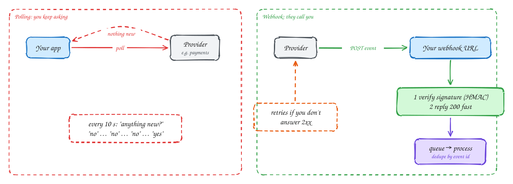

# Webhooks vs polling

Beginner-friendly

**Polling** means asking the provider "anything new?" on a timer. It is simple and works through any firewall, but most calls return nothing, and news arrives up to one interval late.

With a **webhook**, you register a URL and the provider sends an HTTP `POST` to it when the event happens. That is faster and far cheaper, but your endpoint must be public and must handle the provider's rules:

- **Verify the signature.** The provider signs the body with a shared secret (HMAC); reject anything that doesn't match, or anyone could fake a "payment succeeded".
- **Reply `2xx` fast**, then do the work from a queue. Slow replies are treated as failures.
- **Expect retries and duplicates.** Deliveries are at-least-once, so dedupe by the event ID.
- **Expect missed events.** Run a periodic reconciliation poll as a safety net.

## When to use it

- **Polling**: few updates, no public endpoint possible, or as the reconciliation backup.
- **Webhooks**: payments, CI builds, messaging and any third-party event you must react to quickly.

> [!TIP]
> **Say this in the interview:** "The payment provider calls our webhook. We verify the HMAC signature, store the event keyed by its ID so retries are no-ops, return 200, and process it from a queue. A nightly job reconciles against their API in case a webhook was lost."

## Self-check

Try to answer before you open each one.

Why must you verify a webhook's signature?

The URL is public. Without checking the HMAC signature, anyone could POST a fake event such as "payment succeeded".

Why reply 200 quickly and process the event later?

Providers treat slow replies as failures and retry, causing duplicates and timeouts. Acknowledge, enqueue, and process asynchronously.

Webhooks can be retried or lost. How do you handle each?

Dedupe retries by event ID (idempotent processing). Catch lost ones with a periodic reconciliation poll against the provider's API.

## Related

- [Payment system](../problems/payment-system.md)
- [Long-running tasks](../patterns/long-running-tasks.md)
