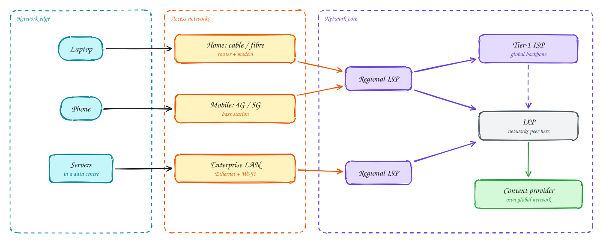
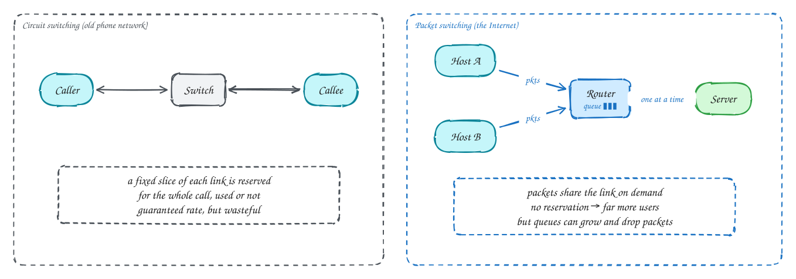
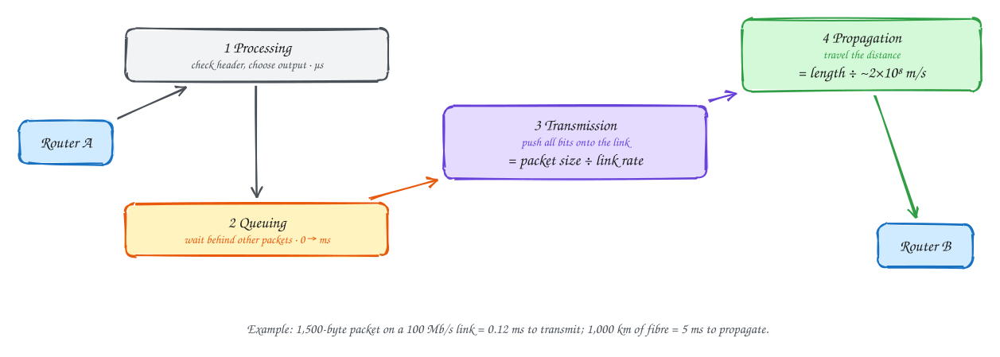
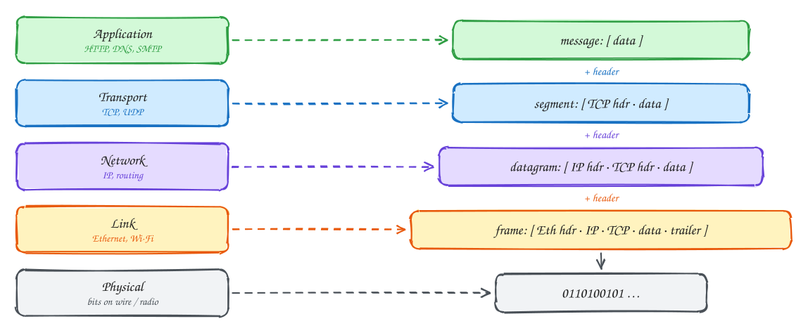

# Chapter 1: Computer Networks and the Internet

Beginner-friendly

> These pages are study notes in our own words and diagrams on *Computer Networking: A Top-Down Approach* by James Kurose and Keith Ross, connected to system design. They don't replace the book, which is worth reading in full.

## TL;DR

The Internet is a **network of networks**: billions of devices at the edge, connected through access networks to ISPs that connect to each other. Data travels as **packets** that share links on demand, which is efficient but means packets can **queue, be delayed or be dropped**. To keep this manageable, networking is split into **layers**, each with one job, and each adds its own header to the data (encapsulation).

**Key ideas:** network edge and core · packet vs circuit switching · four kinds of delay · throughput bottleneck · five-layer stack · encapsulation

## What the Internet is made of

**Why it matters:** in system design, every request crosses this structure. Knowing where the pieces are tells you where latency, cost and failures come from.

**How it's organised:**

1. **The edge.** Laptops, phones and servers in data centres are **hosts** (also called end systems). They run the applications, and everything else exists to move data between them.
2. **Access networks** connect hosts to the first router: a home router with cable or fibre, a mobile base station, or an office's Ethernet and Wi-Fi. This "last mile" is often the slowest part of the path.
3. **The core** is a mesh of **routers** owned by **Internet Service Providers (ISPs)**. Regional ISPs connect to bigger ones, and at the top are a dozen or so **tier-1 ISPs** with global backbones. Networks also connect directly at **Internet Exchange Points (IXPs)**, buildings where many networks plug into each other to swap traffic cheaply (*peering*).
4. **Content providers** such as Google and Netflix now run their own global networks and connect straight into ISPs and IXPs, bypassing much of the traditional hierarchy so their traffic reaches users in fewer hops.

Everything speaks the same **protocols**: agreed rules for the format and order of messages, and what to do when a message arrives. IP, TCP and HTTP are protocols. The IETF publishes them as **RFCs**, which is why equipment from different vendors works together.

## Packet switching vs circuit switching

**Why there's a choice:** two users want to share a link. You can either **reserve** capacity for each of them in advance, or let them **take turns** on demand.

**How each works:**

- **Circuit switching** (the old telephone network) reserves a fixed slice of every link along the path for the whole call. You get a guaranteed rate and no queueing. But the slice is wasted whenever you're silent, and the number of simultaneous users is fixed.
- **Packet switching** (the Internet) breaks data into **packets** and sends each one as soon as possible. Routers use **store-and-forward**: receive the whole packet, then send it on the right outgoing link. If the link is busy, the packet waits in a **queue**; if the queue is full, it's **dropped**.

Packet switching wins for computer traffic because that traffic is **bursty**: a user is idle most of the time, then suddenly sends a lot. Reserving capacity for each user would waste most of it. Sharing on demand lets far more users fit on the same link. A classic example: a link shared by users who each need a tenth of its capacity while active, but are active only 10% of the time. Circuit switching supports exactly 10 users. Packet switching can support around 35, and the chance that more than 10 are active at the same moment is tiny (well under 0.1%).

The price is **unpredictability**: delay varies with how busy the queues are, and packets can be lost. A lot of the rest of the book (TCP especially) exists to cope with that.

## Where delay comes from

**Why it matters:** "the network is slow" is too vague to fix. A packet's delay at each router has four parts with different causes and different cures.

**How each one works:**

1. **Processing delay:** examine the header and decide where to send the packet. Microseconds on modern routers.
2. **Queuing delay:** wait behind other packets for the outgoing link. Zero on an idle link, and it grows sharply as the link gets busy. When the arrival rate approaches the link's capacity (*traffic intensity* near 1), queues grow without limit and packets are dropped.
3. **Transmission delay:** the time to push all the packet's bits onto the link, which is the packet size divided by the link rate. A 1,500-byte packet on a 100 Mb/s link takes 0.12 ms.
4. **Propagation delay:** the time for a bit to travel the length of the link, at roughly two-thirds of the speed of light in fibre (about 200,000 km per second). 1,000 km takes about 5 ms, whatever the bandwidth.

Two lessons for system design:

- **Bandwidth doesn't fix distance.** A faster link shrinks transmission delay, but nothing shrinks propagation. Dhaka to Virginia is roughly 13,000 km, so at least ~65 ms each way, or 130 ms or more per round trip. That's why we use CDNs and regional deployments.
- **Throughput is set by the bottleneck.** An end-to-end transfer can go no faster than the slowest link on its path, which is usually the access link or a congested link in the middle, not the server.

> [!TIP]
> **Say this in the interview:** "Users in Asia hitting a US-only region pay well over 100 ms per round trip in propagation alone, and a page load needs several round trips. So I'd put static content on a CDN and terminate TLS at the edge."

## Layers and encapsulation

**Why layers:** networking involves many separate problems: signals on a wire, getting a frame to the next device, routing across the world, reliable delivery, and what the application actually means. Solving them all in one piece of software would be unmanageable. So the work is split into **layers**. Each layer offers a service to the one above, using the one below, and can change without the others noticing. For example, Wi-Fi can replace Ethernet without changing TCP.

**How it works:** the Internet uses five layers (the book's model):

| Layer | Job | Examples | Unit of data |
|---|---|---|---|
| Application | What the data means | HTTP, DNS, SMTP | message |
| Transport | Process-to-process delivery, reliability | TCP, UDP | segment |
| Network | Host-to-host across many networks | IP, routing protocols | datagram |
| Link | One hop, to the next device | Ethernet, Wi-Fi | frame |
| Physical | Bits as signals | copper, fibre, radio | bits |

When you send data, each layer **adds its own header** with the information its counterpart on the other side needs: ports for transport, IP addresses for network, MAC addresses for link. This wrapping is **encapsulation**. On the receiving side each layer reads and removes its header and hands the rest up. Routers only go up to the network layer (they read IP headers); switches only to the link layer (they read MAC addresses).

> [!NOTE]
> **The OSI model** has seven layers (adding presentation and session between application and transport). You'll hear "L4 load balancer" and "L7 load balancer" from it: L4 is transport (TCP/UDP), L7 is application (HTTP). The Internet itself follows the five-layer model.

## In the system design interview

> [!IMPORTANT]
> **Interviewer asks:** "Why is the API slow for users far away?"
> → Propagation delay: the speed of light in fibre. Bandwidth can't fix it, so reduce round trips (connection reuse, HTTP/2, fewer calls per page) and move content closer (CDN, edge, regional replicas).

> [!IMPORTANT]
> **Interviewer asks:** "What does an L4 vs L7 load balancer see?"
> → L4 sees IP addresses and TCP/UDP ports, and forwards connections without reading them. L7 parses the HTTP request and can route by path, header or cookie.

> [!IMPORTANT]
> **Interviewer asks:** "Why does latency spike when a service is near capacity?"
> → Queuing delay grows sharply as utilisation approaches 100%. Keep headroom (target ~60–70% utilisation) and shed load before queues explode.

## Self-check

Try to answer before you open each one.

Why does packet switching fit Internet traffic better than circuit switching?

Traffic is bursty. Reserved circuits would sit idle most of the time, while sharing on demand lets many more users use the same link, at the cost of variable delay and occasional loss.

A link is upgraded from 100 Mb/s to 10 Gb/s. Which delay improves, and which doesn't?

Transmission delay improves (bits are pushed out 100× faster). Propagation delay doesn't change, because it depends only on distance and the speed of light in the medium.

What is encapsulation?

Each layer adds its own header to the data from the layer above (segment → datagram → frame), and the receiver's matching layer reads and removes it.

## Related

- [What happens when you type a URL](../101/type-a-url.md)
- [Networking essentials](../core-concepts/networking.md)
- [Numbers and estimation](../foundations/numbers-and-estimation.md)

---

[Ch 2: Application layer](02-application-layer.md) →
