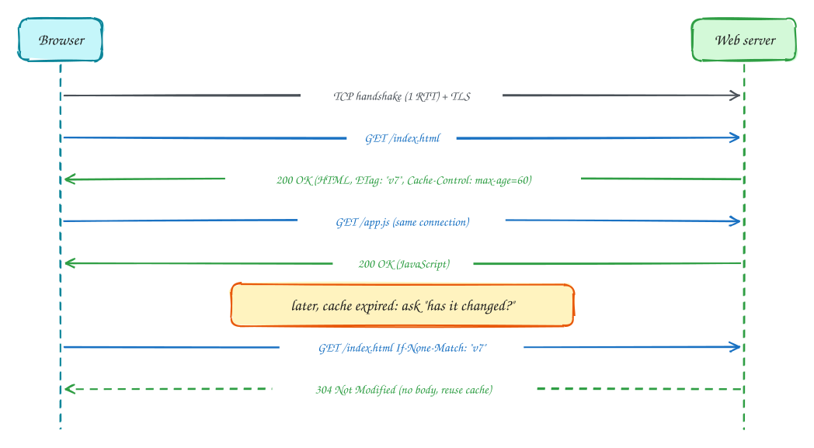
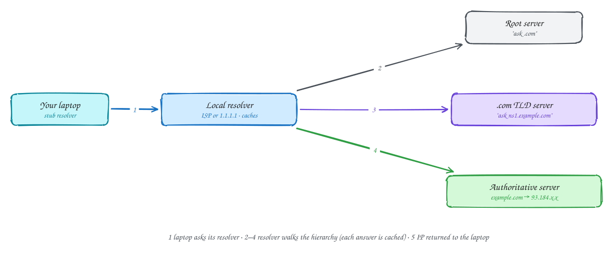
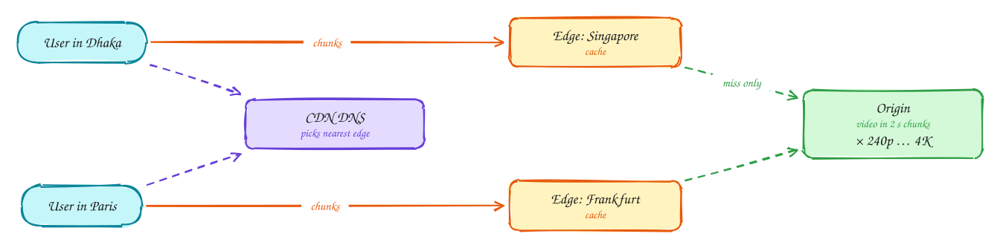
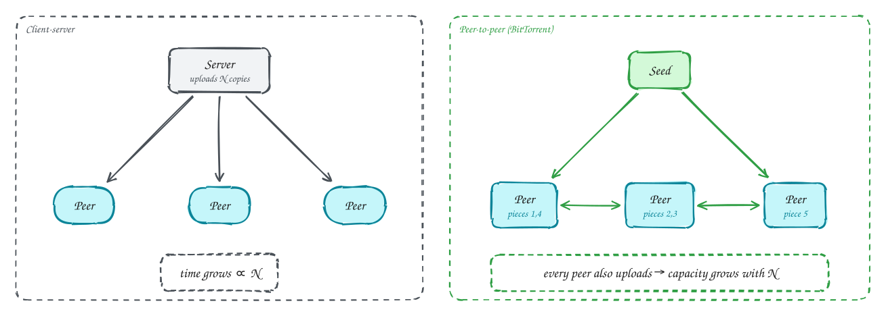

# Chapter 2: The Application Layer

<span class="lvl lvl-b">Beginner-friendly</span>

> These pages are study notes in our own words and diagrams on *Computer Networking: A Top-Down Approach* by James Kurose and Keith Ross, connected to system design. They don't replace the book, which is worth reading in full.

## TL;DR

The book starts at the top: the protocols applications use directly. **HTTP** carries the web and nearly every API, and caching makes it fast. **DNS** turns names into addresses through a hierarchy of cached lookups. **CDNs** and **adaptive streaming** deliver video at global scale. **P2P** spreads the upload work across users. Applications reach the network through **sockets**, choosing **TCP** (reliable stream) or **UDP** (fast datagrams).

**Key ideas:** client-server vs P2P · sockets · HTTP request/response · persistent connections · cookies · caching and conditional GET · HTTP/2 and HTTP/3 · DNS hierarchy and caching · CDNs · DASH

## Application architectures and sockets

**Why it matters:** before choosing a protocol, you decide **who talks to whom**, and what the application needs from the network underneath.

**How applications are organised:**

- **Client-server:** an always-on **server** with a stable address serves many **clients**, which talk to the server but not to each other. The web, email and most APIs work this way. To scale, the "server" becomes a data centre full of machines behind one name.
- **Peer-to-peer (P2P):** ordinary users' machines (**peers**) talk directly to each other, each acting as both client and server. It scales by itself, since every new peer brings capacity, but it's harder to manage, secure and keep reliable.

A process sends and receives through a **socket**, the door between the application and the transport layer. An address for a process is an **IP address** (which host) plus a **port number** (which process on it; web servers use 443 for HTTPS).

When choosing a transport, applications weigh four needs: **reliable delivery**, **throughput**, **timing** and **security**. TCP gives reliability and congestion control, and TLS on top adds security. UDP gives none of these but adds no delay. Neither guarantees throughput or timing, so applications cope with variable network conditions themselves, for example adaptive bitrate video.

## HTTP: the web's protocol

**Why it's designed this way:** a web page is many objects: the HTML, images, scripts, styles. HTTP keeps the conversation simple. The client sends a **request** (method, path, headers, optional body), and the server sends a **response** (status code, headers, body). HTTP is **stateless**: the server keeps no memory of earlier requests, which makes servers easy to replicate and restart.



**How it works in practice:**

1. **Opening a connection costs round trips.** One RTT for the TCP handshake, plus TLS. If each object needed a new connection (non-persistent HTTP), every image would pay that again.
2. **Persistent connections** keep one TCP connection open for many requests. That has been the default since HTTP/1.1, and it removes most of those extra round trips.
3. **Cookies** add state on top of the stateless protocol. The server sets a cookie (`Set-Cookie: session=abc`), and the browser sends it back with every request, so the server can recognise a logged-in user or a shopping cart.
4. **Caching** avoids fetching what you already have. The response says how long it may be reused (`Cache-Control: max-age=60`) and gives a version tag (`ETag`). Once it expires, the client asks "has it changed?" with a **conditional GET** (`If-None-Match: "v7"`). If it hasn't, the server replies `304 Not Modified` with no body, which saves the bandwidth. Web caches and CDNs between client and server do the same for many users at once.

**HTTP/2 and HTTP/3** keep the same requests and responses but change how they travel. HTTP/2 **multiplexes** many requests over one connection, so a large response no longer blocks the small ones queued behind it. HTTP/3 runs on **QUIC** over UDP, so a lost packet only delays its own stream. See [HTTP versions](../101/http-versions.md) for the details.

> [!TIP]
> **Say this in the interview:** "Static assets get long max-age with content-hashed file names, so they're cached forever and a new deploy simply changes the name. API responses that can be shared get a short TTL at the CDN. Per-user responses are `private, no-store`."

## Email in one paragraph

Email shows a different pattern: **push to send, pull to read**. Your mail client pushes a message to your provider's mail server with **SMTP**. Your server pushes it to the recipient's server, also with SMTP, retrying for days if that server is down. The recipient's client later **pulls** it with IMAP (or reads it through a webmail HTTP interface). The servers act like durable queues between people who are rarely online at the same moment, much like a message broker between services.

## DNS: the Internet's directory

**Why it's needed:** people use names (`www.example.com`), but routers need IP addresses. One central directory would be a single point of failure and couldn't handle the query volume. DNS is a **distributed, hierarchical, heavily cached** database instead.



**How a lookup works:**

1. Your laptop asks its **local resolver** (run by your ISP, company, or a public service like 1.1.1.1). Most of the time the answer is already in its **cache** and comes straight back.
2. On a miss, the resolver asks a **root server**, which doesn't know the answer but says "ask the `.com` servers".
3. The resolver asks the **`.com` TLD server**, which says "ask `example.com`'s name servers".
4. The resolver asks the **authoritative server** for `example.com`, which returns the IP address with a **TTL**, saying how long it may be cached.
5. The resolver caches the answer (and the referrals along the way) and returns it to the laptop.

DNS mostly runs over **UDP**, since one small question and answer doesn't need a connection. It does more than map names to addresses: `CNAME` records give aliases, `MX` names mail servers, and returning **different answers to different users** is how CDNs and global load balancers send each user to a nearby server.

> [!NOTE]
> **TTLs are a trade-off.** A long TTL means fewer lookups and resilience if DNS has problems, but a change, like failing over to a new IP, takes that long to reach everyone. Before a planned migration, lower the TTL days ahead.

## Video streaming and CDNs

**Why it's hard:** video is most of the Internet's traffic. A single server can't stream to millions of people, and viewers' bandwidth varies widely and changes from moment to moment.



**How it's done:**

- **DASH (adaptive streaming over HTTP).** The video is encoded at several quality levels and cut into chunks a few seconds long. A **manifest** file lists them. The player measures how fast chunks arrive and chooses the quality for **each next chunk**: higher when the network is fast, lower when it slows, so playback rarely stalls.
- **Content distribution networks (CDNs).** Copies of popular content sit on **edge servers** close to users, either deep inside ISP networks or at a few large sites near IXPs. When a user requests a video, the CDN's **DNS** answers with the address of a good nearby edge. The edge serves from its cache, and fetches from the **origin** only on a miss.

Together, video traffic travels a short distance from a nearby cache, over plain HTTP, adapting to each viewer's connection.

## P2P file distribution

**Why it scales differently:** to send a file to N users, a single server must upload it **N times**, so distribution time grows with N. In P2P, each user who has received part of the file **uploads it to others**. Every new peer adds upload capacity, so the time to reach everyone grows far more slowly.



**How BitTorrent does it:** the file is split into **pieces**. Peers download pieces from several others in parallel, prioritising the **rarest** pieces first so every piece stays available. They upload preferentially to the peers giving them the best rates (*tit-for-tat*), which discourages freeloading. Large companies use the same idea internally to push big files, such as container images or model weights, to thousands of servers quickly.

## Socket programming in a few lines

Here is what "using the transport layer" looks like in code, in Python:

```python
# UDP: no connection, each message carries the destination address
import socket
s = socket.socket(socket.AF_INET, socket.SOCK_DGRAM)
s.sendto(b"hello", ("server.example.com", 12000))
reply, addr = s.recvfrom(2048)

# TCP: connect once (3-way handshake), then a reliable byte stream
t = socket.socket(socket.AF_INET, socket.SOCK_STREAM)
t.connect(("server.example.com", 12000))
t.sendall(b"hello")
reply = t.recv(2048)
```

A TCP server calls `accept()` and gets a **new socket for each client connection**. That's why one server port can serve thousands of clients at once (see [Chapter 3](03-transport-layer.md)).

## In the system design interview

> [!IMPORTANT]
> **Interviewer asks:** "How do you make the page fast for global users?"
> → CDN for static assets and cacheable responses, long cache lifetimes with content-hashed names, persistent connections with HTTP/2 or HTTP/3, and DNS-based routing to the nearest region.

> [!IMPORTANT]
> **Interviewer asks:** "How do you fail over a region?"
> → Health-checked DNS or anycast steering users to another region. Keep DNS TTLs short (30–60 s) so the change reaches clients quickly.

> [!IMPORTANT]
> **Interviewer asks:** "How does a video service handle bad connections?"
> → Adaptive bitrate: the video is cut into chunks encoded at several qualities, and the player picks the quality per chunk, served from CDN edges.

## Self-check

Try to answer before you open each one.

<details class="question" markdown>
<summary>What does a conditional GET save, and how?</summary>

Bandwidth and server work. The client sends the version it has (If-None-Match with the ETag). If unchanged, the server replies 304 with no body, and the client reuses its cached copy.

</details>

<details class="question" markdown>
<summary>Why is DNS hierarchical and cached rather than one big server?</summary>

One server would be a single point of failure and couldn't handle the global query volume. The hierarchy spreads responsibility, and caching at resolvers answers most queries without contacting the root, TLD or authoritative servers.

</details>

<details class="question" markdown>
<summary>How does a CDN decide which edge server a user talks to?</summary>

Usually through DNS: the CDN's authoritative DNS returns the address of an edge server close to (or performing well for) the user's resolver. Some CDNs use anycast instead.

</details>

## Related

- [What happens when you type a URL](../101/type-a-url.md) · [HTTP versions](../101/http-versions.md) · [REST vs GraphQL vs gRPC](../101/rest-graphql-grpc.md)
- [Video platform](../problems/video-platform.md) · [News aggregator](../problems/news-aggregator.md) (CDN caching)

---

← [Ch 1: Networks and the Internet](01-computer-networks-and-the-internet.md) · [Ch 3: Transport layer](03-transport-layer.md) →
