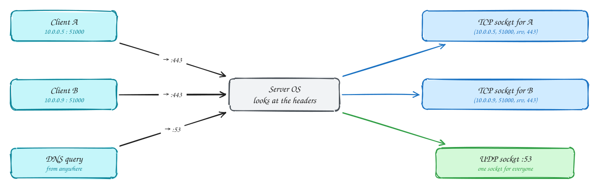
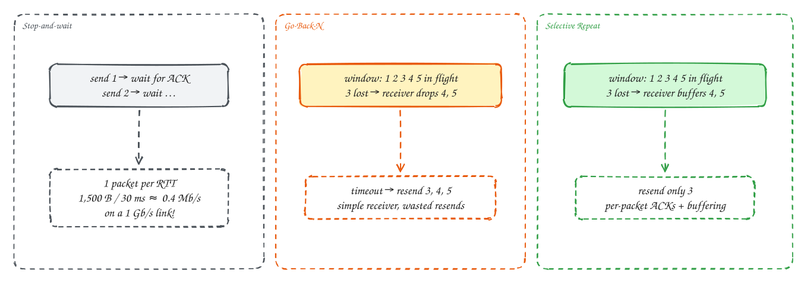
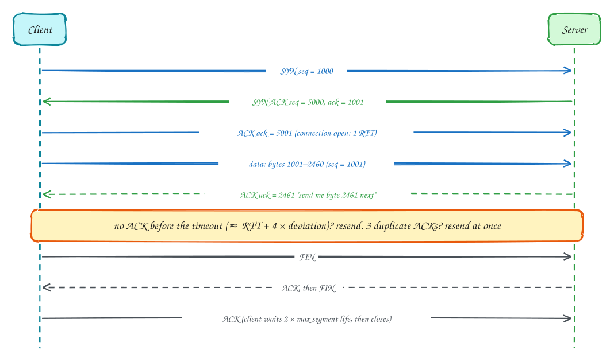
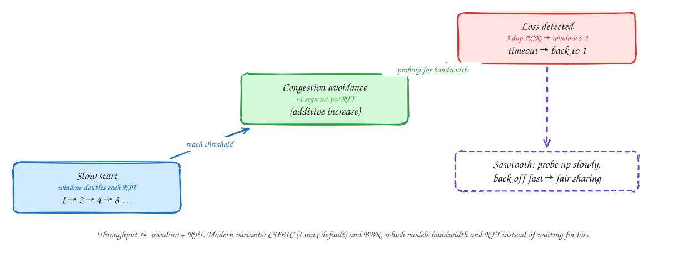

# Chapter 3: The Transport Layer

Intermediate

> These pages are study notes in our own words and diagrams on *Computer Networking: A Top-Down Approach* by James Kurose and Keith Ross, connected to system design. They don't replace the book, which is worth reading in full.

## TL;DR

IP delivers packets **between hosts**, on a best-effort basis: they can be lost, duplicated, reordered or delayed. The transport layer delivers data **between processes** using **ports**. **UDP** adds little more than that. **TCP** builds a **reliable, ordered byte stream** on top of the unreliable network using sequence numbers, acknowledgements, timers and retransmission. It also **slows down** when the receiver or the network can't keep up (flow control and congestion control).

**Key ideas:** ports and demultiplexing · UDP · reliable data transfer · pipelining (Go-Back-N, Selective Repeat) · TCP handshake · RTT and timeouts · flow control · congestion control (AIMD, slow start, CUBIC, BBR)

## Ports: from host-to-host to process-to-process

**Why it's needed:** a server runs many programs at once: a web server, a database, an SSH daemon. An arriving packet has to reach the right one.

**How demultiplexing works:**

- **UDP** delivers by **destination port** only. Everything sent to port 53 goes to the one socket listening there, whoever sent it.
- **TCP** identifies a connection by the **four-tuple**: source IP, source port, destination IP, destination port. Two clients connecting to the same server port 443 get **separate sockets**, because their source addresses or ports differ. That's how one server port serves thousands of connections.

> [!NOTE]
> **Consequence for system design:** each connection uses one ephemeral port on the client side, so a single client IP can have only about 64k connections to one server address and port. Proxies and NAT gateways that open many outbound connections can run out of ports. Connection pooling and reuse avoid it.

## UDP: almost nothing, on purpose

**Why use it:** UDP adds just ports and a **checksum** (to detect corrupted packets) to IP. There's no handshake, no retransmission, no ordering and no congestion control. That sounds bad, but it means **no extra delay**: data goes out the moment you send it, and a lost packet doesn't hold up the ones after it.

**Where it fits:** DNS (one small question and answer), live voice, video and games (a late packet is useless), and protocols that build exactly the reliability they need on top. **QUIC**, which carries HTTP/3, is the big modern example.

## Building reliable delivery from scratch

**Why it's hard:** the network can **lose** packets, **corrupt** them, and **reorder** or **duplicate** them, and the sender can't see any of this happen. The book builds a reliable protocol step by step, and each mechanism fixes one specific failure:

1. **Corruption → checksums and acknowledgements.** The receiver checks each packet and replies ACK (got it) or asks for it again.
2. **Lost ACKs → sequence numbers.** If an ACK is lost, the sender resends, and the receiver might get the same data twice. Numbering packets lets the receiver spot and discard duplicates.
3. **Lost packets → timers.** If no ACK arrives within a timeout, assume loss and **retransmit**.

That's a working protocol, but sending one packet and then waiting for its ACK (**stop-and-wait**) is painfully slow, as the left panel shows:

**Pipelining** keeps a **window** of N packets in flight before needing ACKs, filling the link. When one packet in the window is lost, there are two strategies:

- **Go-Back-N:** the receiver accepts packets only in order and discards anything after a gap. The sender resends the lost packet **and everything after it**. The receiver is simple, but packets that arrived fine get sent again.
- **Selective Repeat:** the receiver **buffers** out-of-order packets and acknowledges each one individually. The sender resends **only** the lost one. It's more efficient, at the cost of more bookkeeping.

TCP uses a mix: cumulative ACKs like Go-Back-N, but it buffers out-of-order data and usually resends only the missing segment (and SACK, an option, says exactly which segments arrived).

## TCP: connection, sequence numbers and timeouts

**Why a connection:** both sides need shared state: starting sequence numbers, buffer sizes, what has been acknowledged. The **three-way handshake** sets it up.

**How it works:**

1. **Handshake:** SYN (with the client's starting sequence number), SYN-ACK (the server's, plus acknowledging the client's), ACK. This costs **one round trip** before any data, which is why connection reuse matters so much.
2. **Sequence numbers count bytes, not packets.** A segment carrying bytes 1001–2460 has sequence number 1001. The ACK says **"the next byte I expect"** (2461). That cumulative ACK confirms everything before it.
3. **Timeouts adapt to the network.** TCP measures round-trip times and keeps a smoothed average and its variation. The retransmission timeout is roughly **average RTT + 4 × deviation**, long enough to avoid needless resends, short enough to recover quickly.
4. **Fast retransmit:** three **duplicate ACKs** (the receiver keeps asking for the same byte) strongly suggest that one segment was lost while later ones arrived. TCP resends it immediately, without waiting for the timeout.
5. **Closing:** each side sends FIN and gets an ACK. The side that closes first waits a while in `TIME_WAIT`, so stray late packets from the old connection can't confuse a new one.

## Flow control: don't overwhelm the receiver

**Why it's needed:** if the sender is faster than the receiving application reads, the receiver's buffer fills and data has to be dropped.

**How:** every ACK carries a **receive window** (`rwnd`), how much free buffer space the receiver has. The sender never has more unacknowledged data in flight than that. If the application stops reading, the window shrinks to zero and the sender pauses. That's **backpressure** built into TCP.

## Congestion control: don't overwhelm the network

**Why it's needed:** if every sender transmits as fast as it can, router queues overflow, packets drop, senders retransmit, and the network carries more and more duplicate traffic while delivering less useful data (**congestion collapse**, which happened on the early Internet). Senders must slow down when the **network**, not just the receiver, is overloaded. But the network doesn't tell them directly.

**How TCP does it:** the sender keeps a **congestion window** (`cwnd`), a limit on unacknowledged data in flight, and treats **loss as the signal** of congestion:

1. **Slow start:** begin with a small window and **double it every round trip** (each ACK grows it). Despite the name, it ramps up quickly.
2. **Congestion avoidance:** past a threshold, grow by just **one segment per round trip**: additive increase, probing gently for spare capacity.
3. **On loss:** if three duplicate ACKs arrive, **halve** the window (multiplicative decrease) and continue. If a timeout happens (worse congestion), drop back to a tiny window and slow-start again.

This **AIMD** pattern gives the sawtooth shape. It also makes flows **share fairly**: two connections on the same bottleneck converge to roughly equal shares. Throughput is roughly **window ÷ RTT**, so long-distance connections ramp up more slowly.

**Modern variants:** **CUBIC** (the Linux default) grows the window as a cubic function of time since the last loss, recovering faster on fast, long links. **BBR** (from Google) doesn't wait for loss: it measures the bottleneck bandwidth and minimum RTT and sends at that rate, which keeps queues short. Some networks also mark packets instead of dropping them (**ECN**), warning senders before loss happens.

> [!TIP]
> **Say this in the interview:** "A new connection starts slow (slow start) and needs a few round trips to reach full speed. So for many small requests I reuse warm connections through a pool, and for global users I terminate connections at the edge, close to them, where the RTT is short."

## In the system design interview

> [!IMPORTANT]
> **Interviewer asks:** "TCP or UDP for this feature?"
> → TCP when every byte must arrive in order (APIs, chat, files). UDP when late data is worthless (live voice, games) or when using QUIC/HTTP/3, which builds its own reliability per stream.

> [!IMPORTANT]
> **Interviewer asks:** "Why use connection pooling between services?"
> → Each new connection costs a handshake round trip (plus TLS), starts in slow start, and uses an ephemeral port. Pools keep warm connections ready, cutting latency and avoiding port exhaustion.

> [!IMPORTANT]
> **Interviewer asks:** "What happens to a TCP stream when one packet is lost?"
> → Later data waits in the receiver's buffer until the missing segment is retransmitted (head-of-line blocking), and the sender cuts its congestion window. That's why HTTP/2 over one TCP connection can stall, and HTTP/3 over QUIC avoids it.

## Self-check

Try to answer before you open each one.

How can thousands of clients connect to the same server port?

TCP identifies each connection by the four-tuple (source IP, source port, destination IP, destination port). Different clients differ in source IP or port, so each connection gets its own socket.

What is the difference between flow control and congestion control?

Flow control protects the receiver: the sender stays within the receiver's advertised window. Congestion control protects the network: the sender limits itself by a congestion window that it shrinks when loss signals overload.

Why does TCP resend after three duplicate ACKs instead of waiting for the timeout?

Duplicate ACKs mean later segments are arriving but one is missing, so it was very likely lost rather than delayed. Resending immediately (fast retransmit) recovers much faster than waiting for a full timeout.

## Related

- [TCP vs UDP](../101/tcp-vs-udp.md) · [HTTP versions](../101/http-versions.md) · [Timeouts, retries and backoff](../101/timeouts-and-retries.md)
- [DDIA Ch 8: unreliable networks](../ddia/08-trouble-with-distributed-systems.md)

---

← [Ch 2: Application layer](02-application-layer.md) · [Ch 4: Network layer, data plane](04-network-layer-data-plane.md) →
