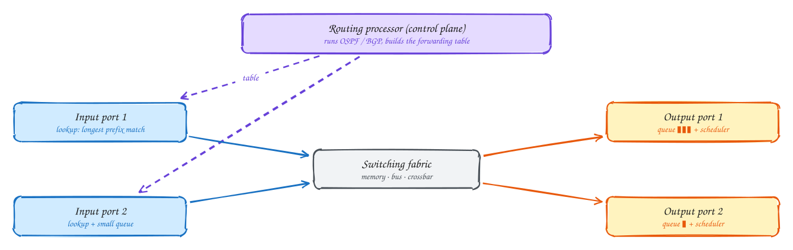
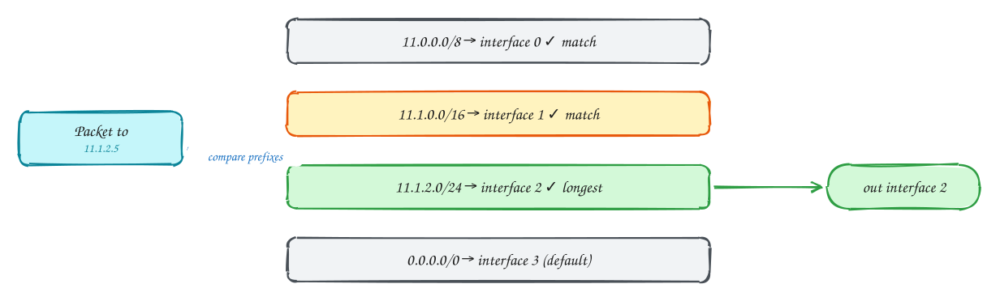
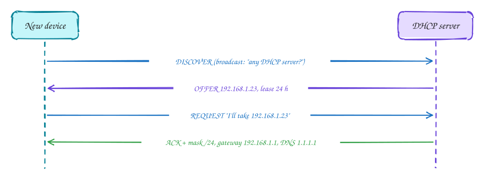
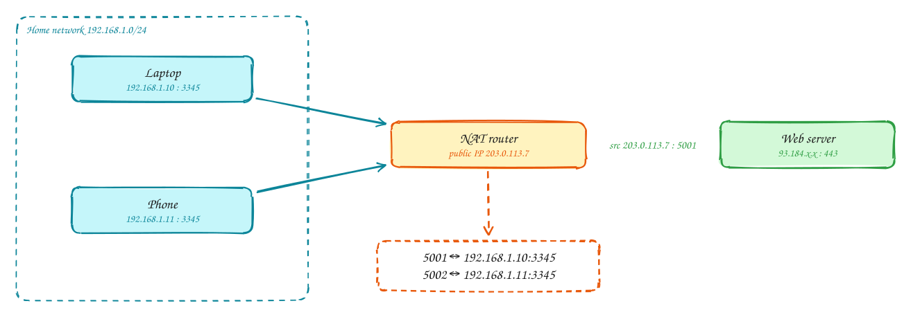
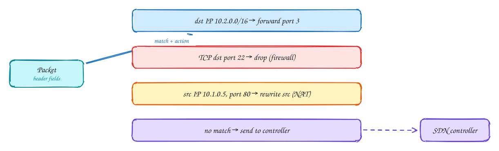

# Chapter 4: The Network Layer: Data Plane

Intermediate

> These pages are study notes in our own words and diagrams on *Computer Networking: A Top-Down Approach* by James Kurose and Keith Ross, connected to system design. They don't replace the book, which is worth reading in full.

## TL;DR

The network layer moves packets **from host to host** across many networks. It has two parts. The **data plane** is what each router does with each packet in nanoseconds: look up the destination and **forward** it out the right port. The **control plane** (Chapter 5) works out the routes. This chapter covers the data plane: what's inside a router, how IP addresses are structured, how devices get addresses (**DHCP**), how many devices share one address (**NAT**), **IPv6**, and the generalised **match + action** model behind SDN, firewalls and load balancers.

**Key ideas:** forwarding vs routing · longest prefix match · router queues and bufferbloat · IPv4 and CIDR · subnets · DHCP · NAT · IPv6 · match + action

## Forwarding vs routing

**Why the split matters:** two very different jobs happen at different speeds.

- **Forwarding** (data plane) is **local and fast**: a packet arrives on one port, and the router sends it out another, using its **forwarding table**. It happens for every packet, in nanoseconds, in hardware.
- **Routing** (control plane) is **network-wide and slow**: working out which paths packets should take, and filling in the forwarding tables. It runs in seconds, in software, when the network changes.

The book's analogy: forwarding is choosing which exit to take at one motorway junction; routing is planning the whole trip.

## Inside a router

**Why it matters:** the router's internals explain where packets get delayed or dropped, which shows up as latency spikes and retransmissions in your services.

**How a packet goes through:**

1. **Input port:** the packet arrives, the link layer is handled, and the router **looks up the destination address** in its forwarding table (see longest prefix match below). The lookup must keep pace with the line rate, so it's done in specialised hardware (TCAM memory).
2. **Switching fabric:** moves the packet from the input port to the right output port. Older routers copied through memory or a shared bus; modern ones use a **crossbar** or multi-stage network that moves many packets in parallel.
3. **Output port:** if packets arrive for one output faster than it can send them, they **queue**. A **scheduler** picks the next packet: first-come-first-served, by priority, or fair queuing across flows. When the buffer is full, packets are **dropped** (or, with active queue management, dropped or marked early to warn senders).
4. The **routing processor** runs the control-plane protocols and installs the forwarding table into the ports.

> [!NOTE]
> **Bufferbloat:** you might think bigger buffers are always better, because there would be fewer drops. But a huge buffer that stays full just adds **delay** to every packet: seconds, sometimes, on home routers. TCP sees no loss, so it doesn't slow down, and latency-sensitive traffic like calls and games suffers. Modern queue management (such as CoDel) keeps queues short.

## Longest prefix match

**Why it's needed:** a router can't hold one table entry per IP address; there are billions. Instead, entries cover **ranges** of addresses written as **prefixes**, and one destination may match several of them.

**How it works:** a prefix like `11.1.0.0/16` means "any address whose first 16 bits match 11.1". For a packet to `11.1.2.5`, three entries match: `/8`, `/16` and `/24`. The router picks the **longest** (most specific) prefix, `/24`, and uses that entry's output interface. A `0.0.0.0/0` entry matches everything and acts as the **default route**. This lets an ISP send "everything for this big block" one way, while a more specific block inside it goes elsewhere.

## IP addresses, subnets and CIDR

**Why addresses are structured:** if addresses were handed out randomly, every router in the world would need an entry for every device. Structured addresses let routers carry **one entry for a whole block**.

**How it works:**

- An IPv4 address is **32 bits**, written as four numbers: `192.168.1.23`.
- A **subnet** is a group of devices that can reach each other directly, without a router, like everything on your home Wi-Fi. They share an address **prefix**: `192.168.1.0/24` means the first 24 bits are the network and the last 8 identify the device (256 addresses).
- **CIDR** (Classless Inter-Domain Routing) allows a prefix of any length, so blocks can be sized to fit. It also allows **aggregation**: an ISP that owns `200.23.16.0/20` can tell the world one route for all of it, even though it's divided among many customers inside.
- Blocks are allocated hierarchically: from regional registries to ISPs to customers.

In the cloud you choose these ranges yourself when creating a VPC (for example `10.0.0.0/16`, split into `/24` subnets per availability zone). Overlapping ranges are a common reason two networks can't be connected later.

## DHCP: getting an address automatically

**Why it's needed:** a device joining a network needs an IP address, the subnet mask, the **default gateway** (the first router), and a DNS server. Typing these by hand doesn't scale, and addresses should be reused when devices leave.

**How it works:** the new device doesn't have an address yet, so it **broadcasts** a DISCOVER. A DHCP server answers with an OFFER. The device REQUESTs it, and the server ACKs with the full configuration and a **lease time**. The device renews before the lease expires. If it leaves, the address returns to the pool.

## NAT: many devices, one public address

**Why it exists:** IPv4 has only about 4.3 billion addresses, far fewer than devices. NAT lets a whole home or company share **one public IP address**, while using **private** addresses inside (`10.0.0.0/8`, `172.16.0.0/12`, `192.168.0.0/16`).

**How it works:** when the laptop (`192.168.1.10:3345`) sends a packet out, the NAT router **rewrites** the source to its public address and a fresh port (`203.0.113.7:5001`), and records the mapping in a table. Replies come back to `203.0.113.7:5001`, and the router looks up the table and rewrites the destination back to the laptop.

**The consequences matter for system design:**

- Devices behind NAT **can't be contacted from outside** unless they connected first. That's why phones keep a connection open to receive pushes, and why peer-to-peer apps need techniques to get through NAT (STUN/TURN in WebRTC).
- Many users can appear to come from **one IP address** (a company, a mobile carrier's NAT). Rate limiting or blocking purely by IP can hit innocent people.
- In the cloud, private servers reach the Internet through a **NAT gateway**, and heavy outbound traffic can exhaust its ports.

## IPv6

**Why:** the real fix for address shortage. IPv6 addresses are **128 bits** (`2001:db8::1`), enough for every device to have a globally reachable address, without NAT.

**How it differs:** a simpler, fixed-size header for faster processing; no fragmentation by routers (senders discover the path's maximum packet size); and flow labels. The transition has been gradual: hosts and networks run both versions (**dual stack**), and IPv6 packets cross IPv4-only sections inside IPv4 packets (**tunnelling**). Today a large share of traffic, especially on mobile networks, is IPv6.

## Generalised forwarding: match + action

**Why it's a big idea:** a router matches only the **destination IP** and forwards. But a firewall matches ports and drops packets; NAT matches addresses and rewrites them; a load balancer matches and chooses a server. All are the same pattern: **match header fields, then take an action**.

**How it works:** a **flow table** holds rules that can match fields from several layers (switch port, MAC addresses, VLAN, IP addresses, protocol, TCP/UDP ports), each with an action: **forward** to a port, **drop**, **modify** fields, or **send to the controller**. OpenFlow standardised this for **software-defined networking**. A central controller (Chapter 5) programs the tables, so one simple device can act as a router, switch, firewall or NAT depending on its rules. Cloud networks (VPCs, security groups) are built on this idea.

> [!NOTE]
> **Middleboxes:** firewalls, NAT, load balancers and caches all sit in the path and touch packets beyond simple forwarding. They break the classic "the network only moves packets" principle, but they're everywhere, and match + action describes them all.

## In the system design interview

> [!IMPORTANT]
> **Interviewer asks:** "How do private servers in your VPC download updates?"
> → Through a NAT gateway: they keep private addresses, and outbound connections are translated to the gateway's public IP. Nothing outside can start a connection to them.

> [!IMPORTANT]
> **Interviewer asks:** "Can you rate-limit by IP address?"
> → Only as a coarse layer. Thousands of users can share one IP behind a carrier or corporate NAT. Prefer limits per API key or user, with IP limits as abuse protection.

> [!IMPORTANT]
> **Interviewer asks:** "Why does latency get worse when a link is busy, even without loss?"
> → Packets wait in router output queues. Large, full buffers add delay (bufferbloat) without dropping anything, so TCP doesn't back off.

## Self-check

Try to answer before you open each one.

A packet to 10.1.2.9 matches 10.0.0.0/8 and 10.1.2.0/24. Which entry is used?

The /24: longest prefix match picks the most specific matching entry.

Why can't an outside server open a connection to a laptop behind a home NAT?

The NAT router only knows where to send incoming packets that match a mapping created by an outgoing connection. An unsolicited incoming packet has no mapping, so the router doesn't know which inside device it's for.

What is the difference between the data plane and the control plane?

The data plane forwards each packet locally using the forwarding table, very fast. The control plane computes routes across the network and fills in those tables, much more slowly.

## Related

- [Ch 5: Network layer, control plane](05-network-layer-control-plane.md)
- [Rate limiting and load shedding](../101/load-shedding.md) · [Networking essentials](../core-concepts/networking.md)

---

← [Ch 3: Transport layer](03-transport-layer.md) · [Ch 5: Network layer, control plane](05-network-layer-control-plane.md) →
