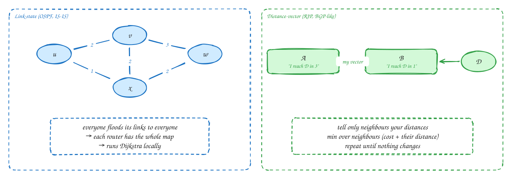
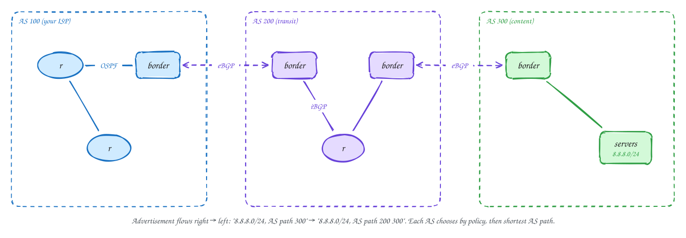
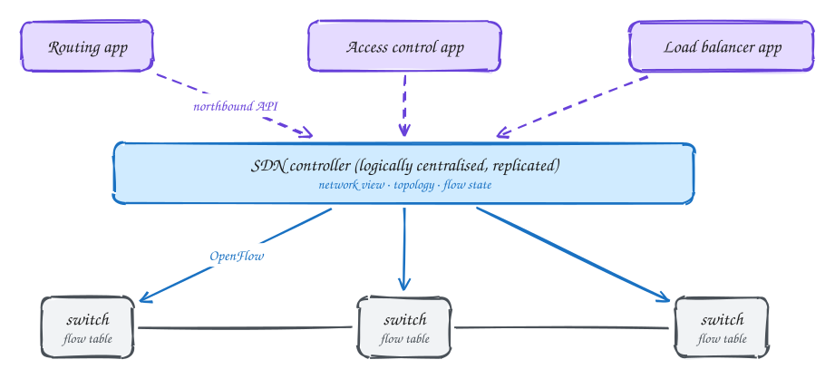
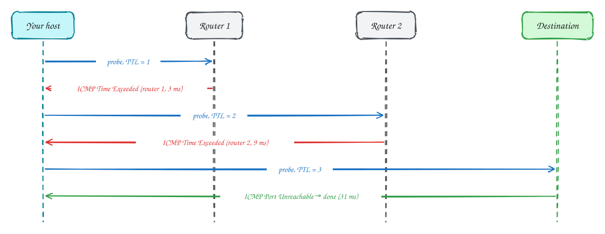

# Chapter 5: The Network Layer: Control Plane

Advanced

> These pages are study notes in our own words and diagrams on *Computer Networking: A Top-Down Approach* by James Kurose and Keith Ross, connected to system design. They don't replace the book, which is worth reading in full.

## TL;DR

The control plane decides **which paths** packets take and fills in every router's forwarding table. Inside one network, routers use algorithms that find **least-cost paths**: **link-state** (everyone learns the whole map, as in OSPF) or **distance-vector** (neighbours share distances). Between the Internet's tens of thousands of independently run networks, **BGP** spreads reachability and lets each network apply its own **policy**. **SDN** moves the control plane into a logically central controller. **ICMP** carries errors and diagnostics, and powers ping and traceroute.

**Key ideas:** least-cost routing · link-state and Dijkstra · distance-vector and Bellman-Ford · count-to-infinity · autonomous systems · OSPF · BGP and policy · hot-potato routing · anycast · SDN controller · ICMP and traceroute

## Two ways to compute routes

**Why it's a problem:** the network is a graph: routers are nodes, links are edges with a cost (delay, capacity, or just 1 per hop). Each router needs the best next hop toward every destination, and the graph keeps changing as links fail and recover.

**How each family works:**

- **Link-state (global knowledge).** Every router **floods** a description of its own links to every other router. Soon each router has the **complete map** and runs **Dijkstra's algorithm** locally to compute the shortest path to everywhere. It converges quickly and predictably. The costs are the flooding traffic and computation, and every router needing the full map. **OSPF** and **IS-IS** work this way.
- **Distance-vector (neighbour gossip).** Each router keeps its current best **distance** to each destination, and tells only its **neighbours**. When it hears their vectors, it updates using **Bellman-Ford**: my distance to D = minimum over neighbours of (cost to that neighbour + its distance to D). This repeats until nothing changes. It's simple and needs no global map, but it can converge slowly. A classic failure is **count-to-infinity**: after a link breaks, two routers keep telling each other they can reach the lost destination through each other, raising the cost step by step. **RIP** works this way, and BGP is a relative of it.

> [!NOTE]
> **Oscillation:** if link costs depend on current traffic, routes can flap. Everyone moves to the quiet path, which becomes busy, so everyone moves back. Real networks use mostly static costs, or change them gradually.

## Inside one network: OSPF

**Why the Internet is split up:** one routing calculation for the entire Internet would be impossibly large, and organisations want to run their own networks their own way. So the Internet is divided into **autonomous systems (ASes)**, each run by one organisation (an ISP, a university, a cloud provider), with its own AS number.

**How routing inside an AS works:** typically **OSPF** (or IS-IS), a link-state protocol. Each router floods its link costs, everyone runs Dijkstra, and operators set the costs to steer traffic. OSPF can split a large network into **areas**, so flooding stays local, and can spread traffic over **equal-cost paths**.

## Between networks: BGP

**Why it's different:** between ASes, the goal isn't only the shortest path. Networks are businesses: they pay providers for transit, get paid by customers, and exchange traffic for free with peers. Each AS wants to decide **which routes to use and which to tell others about**, based on money and policy, without revealing its internal network. **BGP** (Border Gateway Protocol) is how ASes do this, and it's the glue of the Internet.

**How it works:**

1. **Advertising routes.** An AS announces the address blocks (prefixes) it can reach to its neighbours over **eBGP** sessions: "8.8.8.0/24 is here, path: AS 300". Inside an AS, **iBGP** shares what the border routers learned.
2. **Paths are recorded.** Each AS that passes the route on adds itself to the **AS path** ("AS 200 300"). This shows the route's length and prevents loops: an AS rejects any path that already contains itself.
3. **Choosing a route.** Given several routes to the same prefix, a router chooses by **policy first** (a "local preference" set by the operator, typically customers before peers before providers), then the **shortest AS path**, then the **closest exit** (**hot-potato routing**: hand the traffic to the next network as soon as possible, to carry it the shortest distance on your own network).
4. **Policy also controls advertising.** An AS doesn't advertise routes it doesn't want to carry traffic for. A customer that buys from two providers won't pass routes from one provider to the other, so it never carries their traffic for free.

**Anycast** uses BGP for load balancing: many sites around the world announce the **same** prefix, and BGP's route choice sends each user to a nearby one. Public DNS resolvers, root servers and CDNs rely on this.

> [!WARNING]
> **BGP runs on trust.** If an AS wrongly announces someone else's prefix, by mistake or on purpose, traffic can be pulled away worldwide (a **route leak** or **hijack**). This has taken major services offline. RPKI lets networks cryptographically check who may announce which prefix, and its adoption is growing.

## SDN: a central control plane

**Why:** in traditional networks, every router runs its own routing protocols and holds its own control plane. Changing behaviour means configuring many devices one by one, and new ideas need new protocols on every box. Large operators, data centres and cloud networks especially, wanted to program the network as one system.

**How it works:** the switches become simple **match + action** devices (Chapter 4). A **logically centralised controller** (in practice replicated for reliability) holds the network view: topology, link states, flows. It computes forwarding rules and installs them through a **southbound** API such as OpenFlow. **Network applications** (routing, access control, load balancing) run on the controller through a **northbound** API. Google's inter-data-centre WAN and every major cloud's virtual networks are built this way.

The trade-off: the controller is now critical infrastructure. It must be replicated with consensus (as in [DDIA Ch 9](../ddia/09-consistency-and-consensus.md)), and the network must keep forwarding if it's briefly unreachable.

## ICMP: errors and diagnostics

**Why it exists:** IP itself has no way to say "that didn't work". **ICMP** messages travel inside IP packets and report problems: destination unreachable, TTL exceeded, packet too big. They also carry `ping`'s echo requests and replies.

**How traceroute uses it:** every IP packet has a **TTL** (time-to-live) field that each router decrements, and a packet whose TTL reaches zero is dropped, with an ICMP "time exceeded" sent back. Traceroute sends probes with TTL 1, 2, 3 and so on. Each router along the path reveals itself in turn, with the round-trip time to it. When a probe finally reaches the destination, it replies differently ("port unreachable"), and the trace is complete.

> [!NOTE]
> **Network management:** operators also collect device statistics and configure equipment with management protocols: SNMP traditionally, NETCONF and YANG for automated configuration today. These are the networking equivalents of metrics and infrastructure-as-code.

## In the system design interview

> [!IMPORTANT]
> **Interviewer asks:** "How does a global service send users to the nearest region?"
> → GeoDNS (answer with a nearby region's address) or **anycast** (announce the same IP prefix from every region and let BGP deliver users to the closest one), with health checks to withdraw unhealthy regions.

> [!IMPORTANT]
> **Interviewer asks:** "What happens when a region's network fails?"
> → Its routes are withdrawn and BGP reconverges, which can take seconds to minutes. Clients need timeouts and retries, and DNS or anycast should steer them to healthy regions.

> [!IMPORTANT]
> **Interviewer asks:** "Why does the cloud network behave like software?"
> → It's software-defined: a replicated controller computes rules for the virtual network (routes, security groups, NAT) and pushes them to the hosts' virtual switches.

## Self-check

Try to answer before you open each one.

What does each router know in link-state routing, compared with distance-vector?

Link-state: every router learns the whole topology and computes paths with Dijkstra. Distance-vector: each router only knows its neighbours' advertised distances and updates its own with Bellman-Ford.

Why doesn't BGP simply choose the shortest path?

ASes are independent businesses. Routes are chosen by policy first (customer, peer or provider, and what each relationship costs), and only then by AS-path length and exit closeness.

How does traceroute find each router on the path?

It sends probes with increasing TTL. Each router that decrements a probe's TTL to zero drops it and returns ICMP Time Exceeded, revealing its address and the round-trip time.

## Related

- [Ch 4: Network layer, data plane](04-network-layer-data-plane.md)
- [DDIA Ch 9: consensus](../ddia/09-consistency-and-consensus.md) (replicated controllers)

---

← [Ch 4: Network layer, data plane](04-network-layer-data-plane.md) · [Ch 6: Link layer and LANs](06-link-layer-and-lans.md) →
