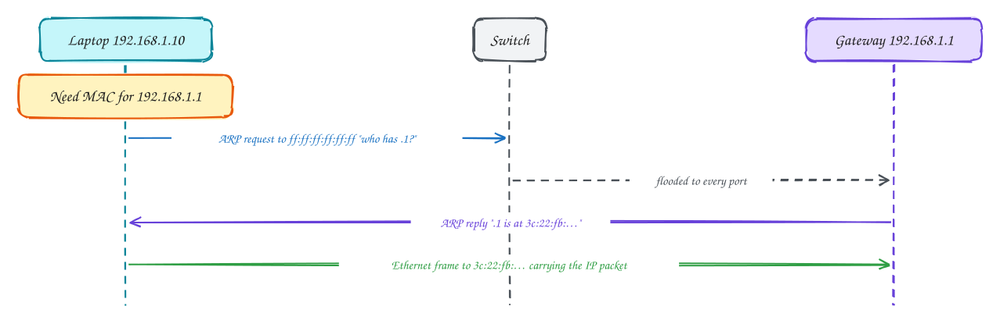
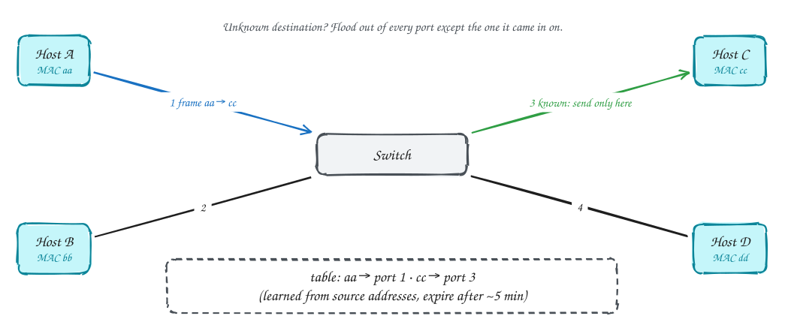
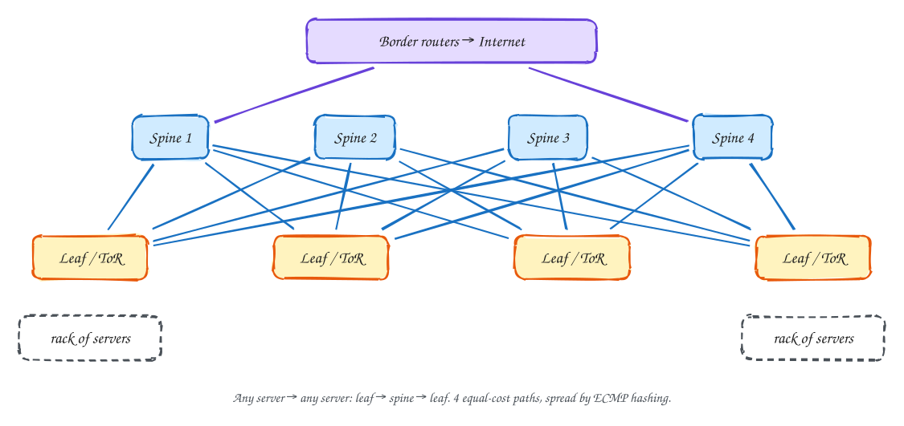
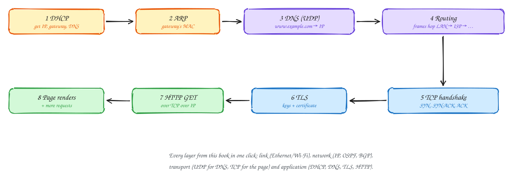

# Chapter 6: The Link Layer and LANs

Intermediate

> These pages are study notes in our own words and diagrams on *Computer Networking: A Top-Down Approach* by James Kurose and Keith Ross, connected to system design. They don't replace the book, which is worth reading in full.

## TL;DR

IP gets a packet across the world, but every step of the journey is one **link**: a cable, a Wi-Fi channel, a fibre. The link layer moves a **frame** across one link to the next device. It detects bit errors, decides who may transmit on a shared medium, and addresses devices by **MAC address**, with **ARP** translating IP addresses to MAC addresses. **Switches** build LANs by learning where each device is. **Data centre networks** connect hundreds of thousands of servers with many equal paths. The chapter ends by following one web request through every layer.

**Key ideas:** frames · error detection (parity, checksums, CRC) · multiple access (TDM, CSMA/CD, taking turns) · MAC addresses · ARP · Ethernet · self-learning switches · VLANs · leaf-spine and ECMP

## What the link layer does

**Why it's needed:** the network layer says "send this to the next router", but every kind of link (Ethernet cable, Wi-Fi, fibre, 5G) has its own way of getting bits across, its own error rate, and possibly many devices sharing it.

**How:** the link layer, implemented mostly in the **network interface card** (NIC), wraps each IP datagram in a **frame** with a header (addresses) and a trailer (an error check). It delivers the frame to the next device on the link. Depending on the link, it may also handle reliable delivery, as Wi-Fi does with link-level ACKs because radio loses frames often, and **who gets to transmit** when the medium is shared.

## Error detection

**Why:** bits get flipped by electrical noise and radio interference. A corrupted frame must be noticed and discarded, not passed up as valid data.

**How, from simplest to strongest:**

- **Parity bit:** one extra bit making the count of 1s even. It catches any single flipped bit, but misses two.
- **Checksum:** add up the data in 16-bit words, as TCP and UDP do. It's cheap in software but fairly weak.
- **CRC (cyclic redundancy check):** treat the data as a big binary number, divide it by an agreed polynomial, and append the remainder. The receiver repeats the division. It catches all burst errors shorter than the check, and almost everything else. It's done in hardware on every Ethernet and Wi-Fi frame.

Detection isn't correction: a bad frame is dropped, and higher layers (TCP) notice the loss and resend.

## Sharing one medium: multiple access

**Why it's a problem:** on a shared medium, such as old Ethernet on one cable, Wi-Fi or a cable-modem network, if two devices transmit at once their signals **collide** and both are garbled. Someone has to decide who talks when, without a central referee.

**How, three families:**

1. **Channel partitioning:** divide the channel by time slots (TDMA) or frequencies (FDMA). It's fair and collision-free, but a slot sits empty when its owner has nothing to send. That suits steady traffic, not bursty traffic.
2. **Random access:** transmit when you have data and recover from collisions. **CSMA** means **listen before talking** (carrier sense). **Collision detection** (CSMA/CD, classic Ethernet) means stop as soon as you hear a collision. Then wait a **random backoff** before retrying, with the range doubling after each collision (*binary exponential backoff*), so repeated collisions spread out. It's efficient when lightly loaded.
3. **Taking turns:** a central device **polls** each station, or a **token** is passed around. No collisions and no idle slots, but the poller or the token is a single point of failure.

> [!NOTE]
> **The same ideas appear in distributed systems:** randomised exponential backoff is exactly how clients should retry against an overloaded service ([Timeouts, retries and backoff](../101/timeouts-and-retries.md)), and for the same reason: to stop everyone colliding again at the same moment.

## MAC addresses and ARP

**Why two kinds of address:** an IP address says **where in the Internet** a device is, and it changes when the device moves networks. A **MAC address** (48 bits, like `3c:22:fb:12:9a:01`) is burned into the network card and identifies it **on the local link**. Frames are delivered by MAC address, so a host that knows the IP address of the next device must find out its MAC address.

**How ARP works:** the laptop wants to send a packet to the Internet, so the next hop is its **default gateway**, `192.168.1.1` (which it learned from DHCP). It **broadcasts** an ARP request to every device on the LAN: "who has 192.168.1.1?" The gateway replies with its MAC address. The laptop **caches** the answer for a while, then sends the Ethernet frame to that MAC address, with the IP packet inside still addressed to the final destination.

Note the split: the **IP destination stays the same** end to end, while the **MAC destination changes at every hop**.

## Ethernet and switches

**Why switches:** early Ethernet put every device on one shared cable (or a hub), so everyone shared the bandwidth and collisions grew with the number of devices. A **switch** gives each device its own link and forwards frames only where they need to go.

**How a switch learns, with no configuration:**

1. When a frame arrives on a port, the switch records **"the source MAC lives on this port"** in its table.
2. To forward, it looks up the **destination MAC**. If known, it sends the frame **only** out of that port.
3. If unknown, it **floods** the frame out of every other port. When the destination replies, the switch learns where it is.
4. Entries **expire** after a few minutes, so devices that move are relearned.

Ports are full-duplex point-to-point links, so there are no collisions on a switched LAN, and many conversations happen in parallel.

**VLANs** let one physical switch act as several separate LANs, for example keeping guest Wi-Fi apart from internal servers. Each frame is tagged with a VLAN number, and switches only deliver it within the same VLAN.

## Data centre networks

**Why they're different:** a large data centre has hundreds of thousands of servers, and most traffic flows **between servers** (east-west): service calls, replication, MapReduce shuffles. The old tree design, with servers under a few big core switches, made those core links a bottleneck.

**How they're built today:**

- Each rack has a **top-of-rack (leaf)** switch. Every leaf connects to **every spine** switch. Any server reaches any other in the same number of hops: leaf → spine → leaf.
- There are **many equal-cost paths** between any two racks, one through each spine. **ECMP** (equal-cost multi-path) spreads flows across them by hashing each flow's addresses and ports, so one flow stays on one path (no reordering), while different flows use different spines.
- Losing a spine just removes one path out of many. Capacity drops a little, and nothing disconnects.
- Large designs add more layers of the same pattern (a Clos network) and use cheap, identical switches. They are often controlled by SDN.

## Putting it together: a day in the life of a web request

**Why this matters:** it's the best way to check that you understand how the layers cooperate. A student plugs a laptop into the campus network and opens a web page:

1. **DHCP:** the laptop broadcasts for configuration and gets its IP address, the gateway's IP and the DNS server's IP.
2. **ARP:** to send anything off the LAN, it needs the gateway's MAC address, so it broadcasts an ARP request.
3. **DNS:** it sends a query in a UDP datagram, inside an IP packet, inside an Ethernet frame to the gateway, asking for the web server's IP address.
4. **Routing:** that packet, and every later one, is forwarded router by router: inside the campus network by OSPF-computed tables, then between ISPs along BGP-chosen routes.
5. **TCP:** with the server's IP, the browser opens a TCP connection with the three-way handshake.
6. **TLS:** it sets up encryption and checks the server's certificate (Chapter 8).
7. **HTTP:** it sends `GET /`, and the response flows back over the same path, reassembled in order by TCP.
8. The browser renders the page and fetches the images and scripts it refers to, mostly over the same connection or from a CDN.

## In the system design interview

> [!IMPORTANT]
> **Interviewer asks:** "Why put replicas in different racks or availability zones?"
> → A top-of-rack switch or power failure takes out a whole rack at once. Spreading replicas across racks and zones ensures one failure can't take all copies.

> [!IMPORTANT]
> **Interviewer asks:** "Why can one huge flow be slow even when the network has spare capacity?"
> → ECMP pins each flow to one path by hashing, so a single big flow can't use more than one link. Splitting the transfer into several parallel connections spreads it over more paths.

> [!IMPORTANT]
> **Interviewer asks:** "Walk me through what happens when I load a page."
> → The day in the life above: DHCP, ARP, DNS over UDP, routing, TCP handshake, TLS, HTTP. Mention caching at each step: ARP cache, DNS cache, connection reuse, browser and CDN caches.

## Self-check

Try to answer before you open each one.

Which address changes at each hop, and which stays the same end to end?

The MAC (link-layer) destination changes at every hop to the next device. The IP destination stays the final server's address throughout (unless NAT rewrites it).

How does a switch learn where a device is?

From the source MAC address of frames it receives: it records which port each address arrived on. Unknown destinations are flooded until the device replies and is learned.

Why do leaf-spine networks suit data centres?

Most traffic is server-to-server. Every leaf connects to every spine, so any two racks have many equal-cost paths, spread by ECMP, with uniform latency and graceful loss of capacity when a switch fails.

## Related

- [What happens when you type a URL](../101/type-a-url.md) · [Timeouts, retries and backoff](../101/timeouts-and-retries.md)
- [Ch 7: Wireless and mobile networks](07-wireless-and-mobile-networks.md)

---

← [Ch 5: Network layer, control plane](05-network-layer-control-plane.md) · [Ch 7: Wireless and mobile networks](07-wireless-and-mobile-networks.md) →
