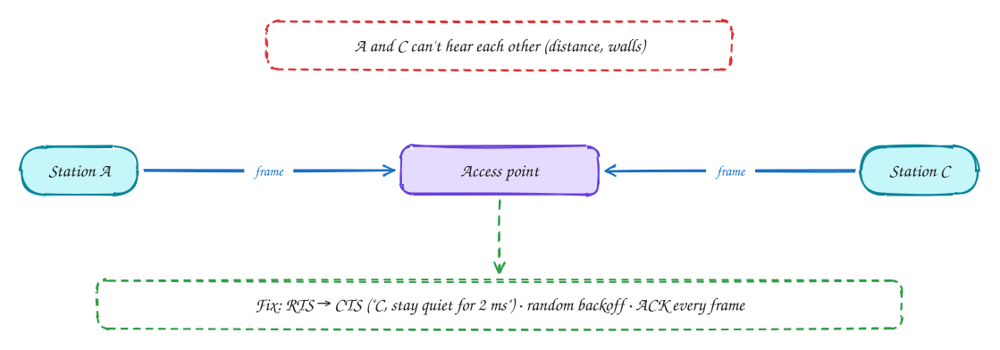
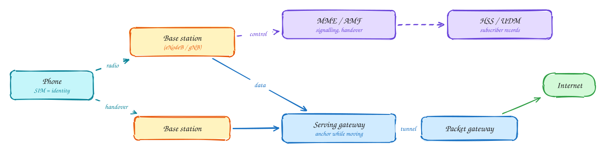
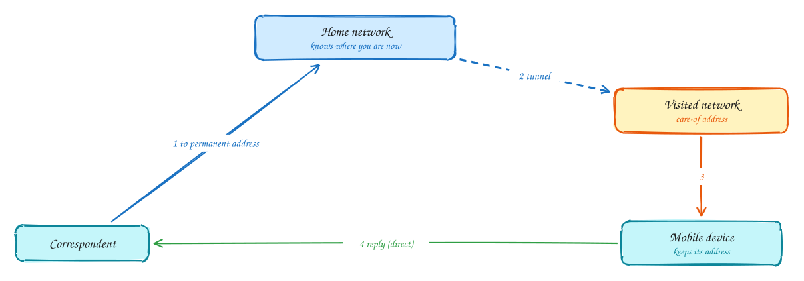

# Chapter 7: Wireless and Mobile Networks

Intermediate

> These pages are study notes in our own words and diagrams on *Computer Networking: A Top-Down Approach* by James Kurose and Keith Ross, connected to system design. They don't replace the book, which is worth reading in full.

## TL;DR

Most users reach your system over **radio**, which is far less reliable than a cable. Signals fade, bounce and interfere, and devices can't always hear each other. **Wi-Fi** shares the air with collision **avoidance** and link-level ACKs. **Cellular networks** (4G, 5G) add a core network that tracks users, authenticates them, and keeps their connections alive as they move between base stations. For system designers, the lesson is that mobile clients have **variable latency, frequent short disconnects and changing addresses**, so design for that.

**Key ideas:** fading and interference · hidden terminals · CSMA/CA · RTS/CTS · access points and association · 4G/5G architecture · handover · mobility (home and visited networks) · effects on TCP

## Why wireless links are hard

**Why it matters:** the physical link affects everything above it. A wired link loses almost nothing; a wireless link can lose frames constantly.

**How radio differs from a wire:**

- **Signal strength drops fast with distance**, and walls and bodies absorb it (path loss).
- **Interference:** other devices on the same frequency (neighbours' Wi-Fi, microwaves, Bluetooth) add noise.
- **Multipath:** the signal bounces off surfaces and arrives several times, slightly out of step, smearing the bits.

The result is a higher and constantly changing **bit error rate**. Devices respond by switching **modulation**: a fast, fragile encoding when the signal is strong, and a slow, robust one when it's weak. That's why your Wi-Fi speed changes as you walk around.

## Wi-Fi: sharing the air

**Why Ethernet's method doesn't work:** wired Ethernet detected collisions by listening while transmitting. A radio can't hear a faint incoming signal while it's transmitting loudly itself. Worse, two stations may not hear each other at all.

**How 802.11 handles it:**

1. **Association:** a device scans for **access points** (APs), which broadcast beacons. It picks one and joins (associates), usually with authentication (WPA2/WPA3). The AP bridges wireless traffic onto the wired network.
2. **The hidden terminal problem:** stations A and C are both in range of the AP but not of each other, because of distance or a wall. Each senses the channel as free and transmits, and their frames collide at the AP. Neither knows.
3. **Collision avoidance (CSMA/CA):** since collisions can't be detected reliably, Wi-Fi tries to **avoid** them. A station senses the channel, then waits a **random backoff** before sending, counting down only while the channel is idle.
4. **Link-layer ACKs:** the receiver acknowledges every frame. No ACK means the sender assumes a collision or corruption, backs off longer and resends. This hides most wireless losses from TCP.
5. **RTS/CTS (optional):** before a long frame, the station sends a short Request-To-Send. The AP answers Clear-To-Send, which **everyone** in range of the AP hears, including hidden stations, and they stay quiet for that time.

Wi-Fi throughput is **shared** by everyone on the same channel, and each frame carries overhead, so a busy AP (a conference, a café) feels slow even with strong signal.

## Cellular networks: 4G and 5G

**Why they're more complex:** a cellular network covers whole countries. It must authenticate millions of subscribers, track where each phone is, keep its data session alive as it moves between cells at motorway speed, and bill for it.

**How the pieces fit:**

- **Base stations** (eNodeB in 4G, gNB in 5G) handle the radio link with phones in their cell, scheduling who transmits when, on which frequencies.
- In the **core network**, the **mobility management** function (MME in 4G, AMF in 5G) handles signalling: attaching phones, tracking which cell they're in, and coordinating handovers. The **subscriber database** (HSS / UDM) holds each SIM's identity and keys, used to **authenticate** the phone.
- User data flows through **gateways**: the **serving gateway** anchors the session while the phone moves between base stations, and the **packet gateway** connects to the Internet and gives the phone its IP address. Data is **tunnelled** between them, so the phone's address doesn't change as it moves.
- **5G** adds much more radio capacity (including high-frequency bands with short range), lower latency, and a core split into software services that can run in the cloud, including slices with different guarantees.

> [!NOTE]
> **Latency on mobile:** a phone's radio **sleeps** to save battery, and waking it up to send adds tens to hundreds of milliseconds to the first request after idle. Batching requests, and avoiding constant small background calls, saves both latency and battery.

## Mobility: keeping connections while moving

**Why it's hard:** an IP address says **where** a device is attached. When a device moves to another network, the obvious result is a new address. Then every TCP connection breaks, because connections are identified by addresses.

**How it's handled:**

1. The device has a **permanent address** from its **home network**. People send to that.
2. When it attaches to a **visited network**, it gets a local **care-of address** and tells its home network where it is now.
3. Packets sent to the permanent address arrive at the home network, which **tunnels** them to the visited network, and they're delivered to the device. Replies can go directly to the sender.

This is **indirect routing**. It's simple for correspondents (nothing changes for them), but traffic can take a long detour (a "triangle"). Cellular networks use exactly this idea: the packet gateway is the anchor, and data is tunnelled to whichever base station the phone is using. Moving between base stations is a **handover**: the network prepares the new cell, switches the tunnel, and the phone carries on, ideally losing nothing.

Moving between **different** networks, from Wi-Fi to mobile data, usually does change the address. That breaks TCP connections, which is one reason **QUIC** identifies connections by a connection ID instead of addresses, so they survive the switch.

## Effects on higher layers

**Why designers should care:** TCP assumes **loss means congestion** and slows down. On wireless, loss is often just a bad moment in the radio, so TCP may cut its speed for no reason. Link-layer retransmission (Wi-Fi ACKs, cellular retransmission) hides much of this, but adds **variable delay**.

**What it means for your app:**

- Expect **latency jitter** and short **disconnects**; use timeouts, retries with backoff and idempotency.
- Design **offline-first** flows where it matters: store locally, sync later (see [Fitness tracking](../problems/fitness-tracking.md)).
- Keep payloads small, and use **adaptive** media (adaptive bitrate video).
- **Resume** rather than restart: resumable uploads, `Last-Event-ID` for SSE streams, cursors for sync.

## In the system design interview

> [!IMPORTANT]
> **Interviewer asks:** "How does your app behave on a flaky mobile connection?"
> → Short timeouts with retries and backoff, idempotency keys on writes, resumable uploads, local queueing while offline, and adaptive bitrate for media.

> [!IMPORTANT]
> **Interviewer asks:** "Why do mobile clients reconnect so often?"
> → Radio sleep states, handovers, switching between Wi-Fi and cellular (which changes the IP address), and carrier NAT timeouts on idle connections. Long-lived connections need heartbeats and automatic reconnect with resume.

> [!IMPORTANT]
> **Interviewer asks:** "Why might HTTP/3 help mobile users?"
> → QUIC connections are identified by a connection ID, so they survive address changes. A lost packet only delays its own stream, and setup takes fewer round trips.

## Self-check

Try to answer before you open each one.

What is the hidden terminal problem?

Two stations can each reach the access point but can't hear each other, so carrier sensing says the channel is free, and their frames collide at the AP. RTS/CTS and random backoff reduce it.

Why does Wi-Fi acknowledge every frame at the link layer?

Radio loses and corrupts frames far more often than wires, and collisions can't be detected while transmitting. Link-level ACKs let the sender retransmit quickly, hiding most losses from TCP, which would otherwise mistake them for congestion.

How does a phone keep its IP address while moving between cell towers?

The packet gateway in the core network anchors the address, and data is tunnelled to whichever base station currently serves the phone. A handover moves the tunnel's end, not the address.

## Related

- [Fitness tracking](../problems/fitness-tracking.md) (offline-first) · [HTTP versions](../101/http-versions.md) (QUIC)
- [Ch 6: Link layer and LANs](06-link-layer-and-lans.md)

---

← [Ch 6: Link layer and LANs](06-link-layer-and-lans.md) · [Ch 8: Security](08-security.md) →
