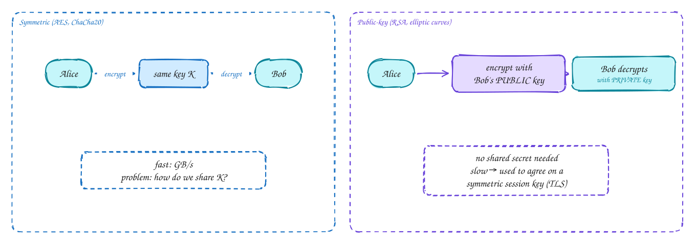
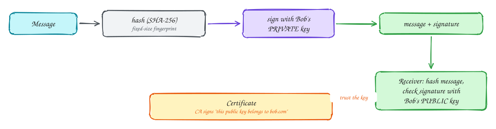
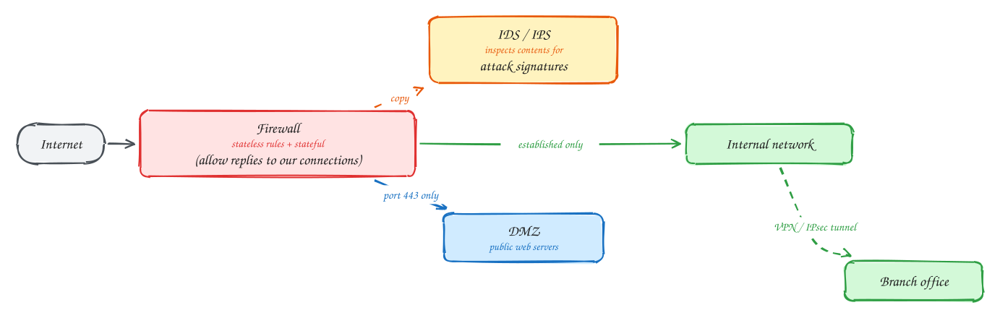

# Chapter 8: Security in Computer Networks

Intermediate

> These pages are study notes in our own words and diagrams on *Computer Networking: A Top-Down Approach* by James Kurose and Keith Ross, connected to system design. They don't replace the book, which is worth reading in full.

## TL;DR

The Internet was built to connect trusting researchers, so security was added later, layer by layer. Secure communication needs **confidentiality** (only the intended receiver can read it), **integrity** (changes are detected), **authentication** (you know who you're talking to) and **availability**. Cryptography provides the first three. **Symmetric** keys are fast but must be shared; **public-key** cryptography solves sharing; **hashes, MACs and signatures** protect integrity; **certificates** bind keys to names. **TLS** combines all of this for the web. **IPsec/VPNs**, **WPA**, **firewalls** and **intrusion detection** protect other layers.

**Key ideas:** confidentiality, integrity, authentication · symmetric vs public-key · Diffie-Hellman key agreement · hashes · MACs · digital signatures · certificates and CAs · nonces and replay · TLS · IPsec and VPNs · WPA · firewalls · IDS

## What "secure" means

**Why it needs defining:** "make it secure" is too vague to design for. The book's cast is **Alice** and **Bob**, who want to talk, and **Trudy**, an intruder on the network who can **eavesdrop**, **modify** or **inject** messages, **replay** old ones, **impersonate** either side, or **flood** them (denial of service).

**The properties we want:**

- **Confidentiality:** Trudy can't read the messages → **encryption**.
- **Integrity:** Trudy can't change them unnoticed → **MACs and signatures**.
- **Authentication:** each side knows who the other really is → **certificates, signatures, challenge-response**.
- **Availability:** the service keeps working under attack → **firewalls, rate limiting, DDoS protection**.

## Symmetric and public-key cryptography

**Why two kinds:** encryption scrambles a message so that only someone with the right key can unscramble it. The question is how the two sides get the right keys.

**How each works:**

- **Symmetric** (AES, ChaCha20): the **same secret key** encrypts and decrypts. It's very fast (gigabytes a second, with hardware support), so it's used for the actual data. The problem: both sides must already share the key, and you can't just send it over the network that Trudy is watching.
- **Public-key** (RSA, elliptic-curve cryptography): each party has a **key pair**. The **public** key can be published to everyone; the **private** key never leaves its owner. What one key locks, only the other unlocks. Anyone can encrypt to Bob with his public key, and only Bob can decrypt. Bob can also **sign** with his private key, and anyone can verify with the public key. It's slow, around 1,000× slower than symmetric.

**How they combine:** use public-key methods only to **agree on a fresh symmetric session key**, then encrypt the data with that key. Modern protocols use **Diffie-Hellman** key agreement (ECDHE): each side sends a public value, and both compute the **same secret** without it ever crossing the network. Because the session keys are thrown away after use, recording traffic today and stealing a server's private key later still doesn't decrypt it (**forward secrecy**).

## Integrity: hashes, MACs and signatures

**Why encryption alone isn't enough:** encryption hides content, but Trudy might still flip bits or replay a message. Bob needs to know the message is exactly what Alice sent.

**How:**

- A **cryptographic hash** (SHA-256) turns any message into a fixed-size **fingerprint**. It's practically impossible to find two messages with the same hash, or to work backwards from a hash.
- A **MAC** (message authentication code, usually **HMAC**) hashes the message **together with a shared secret key**. Only someone with the key can produce the right MAC, so a valid MAC proves the message came from a key holder and wasn't changed. Webhook signatures and API request signing work like this.
- A **digital signature** encrypts the message's hash with the sender's **private** key. Anyone can verify it with the public key, and only the private key holder could have made it. Unlike a MAC, it doesn't need a shared secret, and it proves to **third parties** who signed (non-repudiation).
- A **certificate** solves "is this really Bob's public key?" A **certificate authority (CA)** that everyone trusts signs a statement: "this public key belongs to bob.com". Browsers ship with a list of trusted CAs and check the chain of signatures.

## Authentication and replay attacks

**Why it's subtle:** proving identity over a network is harder than it looks. If Alice proves who she is by sending a password, or even an encrypted password, Trudy can **record** that message and **replay** it later.

**How it's done safely:** **challenge-response with a nonce**. Bob sends a fresh random number (a **nonce**) used only once. Alice proves her identity by returning it encrypted or signed with her key. A recorded answer is useless next time, because the nonce will be different. The same idea protects against replays elsewhere: TLS mixes random values from both sides into its keys, and signed API requests include timestamps and nonces.

## TLS: securing TCP connections

**Why:** TLS (successor to SSL) is how nearly everything on the Internet is protected: HTTPS, secure email, database connections, gRPC.

**How it works, in outline** (see [How HTTPS works](../101/https-tls.md) for the step-by-step diagram):

1. **Handshake:** client and server agree on algorithms and exchange **Diffie-Hellman** values. The server sends its **certificate** and **signs** the handshake with its private key, proving it owns the certificate.
2. The client **verifies** the certificate chain up to a trusted CA, checks the name matches the site, and checks the signature.
3. Both derive the same **session keys** from the shared secret and random values from both sides.
4. **Data transfer:** records are encrypted and integrity-protected with the symmetric keys (authenticated encryption such as AES-GCM). Each record has a sequence number, so reordering or replaying records is detected.

TLS 1.3 completes the handshake in **one round trip** (zero for a resumed session) and removes old, weak options.

> [!TIP]
> **Say this in the interview:** "All traffic uses TLS 1.3: terminated at the load balancer for public traffic, and mutual TLS between internal services, so services authenticate each other with certificates issued by our internal CA."

## IPsec, VPNs and Wi-Fi security

**Why other layers need protection too:** TLS protects one application connection. Sometimes you want to protect **everything** between two networks, or the wireless link itself.

**How:**

- **IPsec** secures traffic at the **network layer**. In tunnel mode, whole IP packets are encrypted and wrapped inside new IP packets between two gateways. Every application benefits without changes. **Site-to-site VPNs** (connecting an office to a cloud VPC) commonly use it. Newer VPNs such as WireGuard follow the same idea with a much simpler design.
- **Wi-Fi security** (WPA2, WPA3) authenticates devices to the access point and encrypts frames over the air, so neighbours can't read or inject traffic on the wireless link. In companies, authentication goes through a central server (802.1X with EAP), so each user has their own credentials.
- **Cellular** networks authenticate each SIM against the operator's subscriber database and encrypt the radio link.

## Firewalls and intrusion detection

**Why:** even with encryption everywhere, organisations must control **what traffic is allowed** in and out, and spot attacks in progress.

**How:**

- **Packet filters** (stateless firewalls) allow or block each packet by rules on addresses, protocol and ports: "allow TCP port 443 to the web servers, block everything else inbound".
- **Stateful firewalls** track connections: "allow replies to connections we started, block unsolicited incoming connections". Cloud **security groups** work this way.
- **Application gateways** and web application firewalls inspect application data, for example blocking SQL injection patterns in HTTP requests.
- **Intrusion detection and prevention systems (IDS/IPS)** inspect traffic deeply, matching known **attack signatures** and unusual patterns, and alert on attacks or block them.
- A **DMZ** is a separate network segment for public-facing servers, so a compromised web server doesn't give direct access to the internal network.

The modern trend is **zero trust**: don't assume anything inside the firewall is safe. Authenticate and encrypt every connection (mutual TLS), and give each service only the access it needs.

## In the system design interview

> [!IMPORTANT]
> **Interviewer asks:** "How do you secure service-to-service traffic?"
> → Mutual TLS with short-lived certificates from an internal CA (often via a service mesh), network policies allowing only the needed paths, and per-service authorisation.

> [!IMPORTANT]
> **Interviewer asks:** "How do you know a webhook really came from the payment provider?"
> → The provider signs the body with an HMAC using a shared secret. You recompute and compare in constant time, and reject old timestamps to stop replays.

> [!IMPORTANT]
> **Interviewer asks:** "How do you protect the system from DDoS?"
> → Absorb at the edge (CDN or anycast DDoS protection), rate limits per client at the gateway, firewall rules dropping unwanted traffic, autoscaling, and load shedding for the rest.

## Self-check

Try to answer before you open each one.

Why does TLS use public-key cryptography only during the handshake?

Public-key operations are slow. They're used to authenticate the server and agree on a shared secret (Diffie-Hellman). Bulk data is then encrypted with fast symmetric keys derived from it.

What is the difference between a MAC and a digital signature?

A MAC uses a shared secret key, so anyone with the key could have produced it. A signature uses the signer's private key and is verified with the public key, so it proves to anyone exactly who signed, and needs no shared secret.

How does a nonce prevent replay attacks?

The verifier sends a fresh random value each time, and the prover must sign or encrypt that value. A recorded old response contains the old nonce, so it is rejected.

## Related

- [How HTTPS works](../101/https-tls.md) · [Storing passwords](../101/storing-passwords.md) · [JWT](../101/jwt.md) · [OAuth 2.0](../101/oauth.md)
- [Webhooks vs polling](../101/webhooks-vs-polling.md) · [Rate limiting and load shedding](../101/load-shedding.md)

---

← [Ch 7: Wireless and mobile networks](07-wireless-and-mobile-networks.md) · [Networking overview](index.md)
