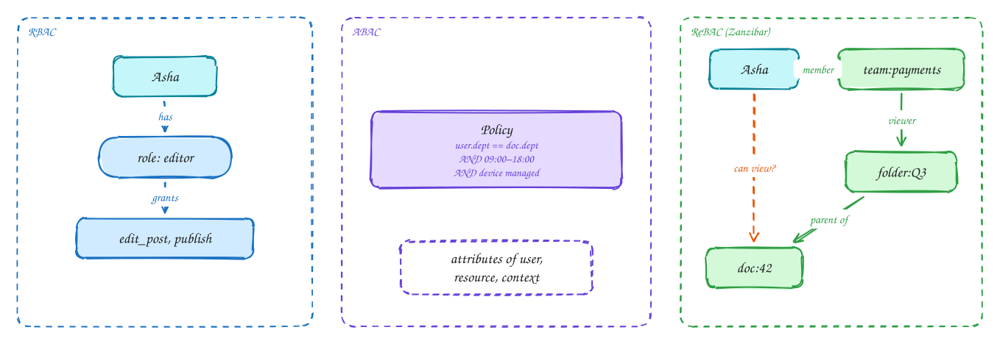
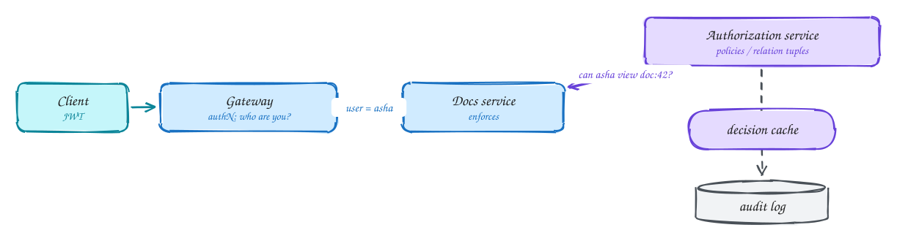

# Authorization: RBAC, ABAC and ReBAC

Intermediate

*Authentication asks "who are you?". Authorization asks "are you allowed to do this?"*

> [!TIP]
> **One-page sketchnote:** [AUTHORIZATION on a single page](../sketchnotes/concept-authorization.svg), for revision or printing.

## The problem it solves

Login ([sessions, tokens](../101/sessions-vs-tokens.md), [OAuth](../101/oauth.md), [SSO](../101/sso.md)) only proves identity. Every request still needs a second decision: can **this** user do **this** action on **this** resource? Can Asha edit this document, refund this order, see this patient's record?

Get it wrong and you get the most common serious vulnerability on the web: **broken access control**, for example changing `/orders/1001` to `/orders/1002` in the URL and seeing someone else's order. And as products grow (teams, shared folders, enterprise admins, guest links) a few `if user.is_admin` checks scattered through the code become impossible to reason about. The three models below are ways to organise that decision.

## Three models

### RBAC: role-based access control

**How:** permissions (`edit_post`, `issue_refund`) are grouped into **roles** (`editor`, `support_agent`); users are assigned roles. A check is "does any of the user's roles grant this permission?"

**Good for:** internal tools, admin consoles, B2B apps where each customer has a handful of roles (owner, admin, member, viewer). Easy to audit: "who can issue refunds?" is a simple query.

**Where it breaks:** permissions that depend on **which** resource. "Editors can edit **their own team's** posts" doesn't fit in a role, and teams try to fix it by creating more roles (`editor_team_7`) until there are thousands: **role explosion**.

### ABAC: attribute-based access control

**How:** a **policy** evaluates attributes of the user, the resource, the action and the context. For example: allow `view` if `user.department == document.department` and `document.classification <= user.clearance` and the request comes from a managed device during working hours. Policy engines such as Open Policy Agent (Rego) or AWS IAM policies work this way.

**Good for:** rules that depend on data and context, regulated environments, cloud IAM.

**Costs:** policies are flexible but harder to audit ("who can see this document?" means evaluating the policy against every user), and every check needs the right attributes at hand.

### ReBAC: relationship-based access control

**How:** permissions follow a **graph of relationships**. Store facts as tuples like `team:payments#member@user:asha`, `folder:Q3#viewer@team:payments#member`, `doc:42#parent@folder:Q3`. A schema says that viewers of a folder can view its documents, and members of a team inherit the team's grants. "Can Asha view doc 42?" becomes: is there a path from Asha to doc 42 that grants `view`?

**Good for:** collaboration products with sharing: Google Drive, GitHub, Notion, Figma. It models nested folders, groups within groups and share links naturally. This is **Google Zanzibar**'s model, used for Drive, YouTube and others; open-source descendants include SpiceDB, OpenFGA and Permify.

**Costs:** a dedicated, highly available service; checks may traverse several hops, so caching and careful consistency matter (see below).

Real systems mix them: RBAC for organisation-wide admin roles, ReBAC for sharing, and ABAC conditions (IP ranges, device posture) on top.

## Where the check happens

1. **Authenticate at the edge.** The gateway validates the token and passes a trusted identity (user ID, tenant) to services.
2. **Authorize in the service that owns the resource.** Only the docs service knows doc 42 exists and what it belongs to. A gateway can do coarse checks ("is this user in a tenant that has this feature?"), but object-level checks belong next to the data.
3. **Ask a precise question:** `check(user: asha, action: view, resource: doc:42) → allow / deny`, either in a library with policies loaded locally or against a central authorization service.
4. **Deny by default**: anything not explicitly allowed is refused.
5. **Log decisions** for audit: who accessed what, and which rule allowed it.
6. **Filter lists too.** "Show me documents I can see" can't run a check per document over millions; authorization services provide **list/lookup** APIs, or you pre-filter by tenant and check the page you return.

**Making it fast and correct.** A check on every request must take a few milliseconds, so decisions are cached. But caching creates a classic bug, the **new enemy problem**: Asha is removed from a folder and then a new secret document is added; a stale cache still lets her see it. Zanzibar solves this with consistency tokens ("zookies"): a write to content returns a token, and later checks must use permission data at least as fresh as that token. Simpler systems keep cache TTLs short and invalidate on permission changes.

## Checklist

1. Authentication (who) at the edge; authorization (may they) at the resource owner.
2. RBAC for a few coarse roles; ABAC for context and data-dependent rules; ReBAC for sharing and hierarchies.
3. Every object access is checked, by ID; deny by default.
4. One place defines policy (library or service), not scattered `if` statements.
5. Cache decisions, and handle revocation (short TTLs, invalidation, consistency tokens).
6. Audit log every decision on sensitive data.

## In the interview

> [!TIP]
> "Sharing is relationship-based, Zanzibar-style: documents, folders, teams and users are tuples in an authorization service, and the docs service calls `check(user, view, doc)` on every read, with a short-lived cache. Org admins are a simple RBAC role on top, and every decision on a document is audit-logged."

## Self-check

Try to answer before you open each one.

What is "role explosion", and which model avoids it?

Encoding resource-specific permissions as roles (editor_team_7, viewer_folder_12) until there are thousands of roles. ABAC (rules over attributes) or ReBAC (relationships to resources) express it without new roles.

Why shouldn't object-level authorization live only in the API gateway?

The gateway doesn't know who owns doc 42 or which folder it's in; only the owning service does. Checking only at the gateway leads to insecure direct object references.

What is the "new enemy" problem?

A user loses access, then new content is added; a stale permission cache still grants the old access, so the removed user sees the new content. Fixes: consistency tokens tying checks to content versions, or prompt invalidation.

How do you show a user "all documents I can see" efficiently?

Use the authorization system's lookup/list API (or index of grants) to get accessible IDs, or pre-filter by tenant/team and check only the results page; never run one check per document in the system.

## Related

- [Sessions vs tokens](../101/sessions-vs-tokens.md) · [JWT](../101/jwt.md) · [OAuth 2.0](../101/oauth.md) · [SSO](../101/sso.md) · [API gateway](../101/api-gateway.md)
- [Encryption and secrets](encryption-and-secrets.md) · [Collaborative editor](../problems/collaborative-editor.md) · [File sync](../problems/file-sync.md)
