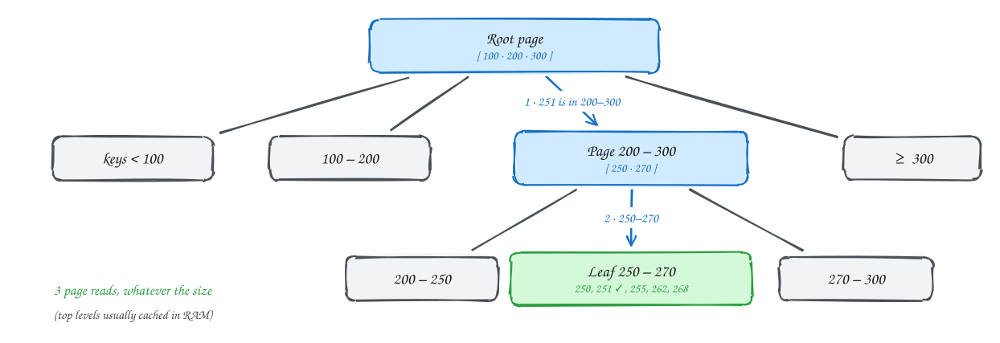
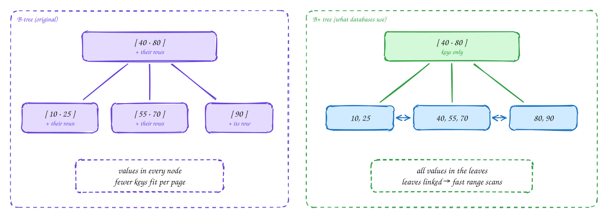
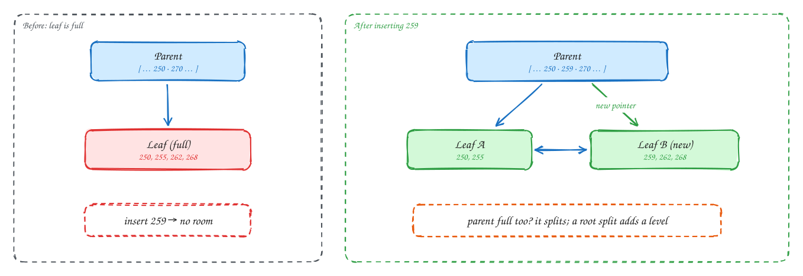
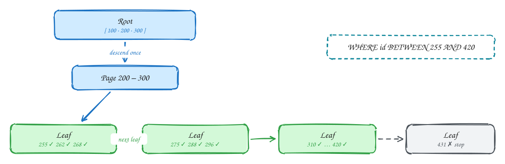

# B-trees and B+ trees

Intermediate

*The index structure inside almost every relational database: a few disk reads to find any key among billions.*

> [!TIP]
> **One-page sketchnote:** [B-TREES AND B+ TREES on a single page](../sketchnotes/concept-b-trees.svg), for revision or printing.

## The problem it solves

You have a table of 1 billion orders on disk and want order 251 fast. The simple options all fail:

- **Scan the table.** Reading a billion rows takes minutes.
- **Keep the rows sorted and binary search.** About 30 steps, but every step is a jump to a random place on disk. Worse, inserting one row in the middle means shifting everything after it.
- **A binary search tree.** Inserts are cheap, but each node holds one key, so the tree is ~30 levels deep. If each level is a separate disk read, that's 30 random reads per lookup: about 3 ms on an SSD and 300 ms on a spinning disk.

The key fact about storage: disks and SSDs don't read single keys, they read **pages** (blocks of 4–16 KB). Reading one byte costs the same as reading the whole page. So the trick is to make every tree node **one page full of keys**, hundreds of them, so that every read narrows the search by a factor of hundreds instead of two. That's a **B-tree**.

## How a lookup works

1. Every node is a page. The **root** page holds a few sorted keys that act as **boundaries**: here 100, 200 and 300. Between each pair of boundaries is a pointer to a child page responsible for that range.
2. To find 251, read the root: 251 is between 200 and 300, so follow that pointer.
3. The child page splits 200–300 further (250, 270). 251 falls between 250 and 270, so follow that pointer down.
4. You reach a **leaf** page holding the actual keys 250–270 in order, and 251 is there, with its row (or a pointer to the row).

**Why it's so shallow.** The number of child pointers per page is the **branching factor**. With 8 KB pages and small keys it's typically a few hundred. With a branching factor of 500:

| Levels | Leaf pages reachable | Keys (≈100 per leaf) |
|---|---|---|
| 2 | 500 | 50 thousand |
| 3 | 250,000 | 25 million |
| 4 | 125 million | 12.5 billion |

So **3–4 page reads find any key among billions**, and the top one or two levels are read so often that they stay cached in memory. In practice a lookup costs one or two real disk reads. (The DDIA book's version of the same arithmetic: four levels of 4 KB pages with a branching factor of 500 can hold up to 250 TB.)

## B-tree vs B+ tree

**Why there are two names.** The original B-tree (Bayer and McCreight, 1970) stores each key **with its value** wherever the key sits, including in the internal nodes. Almost every database actually uses a variant called the **B+ tree**, and most people, including the DDIA book, simply call it a B-tree.

**How they differ:**

| | Original B-tree | B+ tree |
|---|---|---|
| Internal nodes hold | keys **and** their values/rows | keys only, as signposts |
| Where values live | anywhere in the tree | only in the leaves |
| Leaves | not connected | linked to the next (and often previous) leaf |
| Lookup cost | varies: may stop early in an internal node | always root → leaf, so predictable |
| Range scan | walk up and down the tree | find the start once, then follow leaf links |

**Why databases prefer the B+ tree:**

1. **Higher branching factor.** Internal nodes carry no values, so more keys fit in a page. More keys per page means a shallower tree and fewer disk reads.
2. **Range scans are cheap.** `WHERE created_at BETWEEN …` and `ORDER BY` become: descend once, then read leaves sideways in order (shown below).
3. **Simpler, predictable code.** Every lookup ends at a leaf, every value is in one kind of node, and internal pages are small enough to keep in memory.

The original's one advantage, finding a key in an internal node without reaching a leaf, rarely matters when the top levels are cached anyway.

> [!NOTE]
> **Where you'll meet them.** MySQL's InnoDB stores each table as a B+ tree on the primary key (a **clustered index**: the leaves hold the rows), and secondary indexes point to that primary key. PostgreSQL's default index is a B+ tree variant (with links between pages at every level, so concurrent page splits stay safe), pointing into an unordered heap of rows. SQLite, MongoDB's WiredTiger engine and file systems such as XFS, Btrfs and NTFS also use B-tree family structures.

## Inserts and page splits

**Why it's tricky.** Pages have a fixed size, keys must stay sorted, and the tree must stay balanced (every leaf at the same depth) so lookups stay fast.

**How an insert works:**

1. Find the leaf where the new key belongs (same path as a lookup).
2. If the leaf has room, insert the key in sorted position and rewrite that page. Done.
3. If the leaf is **full**, **split** it into two half-full pages and add a new boundary key, with a pointer to the new page, to the parent.
4. If the parent is full too, it splits as well, and so on upwards. If the **root** splits, a new root is created above it: that's the only way the tree gets taller, which is why all leaves always stay at the same depth.

Deletes do the reverse: a page that becomes too empty may be merged with a neighbour (many databases skip this and just leave the space for future inserts).

**Crash safety.** A split rewrites several pages. If the machine crashes after writing some of them, the tree is corrupted, with pointers to pages that were never written. So every change is first appended to a **write-ahead log (WAL)**, and after a crash the database replays the log to finish or undo the half-done change. Some engines (LMDB, for example) avoid in-place overwrites altogether: they write modified pages to new locations (**copy-on-write**) and atomically switch the root.

> [!WARNING]
> **Random keys cause random splits.** With an auto-increment or time-ordered key, inserts always land at the right-most leaf: splits are rare and pages end up full. With **random UUIDv4** keys, every insert lands on a random leaf, touching pages all over the index, splitting them and leaving them half empty. That's why time-ordered IDs (UUIDv7, Snowflake) insert faster. See [DDIA Ch 10: ID generators](../ddia/10-consistency-and-consensus.md#id-generators-and-logical-clocks).

## Range scans and ORDER BY

Because keys are kept in sorted order and the leaves are linked:

1. `WHERE id BETWEEN 255 AND 420` descends from the root **once**, to the leaf holding 255.
2. It then reads forward along the leaf links, page after page, with no further tree descents.
3. It stops at the first key greater than 420.
4. Results come out **already sorted**, so `ORDER BY id` needs no sort step, and `LIMIT 20` can stop after 20 entries.

The same property makes **composite indexes** work: an index on `(user_id, created_at)` sorts by user, then by time within each user, so "user 42's latest 20 orders" is one short range scan. See [Database indexing](indexing.md) for the leftmost-prefix rule.

## B-trees vs LSM-trees

The other big family of storage engines, LSM-trees (Cassandra, RocksDB), never updates in place: it buffers writes in memory and appends sorted files. The trade-off in one table (full story in [DDIA Ch 4](../ddia/04-storage-and-retrieval.md)):

| | B+ tree | LSM-tree |
|---|---|---|
| Writes | random page overwrites + WAL | sequential appends, very fast |
| Reads | one root-to-leaf path | may check several files (Bloom filters help) |
| Each key lives | in exactly one place | possibly several versions until compaction |
| Best for | read-heavy OLTP, transactions, range locks | write-heavy workloads: logs, metrics, events |

## Checklist

1. Disks read pages, so a B-tree node is one page holding hundreds of keys.
2. Branching factor of a few hundred → 3–4 levels for billions of keys; top levels sit in RAM.
3. Databases use **B+ trees**: keys-only internal nodes, all values in linked leaves.
4. Full page → split, pushing a boundary key up; root splits are how the tree grows taller.
5. Every page change goes through the WAL so a crash can't corrupt the tree.
6. Sorted, linked leaves make ranges, ORDER BY and LIMIT cheap.
7. Random keys scatter inserts and splits; time-ordered keys append.

## In the interview

> [!TIP]
> "Postgres indexes are B+ trees: about three page reads to find any order, and because leaves are sorted and linked, the date-range query is a single index range scan. I'd use a time-ordered ID rather than UUIDv4 so inserts append to the right edge instead of splitting pages all over the index."

## Self-check

Try to answer before you open each one.

Why is a B-tree node the size of a disk page instead of holding one key like a binary search tree?

Storage reads whole pages anyway, so one read can bring in hundreds of keys. A node with hundreds of children narrows the search by hundreds per read, making the tree 3–4 levels deep instead of ~30, so a lookup needs a few page reads instead of dozens.

What are the two main differences between a B-tree and a B+ tree, and why do databases prefer the B+ tree?

In a B+ tree, internal nodes hold only keys (all values live in the leaves), and the leaves are linked in order. Keys-only internal nodes mean a higher branching factor and a shallower tree; linked leaves make range scans and ORDER BY a sideways walk instead of repeated descents.

What happens when you insert into a full leaf, and how does the tree get taller?

The leaf splits into two half-full pages and a new boundary key with a pointer is added to the parent; if the parent is full it splits too. Only a split of the root adds a level, so all leaves stay at the same depth.

Why do random UUIDv4 primary keys make inserts slower than auto-increment or UUIDv7 keys?

Random keys land on random leaves, so each insert touches a different page (poor caching) and causes page splits all over the index, leaving pages half empty. Ordered keys always insert at the right-most leaf.

Why does a B+ tree need a write-ahead log?

A page split or update rewrites pages in place; a crash halfway can leave the tree inconsistent (a parent pointing at a page never written). Logging each change first lets the database replay or undo it after a crash.

## Related

- [Database indexing](indexing.md) · [Merkle trees](merkle-trees.md)
- [DDIA Ch 4: Storage and retrieval](../ddia/04-storage-and-retrieval.md) (B-trees vs LSM-trees in depth)
- [OS 7: Storage devices](../os/07-storage-devices.md) (why pages and random reads matter)
