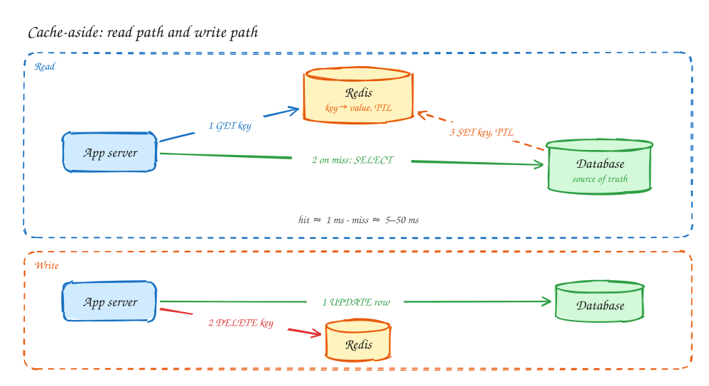
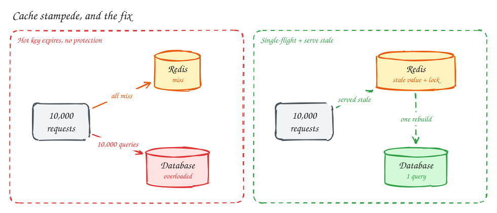

# Caching

Beginner-friendly

**Used by:** [Ticketmaster](../problems/ticketmaster.md) · [URL shortener](../problems/url-shortener.md) · [News feed](../problems/news-feed.md) · [Local delivery](../problems/local-delivery.md) · [Distributed cache](../problems/distributed-cache.md)

> [!TIP]
> **One-page sketchnote:** [CACHING on a single page](../sketchnotes/concept-caching.svg), for revision or printing.

## TL;DR

- A cache keeps a copy of hot data in memory so you don't pay the full cost of reading it every time. A database read takes about 5–50 ms; a Redis read takes about 1 ms.
- The default pattern is **cache-aside**: read from the cache, and on a miss read the database and fill the cache. On a write, update the database and **delete** the cached key.
- Every cache is a trade. You get speed and less database load, and you pay with **stale data**, **stampedes** when hot keys expire, and **hot keys** that overload one node. Name all three before the interviewer does.

## Why cache at all?

Two reasons, and say which one you mean:

1. **Latency.** Memory is orders of magnitude faster than a database query that touches disk or runs joins.
2. **Load.** Popularity is uneven. A small share of items gets most of the traffic, so caching that share removes most of the database load. A cache hit rate of 90% means the database sees one request in ten.

> [!NOTE]
> **Rule of thumb:** add a cache when a calculation shows the database can't keep up (for example, ~50k reads/sec against one Postgres primary) or when a read path misses its latency target. Don't add one "because caches are good".

## Cache-aside: the default

**Read:** `GET key` → hit? return it. Miss? `SELECT` from the database, `SET key value EX 300`, return it.

**Write:** `UPDATE` the database first, then `DELETE key`. The next read repopulates it.

Why delete instead of updating the cache? Two concurrent writers can update the cache in the wrong order and leave it permanently wrong. A delete can't be applied in the wrong order. The worst case is one extra cache miss.

## Other strategies

| Strategy | How it works | Choose it when | Cost |
|---|---|---|---|
| **Cache-aside** | App reads cache, falls back to DB, fills cache | Default for almost everything | Brief staleness after writes |
| **Read-through** | Cache library loads from DB itself on a miss | You want the logic in one place | Same staleness as cache-aside |
| **Write-through** | Every write goes to cache and DB together | Data is read right after it's written | Slower writes; cache fills with data nobody reads |
| **Write-behind** | Write to cache now, flush to DB later | Very high write rates you can afford to lose | Data loss if the cache dies before flushing |
| **CDN / edge cache** | HTTP responses cached near users | Static or identical-for-everyone responses | Invalidation is slow, so use short TTLs or versioned URLs |

## What to cache, and for how long

- **Cache:** things read far more often than written, such as event pages, user profiles, URL redirects and computed feeds.
- **Don't cache:** data that must never be stale (a seat's booking status, an account balance at checkout), or data that's read once.
- **TTL:** pick it from how stale the product can tolerate. "A price shown on a search page may be 60 seconds old" means a 60 s TTL. Always set one, so that bugs in invalidation heal themselves.
- **Eviction:** when memory is full, LRU (evict least recently used) is the usual default. LFU suits stable popularity.

## The three ways caches hurt you

### 1. Stale data

Readers can see an old value between the database write and the cache delete, or until the TTL expires. Decide per feature whether that's acceptable. On the booking path of [Ticketmaster](../problems/ticketmaster.md) it isn't, so that path reads the database. On the browse path it is.

### 2. Stampede (thundering herd)

A very popular key expires, and thousands of requests miss at the same instant. Every one of them queries the database.

Fixes, usually combined:

- **Single-flight / request coalescing:** only one request rebuilds the value, using a short lock such as `SET lock:key 1 NX EX 5`. The others wait briefly or get the old value.
- **Serve stale while revalidating:** keep the old value a little past its TTL and refresh it in the background.
- **Jittered TTLs:** add randomness so many keys don't expire together.
- **Pre-warm** known hot keys before a big event.

### 3. Hot keys

One key gets so much traffic that the single cache node holding it saturates, for example a celebrity's profile or a viral link. Fixes:

- **Replicate the key:** store copies as `key#0` … `key#9` on different nodes and read a random one.
- **Local in-process cache** with a few seconds' TTL in front of Redis.
- **Know your hot keys:** track them, because you can't fix what you can't see.

## Numbers worth knowing

| | Typical |
|---|---|
| Redis GET (same datacenter) | ~0.5–1 ms round trip |
| Redis throughput, one node | ~100k+ simple ops/sec |
| Postgres indexed read | ~1–10 ms; complex queries 10–100 ms+ |
| Memory per Redis node | tens to a few hundred GB |

## Interview phrases

> [!TIP]
> - "Reads outnumber writes 100 to 1 and popularity is skewed, so a cache-aside Redis layer should take 80–90% of reads off Postgres."
> - "On write I update the database, then delete the key. Deleting is safe under concurrent writers."
> - "This key is hot, so I'll guard against a stampede with single-flight and jittered TTLs."
> - "The checkout path doesn't read from cache, because it must never be stale."

## Common mistakes

- Caching without a TTL, so one invalidation bug lives forever.
- Updating the cache on write instead of deleting it.
- Treating the cache as the source of truth. Redis can lose data, and the database must still be correct on its own.
- Forgetting the cold start: after a deploy or failover the cache is empty and the database takes the full load.

## Related

- **Problems:** [Ticketmaster](../problems/ticketmaster.md) · [Distributed cache](../problems/distributed-cache.md) (design the cache itself)
- **DDIA:** [Ch 5 Replication](../ddia/05-replication.md). Read replicas are the other way to scale reads, with the same staleness trade-off.
- **Patterns:** [Scaling reads](../patterns/scaling-reads.md)
