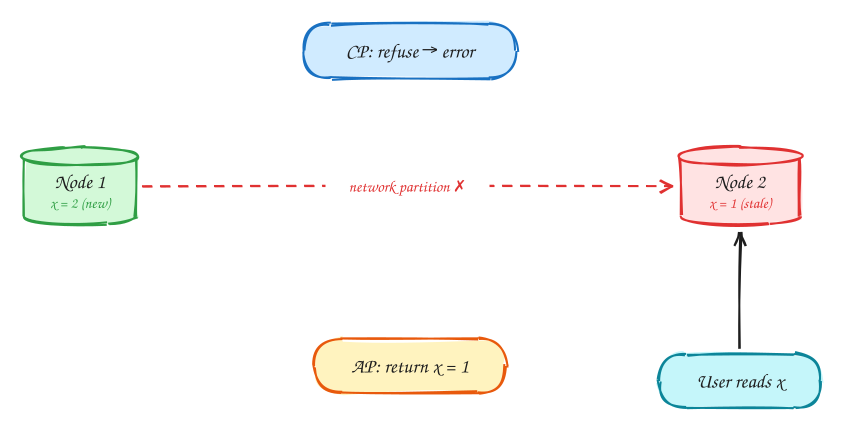

# CAP theorem and PACELC

Intermediate

*When the network splits, choose between refusing requests and answering with possibly stale data, separately for each feature.*

## The situation CAP is about

Your data is copied on two servers, maybe in two data centres. Normally every write reaches both. Now the network link between them breaks: a **network partition**. Both servers are still running, and users can still reach each of them, but the servers can't talk to each other. A write lands on one; the other never hears about it. Then a user asks the other server for that data. What should it do?

1. The link between Node 1 and Node 2 breaks. Partitions **will** happen in any distributed system (a switch fails, a cable is cut, a cloud zone has problems), so you can't choose to avoid them. That's why "P" isn't really optional.
2. A user writes `x = 2` to Node 1. Node 2 still has the old value, `x = 1`, and can't find out about the change.
3. Another user reads `x` from Node 2. There are only two choices:
   - **Refuse** to answer (return an error or wait) because it can't confirm it has the latest value. You stay **consistent**, but that part of the system is **unavailable**. This is **CP**.
   - **Answer** with `x = 1`, which may be stale. You stay **available**, but the answer may be **inconsistent**. This is **AP**.

That's the whole theorem: **during a partition, choose between consistency and availability.** When there's no partition, you can have both.

## Choose per feature, not per system

The common mistake is calling a whole system "CP" or "AP". In practice you choose **per feature**, based on what a wrong answer costs:

| Feature | Choice |
|---|---|
| Booking, payments, inventory | CP: never oversell or double-charge |
| Search, feeds, reviews, likes | AP: stale for seconds is fine |
| Usernames / unique constraints | CP (linearizable) |

The question to ask for each feature: **is a stale or conflicting answer worse than no answer?** Selling the same seat twice is worse than a "please try again" error, so booking is CP. A like count that's a few seconds old is far better than an error page, so likes are AP.

> [!TIP]
> **Say this in the interview:** "CAP is a per-feature choice: the booking path is CP, browsing is AP."

> [!NOTE]
> **PACELC, the everyday version:** even with **no** partition, strong consistency costs **latency**, because each write must wait for other replicas to confirm. So the extended rule is: during a **P**artition choose **A** or **C**; **E**lse choose **L**atency or **C**onsistency. More in [DDIA Chapter 9](../ddia/09-consistency-and-consensus.md).

> [!TIP]
> **One-page sketchnote:** [CAP THEOREM AND PACELC on a single page](../sketchnotes/concept-cap-theorem.svg), for revision or printing.

## Checklist

1. Partitions will happen, so the real choice is C or A during one.
2. Choose per feature, not per system.
3. Money, inventory and uniqueness: consistency (CP).
4. Feeds, search, reviews, counters: availability (AP).
5. PACELC: even without partitions, stronger consistency costs latency.

## In the interview

> [!TIP]
> "Booking is CP: I'd rather reject than double-sell. Browsing is AP: a few seconds stale is fine."

## Related

- Pattern: [Dealing with contention](../patterns/contention.md)
