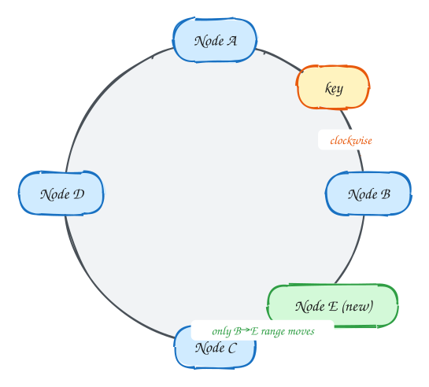

# Consistent hashing

*Add or remove a node and move only a small share of the keys.*

1. Nodes and keys hash onto a ring.
2. A key belongs to the next node clockwise.
3. Adding a node moves only the keys in one arc (~1/N), unlike hash % N which moves almost everything. Virtual nodes even out the load.

> [!NOTE]
> **Used by:** Distributed caches, Cassandra, DynamoDB, L7 routing of video/doc IDs to servers.

> [!TIP]
> **One-page sketchnote:** [CONSISTENT HASHING on a single page](../sketchnotes/concept-consistent-hashing.svg), for revision or printing.

## Checklist

1. Place nodes and keys on the same hash ring.
2. A key belongs to the first node clockwise from it.
3. Use virtual nodes (many points per server) to even out load.
4. Adding a node moves roughly 1/N of keys; hash % N moves almost all of them.

## In the interview

> [!TIP]
> "Cache nodes sit on a consistent-hash ring with virtual nodes, so adding a node remaps about 1/N of keys instead of emptying the whole cache."

## Related

- Pattern: [Scaling reads](../patterns/scaling-reads.md)
