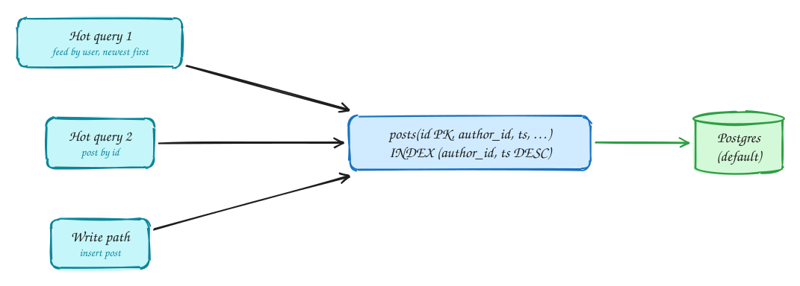

# Data modeling

*Start from the queries the product runs, then choose keys and indexes that make each one cheap.*

1. Start from the queries the product actually runs, not from the nouns.
2. Choose keys and indexes that make each hot query a single index lookup or range scan.
3. Default to Postgres; deviate only with a reason (write volume → Cassandra, flexible docs → DynamoDB/Mongo, search → Elasticsearch).

> [!NOTE]
> **Normalize vs denormalize:** Normalize by default (one place to update). Denormalize deliberately for a hot read path, and say how the copy stays in sync (CDC, async job).

> [!TIP]
> **One-page sketchnote:** [DATA MODELING on a single page](../sketchnotes/concept-data-modeling.svg), for revision or printing.

## Checklist

1. List the two or three hottest queries first.
2. Make each one a key lookup or a single index range scan.
3. Default to Postgres; switch only with a reason you can state.
4. Normalize by default; denormalize deliberately for a hot read and say how the copy stays in sync.
5. Choose the partition key from the hottest query if you will shard.

## In the interview

> [!TIP]
> "The hot query is a user's posts, newest first, so the posts table gets an index on (author_id, created_at DESC)."

## Related

- Pattern: [Scaling reads](../patterns/scaling-reads.md)
