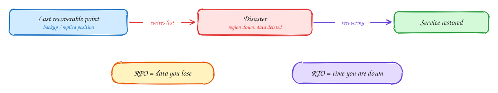
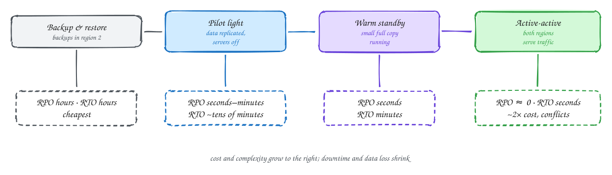

# Disaster recovery and multi-region

Intermediate

*Plan for losing a whole datacenter, or your data, before it happens.*

> [!TIP]
> **One-page sketchnote:** [DISASTER RECOVERY on a single page](../sketchnotes/concept-disaster-recovery.svg), for revision or printing.

## The problem it solves

Replicas inside one region protect you from a dead disk or server. They don't protect you from:

- **Losing a region**: a cloud region outage, a fire, a fibre cut, a bad config pushed to every zone.
- **Losing data by mistake**: `DELETE` without a `WHERE`, a bug that corrupts rows, a ransomware attack, or an attacker with your credentials. Replication copies these to every replica within seconds.

Disaster recovery (DR) is the plan for both, and it starts with two numbers the business must agree on, because every extra minute of protection costs money.

## RPO and RTO

- **RPO (recovery point objective): how much data can we afford to lose?** It's the gap between the last point you can recover to and the disaster. Nightly backups mean an RPO of up to 24 hours; continuous replication can make it seconds.
- **RTO (recovery time objective): how long can we be down?** From the disaster to service restored. Restoring 10 TB from backup takes hours; failing over to a running standby takes minutes.

Different parts of a system deserve different targets. A payments ledger might need RPO ≈ 0 and RTO of minutes; an analytics warehouse can lose a day and come back tomorrow. Asking "what's the RPO and RTO for this?" is a strong move in an interview.

## Backups: the foundation

**Why backups even with replicas.** Replication is for availability; backups are for **going back in time**. Only a copy from the past can undo a bad delete or corruption.

**How to do them properly:**

1. **Full backups plus continuous logs.** Take a snapshot periodically and archive the write-ahead log continuously. Then you can do **point-in-time recovery**: restore the snapshot and replay the log up to one second before the mistake.
2. **Store them elsewhere.** In another region, and ideally another account with separate credentials, so one compromised account can't delete both data and backups. Use **immutable** (write-once, object-lock) storage against ransomware.
3. **Encrypt them**, and keep the keys recoverable separately (losing the key loses the backup).
4. **Test restores regularly.** A backup that has never been restored is a hope, not a backup. Measure how long a restore actually takes: that's your real RTO.

The classic rule of thumb is **3-2-1**: three copies, on two kinds of storage, one off-site.

## The multi-region ladder

Each rung costs more and recovers faster:

| Strategy | What runs in the second region | RPO | RTO | Cost |
|---|---|---|---|---|
| **Backup and restore** | Nothing; backups only | hours (last backup) | hours to a day | lowest |
| **Pilot light** | Databases receiving replication; app servers off | seconds to minutes | tens of minutes (start and scale servers) | low |
| **Warm standby** | A scaled-down but working copy of everything | seconds | minutes (scale up, switch traffic) | medium |
| **Active-active** | Full capacity, serving users all the time | ≈ 0 to seconds | seconds (stop routing to the bad region) | ~2×, plus complexity |

**Active-active is not just "deploy twice".** If both regions accept writes, the same record can be changed in both at once. You need one of:

- **Partition users by home region**: each user's writes go to one region (conflict avoidance), the other region takes over only on failure.
- **Conflict resolution**: CRDTs or merge logic for data that can merge ([DDIA Ch 6](../ddia/06-replication.md)).
- **A globally consistent database** (Spanner, CockroachDB) that pays cross-region latency on writes to avoid conflicts.

Asynchronous replication between regions also means a sudden region loss can drop the last few seconds of writes, so RPO isn't exactly zero unless writes wait for the other region.

## Failing over (and back)

1. **Detect** the regional failure (health checks from outside the region, not just inside it).
2. **Decide**: automatic failover is fast but risky, because a network partition can make a healthy region look dead and leave both regions taking writes. Many teams automate detection and keep a human approval for the switch, or use a consensus-backed arbiter.
3. **Promote** the standby database, **fence** the old primary so it can't accept writes if it comes back ([fencing tokens](../ddia/09-trouble-with-distributed-systems.md)).
4. **Shift traffic** with DNS (watch the TTL) or a global load balancer.
5. **Fail back** later, deliberately, after re-syncing data, which is often harder than failing over.

**Test it.** Run game days: actually fail a region in a controlled way. Untested failover usually fails on something mundane: a hard-coded endpoint, expired credentials in the standby, or capacity limits in the other region.

## Checklist

1. Agree RPO and RTO per system, not one number for everything.
2. Replicas are not backups: keep point-in-time backups, off-site, immutable, encrypted.
3. Test restores and failovers; measured times are your real RTO.
4. Pick the cheapest rung of the ladder that meets the targets.
5. Active-active needs a write-conflict strategy.
6. Fence the old primary on failover; plan the failback.

## In the interview

> [!TIP]
> "The ledger has RPO near zero and RTO of 15 minutes: synchronous replicas across three zones, async replication to a warm standby region, and point-in-time backups in a separate account with object lock. Browsing and search run active-active from both regions because they're read-only and rebuildable."

## Self-check

Try to answer before you open each one.

Explain RPO and RTO with an example.

RPO is how much data you can lose (nightly backups → up to 24 hours of writes). RTO is how long you can be down (restoring 10 TB from backup → hours; promoting a warm standby → minutes).

Why don't three replicas across zones remove the need for backups?

Replicas copy mistakes and corruption within seconds. Only a backup from before the mistake (with point-in-time recovery) can undo it.

What extra problem does active-active introduce that warm standby avoids?

Both regions accept writes, so the same data can be changed concurrently in both; you need home-region routing, conflict resolution, or a globally consistent database.

Why is automatic regional failover dangerous?

A network partition can make a healthy region look dead; failing over then leaves two regions accepting writes (split brain). It needs reliable outside detection, fencing of the old primary, and often a human or consensus-based decision.

## Related

- [DDIA Ch 6: Replication](../ddia/06-replication.md) · [DDIA Ch 2: reliability](../ddia/02-nonfunctional-requirements.md) · [Database replication](../101/replication.md)
- [Deploying safely](../101/safe-deploys.md) · [Payment system](../problems/payment-system.md)
