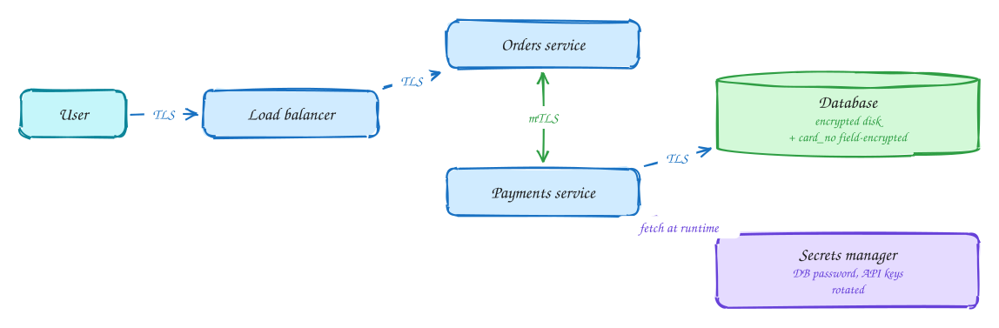
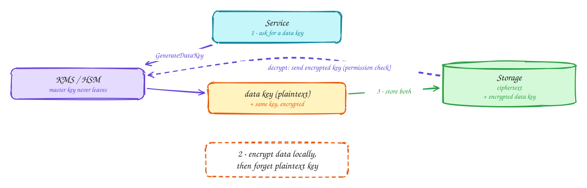

# Encryption and secrets

Intermediate

*Protect data on the wire and on disk, and keep the keys somewhere better than a config file.*

> [!TIP]
> **One-page sketchnote:** [ENCRYPTION AND SECRETS on a single page](../sketchnotes/concept-encryption-and-secrets.svg), for revision or printing.

## The problem it solves

Data is exposed in three places: **on the network** (anyone on the path can read unencrypted traffic, including inside your own datacenter), **on disk** (a stolen laptop, a misconfigured storage bucket, a decommissioned drive, a leaked backup), and **through the credentials** your services use (a database password committed to Git gives an attacker everything). Encryption handles the first two; secrets management handles the third. Interviewers expect you to mention all three for any system holding personal or payment data.

## Where encryption applies

**In transit:**

- **TLS everywhere**: user to load balancer, and also load balancer to services and services to databases. "It's inside our network" isn't protection: attackers who get in anywhere can listen. See [How HTTPS works](../101/https-tls.md).
- **Mutual TLS (mTLS)** between services: both sides present certificates, so the payments service knows the caller really is the orders service. A service mesh can issue and rotate these certificates automatically ([Monolith vs microservices](monolith-vs-microservices.md)).

**At rest, in layers:**

| Layer | Protects against | Doesn't protect against |
|---|---|---|
| **Disk / volume encryption** (cloud default) | Stolen or discarded drives | Anyone who can query the database |
| **Database or storage encryption** (TDE, S3 server-side) | Copies of database files and backups | Anyone with database access |
| **Application-level (field) encryption** | Database admins, SQL injection dumps, leaked backups | The application itself, which holds the key |

For highly sensitive fields (card numbers, national IDs, health data), encrypt in the application before writing, so the database only ever sees ciphertext. The cost: you can't query or index those fields directly. **Tokenization** is a common alternative for card numbers: store the real value in a small, locked-down vault and use a random token everywhere else.

## Envelope encryption with a KMS

**Why not just one key in a config file?** It would be readable by anyone who can read the config, impossible to rotate without re-encrypting everything, and there'd be no record of who used it.

**How envelope encryption works** (AWS KMS, Google Cloud KMS, HashiCorp Vault):

1. A **master key** (key-encryption key) lives inside the KMS, backed by hardware security modules. It **never leaves**; you can only ask the KMS to use it.
2. To encrypt something, the service asks the KMS for a fresh **data key**. It receives it twice: in plaintext, and encrypted under the master key.
3. The service encrypts the data locally with the plaintext data key (fast, no size limit), stores the ciphertext **together with the encrypted data key**, and discards the plaintext key.
4. To decrypt, it sends the encrypted data key to the KMS, which checks the caller's permissions, logs the request, and returns the plaintext data key.

**What that buys:**

- A stolen database dump or disk is useless without permission to call the KMS.
- **Every decryption is logged and access-controlled** in one place.
- **Rotation** is cheap: a new master key version encrypts new data keys; old ones can be re-wrapped without re-encrypting the data itself.
- **Crypto-shredding**: give each customer (or user) their own key; deleting that key makes all their data unreadable everywhere, including backups and immutable logs ([DDIA Ch 1](../ddia/01-trade-offs-in-data-systems-architecture.md#data-systems-law-and-society)).

## Secrets management

**Why.** Database passwords, API keys and signing keys end up in source code, Docker images, environment files and CI logs, and from there in breaches. Secrets that never change also stay valid long after the person or service that had them is gone.

**How:**

1. Store secrets in a **secrets manager** (Vault, AWS Secrets Manager, Google Secret Manager), never in code or images.
2. Services fetch them **at runtime** using their own identity (a cloud IAM role, a Kubernetes service account), not another stored password.
3. **Rotate automatically**. Better still, use **short-lived credentials**: Vault can create a database user valid for one hour per service instance.
4. **Least privilege**: each service can read only its own secrets. Audit every access.
5. Scan repositories and images for leaked secrets, and revoke anything that leaks immediately.

Passwords **of your users** are a different problem: never encrypt them, hash them with a slow salted hash. See [Storing passwords](../101/storing-passwords.md).

## Checklist

1. TLS on every hop; mTLS between services.
2. At rest: disk and database encryption by default; field-level encryption or tokenization for the most sensitive data.
3. Envelope encryption with a KMS: master keys never leave, data keys are per object or per tenant.
4. Rotate keys; per-customer keys enable crypto-shredding.
5. Secrets in a secrets manager, fetched with service identity, short-lived where possible.
6. Hash user passwords; don't encrypt them.

## In the interview

> [!TIP]
> "All traffic is TLS, with mTLS between services from the mesh. Card numbers never touch our main database: the payment service tokenizes them into a separate vault encrypted with per-merchant data keys from KMS. Service credentials come from the secrets manager at startup and the database passwords rotate daily."

## Self-check

Try to answer before you open each one.

The cloud already encrypts your disks. Why might you still encrypt card numbers in the application?

Disk encryption only protects against stolen drives. Anyone who can query the database (an admin, an attacker via SQL injection, a leaked backup restored elsewhere) sees plaintext. Application-level encryption means the database only holds ciphertext.

In envelope encryption, what is stored next to the data, and why is that safe?

The data key encrypted under the KMS master key. Without permission to call the KMS to decrypt it, the encrypted data key is useless.

How do per-user keys help with deletion requests?

Deleting the user's key makes all their encrypted data unreadable everywhere at once, including backups and append-only logs that can't easily be edited (crypto-shredding).

Why are short-lived credentials better than a database password stored in a secrets manager?

A leaked short-lived credential expires on its own within minutes or hours, and each service instance gets its own, so access is attributable and revocable without coordinating a global password change.

## Related

- [How HTTPS works](../101/https-tls.md) · [Storing passwords](../101/storing-passwords.md) · [Authorization](authorization.md)
- [CN 8: Security](../cn/08-security.md) · [Payment system](../problems/payment-system.md)
