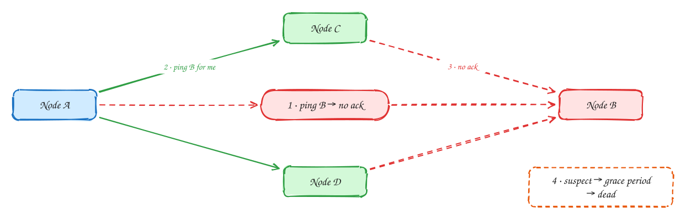
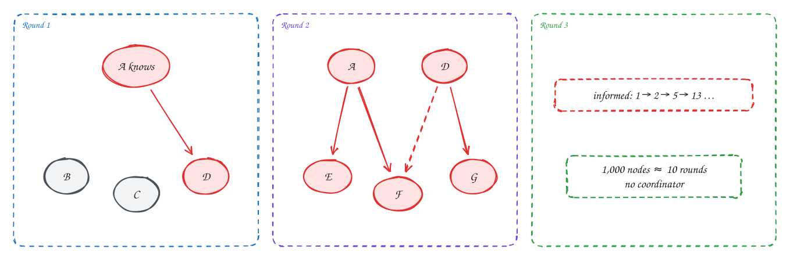

# Gossip and failure detection

Advanced

*How a cluster of hundreds of nodes agrees on who is alive, with no central server to ask.*

> [!TIP]
> **One-page sketchnote:** [GOSSIP AND FAILURE DETECTION on a single page](../sketchnotes/concept-gossip-and-failure-detection.svg), for revision or printing.

## The problem it solves

A Cassandra or Consul cluster has hundreds of nodes. Each node needs to know which others are alive, to route requests and re-replicate data when one dies. Two obvious designs fail:

- **A central monitor** that pings everyone is a single point of failure and a bottleneck, and its view of "alive" is not the view from your node.
- **Everyone pings everyone**: with 1,000 nodes that's about a million pings per interval, and the load grows with the square of the cluster size.

And underneath both is the problem from [DDIA Ch 9](../ddia/09-trouble-with-distributed-systems.md): a node that doesn't answer might be dead, slow, paused for garbage collection, or just cut off from **you**. You can only ever **suspect** failure, never know it. The techniques below make that suspicion cheap, accurate and quickly shared.

## Heartbeats and timeouts

**How.** Each node sends a small "I'm alive" message periodically (every second, say). If no heartbeat arrives within a timeout, the node is marked down.

**The trade-off is all in the timeout.** Short timeouts detect real failures quickly but declare healthy nodes dead during a GC pause or a network hiccup, which triggers needless failovers and data movement. Long timeouts avoid false alarms but leave clients sending requests to a dead node for longer. A fixed number is wrong for some environment: 2 seconds is generous in one datacenter and too short across continents.

## Phi accrual failure detector

**Why.** Instead of a yes/no verdict from a fixed timeout, give a **suspicion level** that adapts to how this particular link normally behaves.

**How it works** (used by Cassandra and Akka):

1. Each node records the intervals between recent heartbeats from each peer, and learns their distribution (say, usually 1 s ± 50 ms).
2. When a heartbeat is late, it computes **φ (phi)**: how unlikely this delay is given the history. φ = 1 means about a 10% chance the node is still fine; φ = 3, about 0.1%.
3. Each application picks its own threshold: a quick, cheap action (stop sending reads there) at a low φ, an expensive one (re-replicating its data) only at a high φ.

On a jittery network the learned distribution is wider, so the same delay produces lower suspicion: the detector adapts automatically.

## SWIM: probing without all-to-all

**Why.** All-to-all heartbeats don't scale, and a direct ping can fail because of one bad link rather than a dead node.

**How it works** (SWIM; used by HashiCorp's Serf and Consul):

1. Every interval, each node picks **one random member** and pings it. Total load is one ping per node per interval, whatever the cluster size.
2. No reply in time? Instead of declaring it dead, ask **k other nodes** to ping it on your behalf (**indirect probes**). If any of them gets a reply, the problem was just your link.
3. Still nothing: mark the node **suspect** and spread that suspicion. The suspected node, if it's alive, sees the rumour and **refutes** it by announcing a higher incarnation number.
4. Only if the suspicion isn't refuted within a timeout is the node declared **dead**.

## Gossip: spreading the news

**Why.** Once one node learns something (a node joined, a node is suspect, a schema changed), everyone needs to hear it, without a broadcast server.

**How it works:**

1. Periodically, each node picks a few random peers and exchanges what it knows, typically a table of every member with a version number (a heartbeat counter or incarnation).
2. Each side keeps the newer entry for every member.
3. Information spreads like an epidemic: the number of informed nodes roughly multiplies each round, so news reaches all *N* nodes in about **log N rounds**: around 10 rounds for 1,000 nodes.

It's robust (no single point of failure; losing messages just slows it slightly), it scales (each node does constant work per round), and it's eventually consistent: for a short while, different nodes have slightly different views. That's why gossip is used for **membership and metadata**, not for decisions that need agreement. Electing a single leader or committing a transaction needs **consensus** ([DDIA Ch 10](../ddia/10-consistency-and-consensus.md)).

> [!NOTE]
> **Where you'll meet it:** Cassandra and ScyllaDB (gossip for membership and token ownership, phi accrual for failure detection), Consul and Serf (SWIM), Amazon's Dynamo design, Redis Cluster (a gossip bus between nodes), and anti-entropy repair, which is gossip about data rather than membership (see [Merkle trees](merkle-trees.md)).

## Checklist

1. You can only suspect failure; tune for false alarms vs detection speed.
2. Adaptive detection (phi accrual) beats one fixed timeout.
3. SWIM: one random probe per interval, indirect probes before suspicion, a grace period to refute.
4. Gossip spreads membership in ~log N rounds with constant work per node.
5. Gossip gives eventual agreement; use consensus for leaders and locks.

## In the interview

> [!TIP]
> "Storage nodes gossip membership every second, so there's no central coordinator and news reaches 500 nodes in about 9 rounds. Failure detection is phi accrual: we stop routing reads to a node at low suspicion, but only start re-replicating its data after it's been unreachable for minutes, so a GC pause doesn't trigger terabytes of data movement."

## Self-check

Try to answer before you open each one.

Why not have every node heartbeat every other node?

The number of messages grows with the square of the cluster size: about a million per interval for 1,000 nodes. SWIM-style random probing costs one ping per node per interval.

What problem do SWIM's indirect probes solve?

A failed direct ping may be caused by a bad link between two nodes, not a dead node. Asking other nodes to probe it avoids declaring a healthy node dead.

Roughly how many gossip rounds to inform 1,000 nodes, and why?

About 10, because the number of informed nodes roughly multiplies each round, so it grows exponentially: log₂(1,000) ≈ 10.

Why shouldn't gossip be used to elect a leader?

Gossip only guarantees that views converge eventually; for a while two nodes can disagree, so two could each believe they're leader. Leader election needs consensus with a majority quorum.

## Related

- [DDIA Ch 9: The trouble with distributed systems](../ddia/09-trouble-with-distributed-systems.md) · [DDIA Ch 10: consensus](../ddia/10-consistency-and-consensus.md)
- [Merkle trees](merkle-trees.md) · [Consistent hashing](consistent-hashing.md) · [Distributed key-value store](../problems/key-value-store.md)
