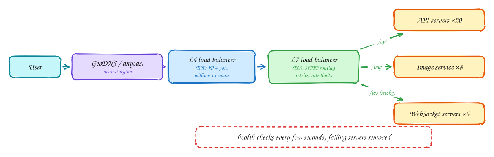
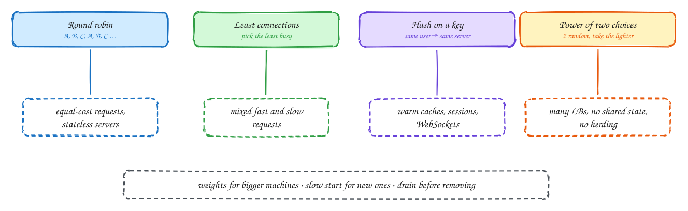

# Load balancing

Beginner

*Spread requests across many servers, and stop sending them to the ones that are broken.*

> [!TIP]
> **One-page sketchnote:** [LOAD BALANCING on a single page](../sketchnotes/concept-load-balancing.svg), for revision or printing.

## The problem it solves

One server handles a few thousand requests a second. Your app needs a hundred thousand, and must keep working when any one server crashes or is being upgraded. So you run many identical servers, and you need something in front of them that answers two questions for every request: **which server should take this?** and **is that server actually healthy?** That something is a load balancer. Getting it wrong shows up as one overloaded server while others idle, or as users being sent to a server that died a minute ago.

## The layers a request passes through

Large systems balance at several levels, each with a different job:

1. **Global: which region?** **GeoDNS** answers the domain name with the address of the nearest healthy region. **Anycast** advertises the same IP address from many locations, and the internet's routing sends each user to the closest one (CDNs and Cloudflare-style edges work this way). DNS answers are cached for their TTL, so a failover by DNS takes as long as that TTL; anycast reacts faster.
2. **Layer 4 (transport): which machine gets this connection?** An L4 balancer looks only at IP addresses and ports and forwards TCP (or UDP) connections without reading their contents. Because it does so little, it handles millions of connections and adds microseconds. Examples: AWS Network Load Balancer, Google Maglev, Linux IPVS.
3. **Layer 7 (application): which service gets this request?** An L7 balancer terminates TLS, reads the HTTP request, and routes by path, host or header: `/api` to the API servers, `/img` to the image service. Because it understands requests, it can also retry a failed request on another server, add rate limits, compress, and balance individual requests inside one long-lived HTTP/2 connection. Examples: nginx, Envoy, HAProxy, AWS Application Load Balancer.

The usual setup is all three: GeoDNS or anycast to a region, a fleet of L4 balancers in front of a fleet of L7 proxies, and those in front of the services. The load balancers themselves run as several instances so they aren't a single point of failure.

> [!NOTE]
> A **reverse proxy** is the same idea as an L7 load balancer: a server that accepts requests on behalf of backends. People say "reverse proxy" when it's mainly terminating TLS, caching or routing, and "load balancer" when it's mainly spreading load. An [API gateway](../101/api-gateway.md) is an L7 proxy with API concerns added (auth, quotas, versioning).

## Choosing a server: algorithms

**Why the choice matters.** If every request cost the same, any fair rotation would do. In reality some requests take 5 ms and some 5 seconds, servers differ in size, and some servers hold state (a cache, an open WebSocket) that makes them the right place for a particular user.

| Algorithm | How it decides | Use when |
|---|---|---|
| **Round robin** (optionally weighted) | Next server in turn; bigger machines get bigger weights | Requests are similar in cost and servers are stateless |
| **Least connections / least outstanding requests** | The server with the fewest requests in progress | Request cost varies a lot (some slow queries, uploads) |
| **Consistent hashing on a key** | hash(user ID or URL) picks the server | You want the same user or object on the same server: warm caches, sessions, WebSockets. See [Consistent hashing](consistent-hashing.md) |
| **Power of two choices** | Pick two servers at random, send to the less loaded one | Many independent balancers without shared state; avoids every balancer piling onto the same "least loaded" server |

**Operational details that matter as much as the algorithm:**

- **Slow start:** a freshly started server has cold caches; ramp its share of traffic up over a minute instead of hitting it with full load.
- **Connection draining:** before removing a server (deploy, scale-in), stop sending new requests but let in-flight ones finish.
- **Long-lived connections:** WebSockets and gRPC streams stay on one server for hours, so new servers get no traffic from existing connections. Balance on connection count, and have servers occasionally ask clients to reconnect.

## Health checks

**Why.** The balancer is only useful if it knows which servers are alive. A crashed process, a full disk or a dead database connection all need to take a server out of rotation within seconds.

**How:**

1. **Active checks:** the balancer calls `/health` on each server every few seconds. A few failures in a row mark it unhealthy; a few successes bring it back. That hysteresis stops a flapping server from bouncing in and out.
2. **Passive checks (outlier detection):** the balancer watches real traffic and ejects a server whose requests start failing or slowing, even if `/health` still says OK.
3. **What `/health` should check:** that this server can do its job (process alive, can reach its own dependencies), but be careful. If every server's health check calls the shared database and the database blips, **every** server fails its check at once and the balancer has nowhere to send traffic. Keep liveness checks shallow, and let deep dependency problems show up as errors instead.

## Sticky sessions

**Why people use them.** If a user's session lives in one server's memory, every request from that user must go back to that server, so the balancer pins them (by cookie or by hashing their IP).

**Why to avoid them.** Pinned users overload some servers, and when that server dies, its users lose their sessions. The better design is **stateless servers**: keep session data in a shared store (Redis) or in a signed token, so any server can handle any request. Use stickiness only where state is unavoidable, like a WebSocket connection, and plan for reconnects.

## Checklist

1. GeoDNS or anycast picks the region; L4 spreads connections; L7 routes requests.
2. Round robin for uniform stateless work; least-outstanding-requests when costs vary; hashing when locality matters.
3. Active plus passive health checks, with shallow liveness checks.
4. Slow start for new servers, draining before removing old ones.
5. Keep servers stateless; avoid sticky sessions except for connections that must stay put.
6. Run the balancers redundantly too.

## In the interview

> [!TIP]
> "Users hit GeoDNS, then an L7 load balancer per region that terminates TLS and routes `/api` and `/ws` to separate pools. API servers are stateless behind least-outstanding-requests balancing; WebSocket servers are balanced by connection count, and clients reconnect with backoff if a server is drained."

## Self-check

Try to answer before you open each one.

What can an L7 load balancer do that an L4 one can't, and what does it cost?

It reads requests, so it can route by path or header, terminate TLS, retry on another server and balance individual requests within one connection. It costs more CPU and latency per request than forwarding packets at L4.

Why is round robin a poor choice when some requests take 5 seconds and others 5 ms?

Servers that happen to get several slow requests pile up work while others are idle. Least-outstanding-requests sends new work to whichever server currently has the least in progress.

Every server's health check queries the database. What happens during a 10-second database blip?

Every server fails its health check at once, the load balancer removes them all, and the whole service goes down for longer than the blip. Keep health checks shallow.

Why are sticky sessions a problem, and what's the alternative?

They create uneven load and lose users' sessions when a server dies. Keep servers stateless with sessions in a shared store or signed token.

## Related

- [Networking essentials](networking.md) · [Consistent hashing](consistent-hashing.md) · [API gateway](../101/api-gateway.md) · [Rate limiting and load shedding](../101/load-shedding.md)
- [Real-time updates](../patterns/real-time-updates.md) (balancing WebSocket connections)
