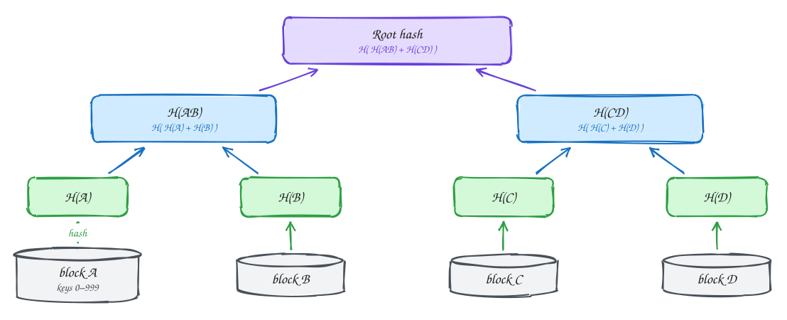
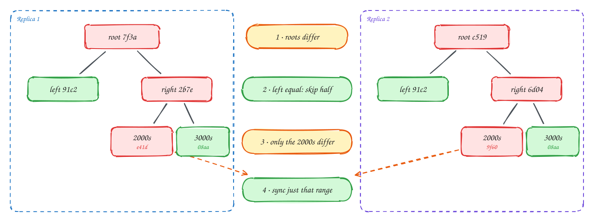
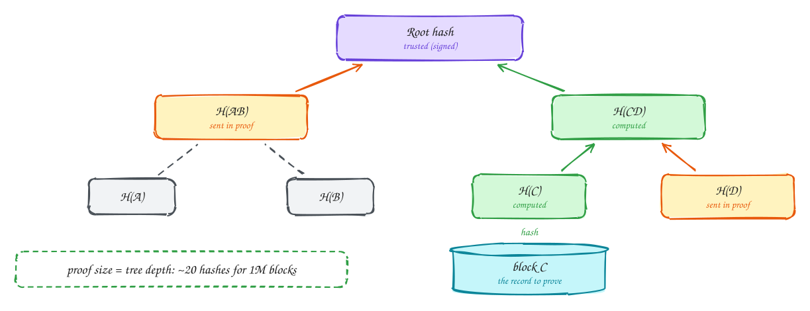

# Merkle trees

Intermediate

*A tree of hashes: compare or verify huge datasets by looking at a handful of hashes.*

> [!TIP]
> **One-page sketchnote:** [MERKLE TREES on a single page](../sketchnotes/concept-merkle-trees.svg), for revision or printing.

## The problem it solves

Two situations come up again and again in distributed systems:

1. **Two copies have drifted apart. Where?** Two replicas of a key-value store each hold a billion keys. A node was down for an hour and missed some writes, or a disk silently corrupted a block. You need to find the few thousand keys that differ. Sending all billion keys (or their hashes) across the network to compare them would take hours and saturate the link.
2. **Has this data been tampered with?** A client downloads a file, a log entry or a block from a server it doesn't fully trust. It wants to check that this exact piece belongs to the dataset, without downloading the whole dataset.

A single hash of the whole dataset helps with neither: it tells you *that* something differs or was changed, but not *what*, and to check one record against it you'd need everything. A **Merkle tree** (named after Ralph Merkle, who described it in 1979) is a hierarchy of hashes that answers both questions with a few hashes, logarithmic in the size of the data.

## How it's built

1. **Split the data into blocks.** For a key-value store, a block might be a range of keys (keys 0–999, 1000–1999, …). For a file, fixed-size chunks.
2. **Hash each block.** These hashes are the **leaves**: H(A), H(B), H(C), H(D).
3. **Hash pairs of hashes.** Concatenate two neighbouring hashes and hash the result: H(AB) = hash(H(A) + H(B)). Repeat level by level.
4. **The single hash at the top is the root.** It summarises everything below it.

The key property: **change one byte anywhere, and every hash on the path from that block to the root changes**, and nothing else does. So equal hashes at any node mean everything below it is equal (with overwhelming probability, for a good hash function), and a different hash pinpoints which half to look in.

With a million blocks the tree is only about **20 levels** deep (2²⁰ ≈ 1 million).

## Use 1: finding differences between replicas (anti-entropy)

**Why it matters.** Leaderless databases ([DDIA Ch 6](../ddia/06-replication.md)) such as Cassandra, Riak and Amazon's original Dynamo let replicas fall out of sync when a node misses writes. Read repair fixes keys that happen to be read; a background **anti-entropy** process must find and fix the rest, and Merkle trees are how these systems do it cheaply.

**How it works:**

1. Each replica builds a Merkle tree over the **same key ranges**, so the trees have the same shape.
2. They exchange **root hashes**. Equal? The replicas are in sync, and they're done after sending one hash.
3. Different? Compare the two children. Whichever child hash matches, that entire half of the data is identical and is **skipped**.
4. Keep descending only into mismatched subtrees until you reach the leaves that differ.
5. Exchange and repair only the keys in those ranges.

If only one range differs, the replicas exchange about two hashes per level: some 40 hashes for a million ranges, instead of a million. The work is proportional to **how much differs**, not to how much data there is.

> [!WARNING]
> **The trees cost something too.** Every write changes a leaf and all hashes above it, so systems either update the tree incrementally or rebuild it before each comparison. Cassandra builds its trees during a repair by reading the data, which is heavy I/O, so repairs are scheduled carefully. And leaves cover ranges, so one changed key makes its whole leaf range look different: more leaves give finer diffs but a bigger tree.

## Use 2: proving a record belongs (inclusion proofs)

**Why it matters.** If you trust just the **root hash** (because it's signed, published, or stored somewhere safe), you can verify any single block without trusting whoever sends it to you.

**How it works:**

1. The client knows the trusted root hash.
2. To prove block C is in the dataset, the server sends block C plus the **sibling hashes** along its path to the root: H(D) and H(AB).
3. The client hashes C itself to get H(C), combines it with H(D) to compute H(CD), combines H(AB) with H(CD) to compute a root.
4. If the computed root equals the trusted root, block C is genuine and unmodified. A forged block would need a hash collision.

The proof is just one hash per level: **about 20 hashes for a million blocks**, a few hundred bytes.

**Where this is used:**

- **Certificate Transparency.** Every TLS certificate issued by public CAs is appended to public, append-only logs built as Merkle trees. Browsers and auditors can check that a certificate is in the log (inclusion proof) and that the log was only ever appended to, never rewritten (consistency proof). The DDIA book (Chapter 13) points to this as a model for auditable data systems.
- **Git.** Every file, directory tree and commit is named by the hash of its content, and a commit's hash covers the whole tree beneath it. Two clones compare commit hashes to know instantly whether they're identical, and any tampering with history changes every later hash.
- **Blockchains.** A Bitcoin block header holds the Merkle root of its transactions, so a light wallet can verify that a payment is in a block with a short proof instead of downloading every transaction.
- **Storage and file transfer.** ZFS keeps a checksum of each block in its parent pointer, forming a Merkle tree that detects silent disk corruption on every read. BitTorrent v2 and IPFS verify each downloaded piece against a Merkle root, so a corrupted piece from one peer is caught and fetched again from another.

> [!NOTE]
> **A subtle detail for real implementations:** hash leaves and internal nodes differently (for example prefix leaves with a 0x00 byte and internal nodes with 0x01, as Certificate Transparency does). Otherwise an attacker could present an internal node's two child hashes as if they were a leaf's data and build a fake proof. Use a cryptographic hash (SHA-256) whenever tampering matters; for comparing replicas you control, a fast hash is enough.

## Checklist

1. Hash each block, then hash pairs upwards to a single root.
2. One change alters only the hashes on its path to the root.
3. Replica repair: compare roots, descend only into mismatched subtrees; cost grows with the difference, not the data size.
4. Proofs: block + one sibling hash per level (~log₂ n) lets anyone check it against a trusted root.
5. Trees must be kept up to date with writes, or rebuilt before comparing.
6. Domain-separate leaf and internal hashes; use a cryptographic hash against tampering.

## In the interview

> [!TIP]
> "Replicas drift when a node misses writes. Besides read repair, I'd run background anti-entropy with Merkle trees per key range: the nodes compare root hashes and walk down only the subtrees that differ, so a repair exchanges a few dozen hashes instead of scanning a billion keys."

> [!TIP]
> "For file sync, each file's chunks get hashed into a Merkle tree; the client compares hashes top-down with the server and uploads only the chunks that changed."

## Self-check

Try to answer before you open each one.

Why isn't a single hash of the whole dataset enough to sync two replicas?

It only tells you that something differs, not where. You'd still have to compare everything. A Merkle tree lets you descend into just the subtrees whose hashes differ.

Two replicas each hold a million key ranges and exactly one range differs. Roughly how many hashes do they exchange?

About two per level for ~20 levels (2²⁰ ≈ 1 million), so around 40 hashes, versus a million for comparing every range.

What does a client need to verify that one record is in a dataset of a million records?

A trusted root hash, the record itself, and the sibling hashes along its path to the root, about 20. It recomputes the root and compares.

Why does Cassandra schedule repairs carefully instead of running them constantly?

Building the Merkle trees means reading and hashing the data for each range, which is heavy disk I/O and competes with live traffic.

Name three real systems that use Merkle trees and what for.

Cassandra/Riak/Dynamo-style stores (anti-entropy repair between replicas), Git (content-addressed history; comparing and verifying commits), Certificate Transparency (provable append-only certificate logs), Bitcoin (light-client payment proofs), ZFS (detecting silent corruption), BitTorrent v2/IPFS (verifying downloaded pieces).

## Related

- [B-trees and B+ trees](b-trees.md) · [Consistent hashing](consistent-hashing.md)
- [DDIA Ch 6: Replication](../ddia/06-replication.md) (leaderless replicas, read repair, anti-entropy)
- [DDIA Ch 13: A philosophy of streaming systems](../ddia/13-philosophy-of-streaming-systems.md) (auditing and integrity)
- [File sync](../problems/file-sync.md)
