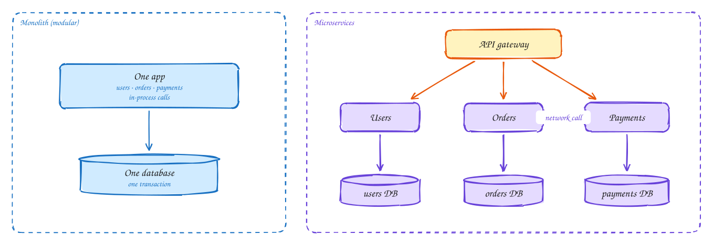
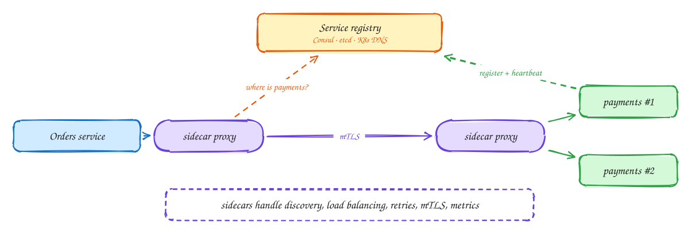

# Monolith vs microservices

Beginner

*Splitting an application into services is an organisational decision with technical costs.*

> [!TIP]
> **One-page sketchnote:** [MONOLITH VS MICROSERVICES on a single page](../sketchnotes/concept-monolith-vs-microservices.svg), for revision or printing.

## The problem it solves

As a product grows, one codebase with fifty engineers becomes slow to change: every deploy carries everyone's changes, one bad module can crash the whole app, and the part that needs 100 servers scales together with the part that needs two. Microservices promise to fix that. They also turn function calls into network calls, one database into many, and one deploy into dozens. The skill interviewers look for is knowing **when** the trade is worth it, and saying so.

## The trade-off

| | Monolith | Microservices |
|---|---|---|
| Deploy | One artifact; simple pipeline | Each service independently; many pipelines |
| Calls between parts | In-process: nanoseconds, never "partially fail" | Network: milliseconds, timeouts, retries, partial failure |
| Data | One database; ACID transactions across features | Database per service; consistency via sagas and events |
| Scaling | Scale the whole app | Scale each service by its own load |
| Failure isolation | A memory leak or crash takes everything down | A failing service can be isolated (with timeouts and circuit breakers) |
| Teams | Everyone coordinates in one codebase | Each team owns, deploys and runs its services |
| Debugging | One stack trace, one log | Distributed tracing across services |
| Tech choices | One language and stack | Each service can choose (a blessing and a burden) |

**The honest summary**, which the DDIA authors also make: microservices are mainly **a technical solution to a people problem**. They let many teams ship independently. For a small team they mostly add cost. Start with a **modular monolith**, a single deployable app with strict internal boundaries (separate modules, each owning its tables, talking through interfaces), and split out a service when there's a concrete reason:

- a team needs to deploy on its own schedule;
- a part has very different scaling or hardware needs (a video transcoder, an ML model on GPUs);
- a part needs stronger isolation (payments, running untrusted code);
- a part has a different availability requirement than the rest.

## Drawing service boundaries

**Why it matters.** Bad boundaries are worse than no boundaries: two services that must change together, or call each other for every request, are a **distributed monolith** with all the costs of both.

**How to draw them:**

1. Follow **business capabilities** (users, catalogue, orders, payments, notifications), not technical layers (a "database service", a "validation service").
2. Each service **owns its data**; no other service reads its tables directly. Others use its API or its events.
3. Prefer **asynchronous events** for things that don't need an immediate answer ("order placed" → notifications, analytics), and synchronous calls only where the caller truly needs the result.
4. Keep chatty interactions inside one service. If every request crosses five services in sequence, latencies and failure probabilities multiply ([tail amplification](../ddia/02-nonfunctional-requirements.md#percentiles-and-tail-latency)).
5. Cross-service workflows (checkout: reserve stock, charge, ship) use **sagas** or durable workflows, not distributed transactions ([Multi-step processes](../patterns/multi-step-processes.md)).

## Service discovery and service meshes

**Why.** Services run as many instances that start, stop and move constantly. Callers can't hard-code addresses.

**How:**

1. **Registration.** Each instance registers its address with a **service registry** (Consul, etcd, Eureka) and keeps heartbeating; in Kubernetes, the platform does this and exposes a stable DNS name per service.
2. **Discovery.** Callers look up healthy instances by name and pick one (client-side load balancing), or call a load balancer that does it for them (server-side).
3. **Service mesh** (Istio, Linkerd, Consul Connect): a **sidecar proxy** next to every instance intercepts its network traffic and handles discovery, load balancing, retries, timeouts, circuit breaking, **mTLS** and metrics. Application code just calls `http://payments`. The cost: an extra hop and a significant platform to operate.

Plus the rest of the platform microservices need: an [API gateway](../101/api-gateway.md) at the edge, centralised [logs, metrics and traces](../101/observability.md), and [safe deploys](../101/safe-deploys.md) per service.

## Checklist

1. Default to a modular monolith; split for a concrete team, scaling, isolation or availability reason.
2. Boundaries follow business capabilities; each service owns its data.
3. Async events for side effects; sync calls only when an answer is needed now.
4. Every network call gets a timeout, retries with backoff, and a circuit breaker.
5. Cross-service workflows use sagas or durable workflows.
6. Discovery via a registry or Kubernetes DNS; a mesh when you need mTLS and uniform traffic policy.

## In the interview

> [!TIP]
> "I'd start this as a modular monolith with Postgres, since it's one team and moderate load. The one thing I'd split out on day one is the transcoding workers, because they need GPUs and scale with uploads, not users. If the org grows, the module boundaries become the service boundaries."

## Self-check

Try to answer before you open each one.

What is a "distributed monolith" and how do you avoid it?

Services that must be changed and deployed together or call each other constantly, so you pay network costs without independence. Draw boundaries around business capabilities, give each service its own data, and use events for side effects.

Why can't the orders service just read the payments service's database tables?

It couples them to the table schema, so payments can't change its data model without breaking orders, and it bypasses payments' rules and invariants. Use its API or its events.

What does a service mesh sidecar take off the application's hands?

Service discovery, load balancing, retries, timeouts, circuit breaking, mTLS between services and request metrics.

Give two good reasons to split one component out of a monolith early.

Very different resource needs (GPUs for transcoding or ML), strong isolation needs (payments, untrusted code execution), a different scaling curve, or a separate team that needs to deploy independently.

## Related

- [DDIA Ch 1: microservices and serverless](../ddia/01-trade-offs-in-data-systems-architecture.md#distributed-vs-single-node-systems) · [DDIA Ch 5: service calls](../ddia/05-encoding-and-evolution.md)
- [API gateway](../101/api-gateway.md) · [Circuit breaker](../101/circuit-breaker.md) · [Multi-step processes](../patterns/multi-step-processes.md) · [Load balancing](load-balancing.md)
