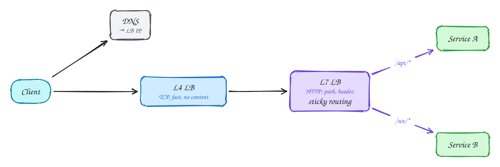

# Networking essentials

*How a request travels from a user to your service, and which protocol to pick for which job.*

1. DNS resolves the name; an **L4** load balancer forwards TCP connections without reading them. Very fast, good for WebSockets and raw TCP.
2. An **L7** load balancer reads HTTP and routes by path, header, or cookie; it terminates TLS and can do sticky sessions.

| Protocol | Use |
|---|---|
| REST over HTTP | Default public API |
| gRPC (HTTP/2 + Protobuf) | Internal service-to-service, high QPS |
| SSE | Server→client stream (feeds, tokens, comments) |
| WebSocket | Bidirectional real-time (chat, docs, games) |
| Long polling | Fallback push when nothing else works |

## Checklist

1. Public API used by browsers and partners: REST over HTTPS.
2. High-volume calls between internal services: gRPC.
3. Server pushes a stream to the client: SSE.
4. Two-way, low-latency messages: WebSocket.
5. Routing by URL path, header or cookie: L7 load balancer. Raw TCP or very high throughput: L4.

## In the interview

> [!TIP]
> "Clients talk REST through an L7 load balancer; internal services use gRPC. Live updates go over SSE, which reconnects automatically."

## Related

- Pattern: [Real-time updates](../patterns/real-time-updates.md)
