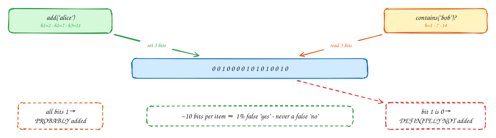
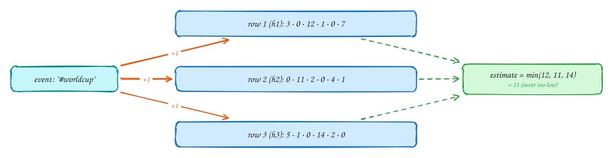
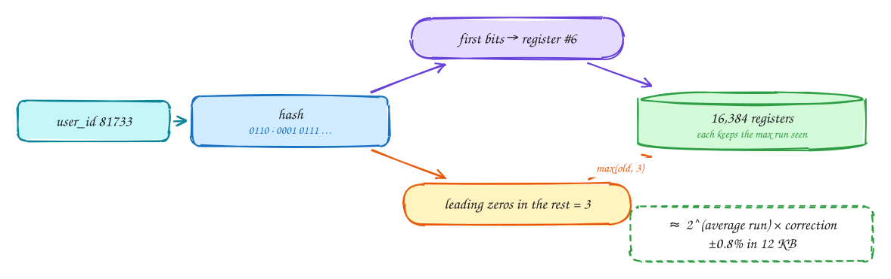

# Probabilistic data structures

Intermediate

*Trade a small, known error for using a tiny fraction of the memory.*

> [!TIP]
> **One-page sketchnote:** [PROBABILISTIC DATA STRUCTURES on a single page](../sketchnotes/concept-probabilistic-data-structures.svg), for revision or printing.

## The problem they solve

Three questions come up constantly at scale:

1. **Have I seen this before?** Has this crawler visited this URL? Has this user already been shown this profile? Is this key in this file on disk?
2. **How often has this appeared?** How many times was this hashtag used in the last hour? Which IPs are sending the most requests?
3. **How many different ones?** How many unique visitors did this page get today?

Exact answers need memory proportional to the data. Ten billion URLs at ~100 bytes each is a terabyte just to remember which you've crawled; counting unique visitors exactly means keeping every visitor ID. Often a **nearly right** answer is just as useful, and these three structures give one in kilobytes or megabytes, with error you can calculate in advance.

## Bloom filter: "definitely not" or "probably yes"

**How it works:**

1. Start with an array of *m* bits, all 0, and pick *k* hash functions.
2. **Add** an item: compute its *k* hashes and set those *k* bits to 1.
3. **Check** an item: compute the same *k* hashes. If **any** of those bits is 0, the item was **definitely never added**. If all are 1, it was **probably** added: other items might have set those bits by coincidence.

**The numbers.** About **10 bits per item** with 7 hash functions gives roughly a **1% false-positive** rate; about 14–15 bits per item gives 0.1%. One billion items at 1% needs about 1.2 GB instead of a terabyte. It **never** gives a false negative.

**Where it's used:**

- **LSM-tree databases** (Cassandra, RocksDB) keep one per file so reads skip files that can't contain the key ([DDIA Ch 4](../ddia/04-storage-and-retrieval.md)).
- **Web crawlers**: skip URLs already seen (a rare false positive just skips one page).
- **"Don't show again" lists**: profiles already swiped, articles already recommended.
- **Caches and CDNs**: only cache an object the second time it's requested, so one-hit wonders don't evict useful entries.

**Limits:** you can't delete an item (clearing its bits could remove others), and you can't list what's in it. A **counting Bloom filter** (small counters instead of bits) or a **cuckoo filter** supports deletion. If you add far more items than planned, the false-positive rate climbs towards 100%, so size it for the expected count.

## Count-min sketch: approximate counts

**Why.** Counting every hashtag, search term or IP exactly needs one counter per distinct item, potentially hundreds of millions. Often you only care about the frequent ones.

**How it works:**

1. Keep a small grid of counters: *d* rows, each *w* counters wide, each row with its own hash function.
2. When an item arrives, hash it with each row's function and **increment one counter per row**.
3. To estimate an item's count, read its counter in every row and take the **minimum**.

Other items that collide with yours only ever **add** to a counter, so every row overestimates or is exact, and the minimum is the best guess. It **never undercounts**. The error is proportional to the total number of events divided by *w*, so heavy hitters are estimated accurately while rare items may look a bit bigger than they are. A few rows of a few thousand counters (tens of kilobytes) is typical.

**Where it's used:** trending topics and top-K (pair it with a small heap of the current top items; see [Top-K videos](../problems/top-k-videos.md)), detecting heavy hitters for rate limiting or DDoS mitigation, and frequency-aware cache admission.

## HyperLogLog: approximate distinct counts

**Why.** "Unique visitors today" can't be computed by adding up counters: the same visitor comes back many times. Exact distinct counting means remembering every ID you've seen.

**How it works (the intuition):**

1. Hash every item. A good hash looks like random bits.
2. Look at how many **leading zeros** the hash has. Half of all hashes start with 0, a quarter with 00, one in 2ⁿ with *n* zeros. So if the longest run of leading zeros you've seen is 20, you've probably seen around 2²⁰ ≈ 1 million distinct items.
3. One such estimate is very noisy, so HyperLogLog uses the first bits of each hash to pick one of many **registers** (16,384 in Redis), keeps the longest run seen in each, and combines them with a harmonic mean and correction factors.
4. Duplicates hash identically, so they never change any register: the count is of **distinct** items.

**The numbers.** Redis's HyperLogLog uses **12 KB** and has a standard error of about **0.81%**, whether you've added a thousand items or billions. Two HyperLogLogs can be **merged** (take the max of each register), so you can count uniques per hour and combine them into per-day or per-region counts without double counting.

**Where it's used:** unique visitors and users in analytics (Redis `PFADD`/`PFCOUNT`, BigQuery's and Presto's approximate distinct counts), counting distinct IPs or devices for abuse detection, and database query planners estimating distinct values.

## Choosing one

| Question | Structure | Memory | Error |
|---|---|---|---|
| Is X in the set? | Bloom filter | ~10 bits per item | false positives only (~1%) |
| How often has X appeared? | Count-min sketch | fixed, tens of KB | overestimates only, worse for rare items |
| How many distinct items? | HyperLogLog | fixed, ~12 KB | ±~1% |

## Checklist

1. Use them when an approximate answer is acceptable and exact state would be huge.
2. Bloom filter: no false negatives; size for the expected item count; no deletes.
3. Count-min: increment one counter per row, read the minimum; never undercounts.
4. HyperLogLog: leading-zero runs across many registers; mergeable; ~1% error in 12 KB.
5. Say the error out loud and why it's acceptable for this feature.

## In the interview

> [!TIP]
> "The crawler keeps a Bloom filter of seen URLs, 10 billion at 1% false positives is about 12 GB, so it fits in memory; a false positive just skips a page. Daily unique viewers per video use HyperLogLog in Redis, 12 KB per video with under 1% error, and hourly sketches merge into daily ones."

## Self-check

Try to answer before you open each one.

A Bloom filter says an item is present. What do you actually know?

Only that it's probably present: all its bits are 1, but other items may have set them. If it said "absent", that would be certain.

Why does a Count-min sketch take the minimum across rows?

Collisions only add to counters, so every row's value is at least the true count. The smallest is the one with the least collision noise.

You have hourly unique-visitor counts. Why can't you add them to get daily uniques, and how does HyperLogLog help?

The same visitor appears in many hours, so adding double counts. HyperLogLog sketches merge by taking the maximum of each register, giving the distinct count of the union.

Why can't you delete from a standard Bloom filter?

Bits are shared between items; clearing an item's bits could clear bits other items rely on, creating false negatives. Counting Bloom filters or cuckoo filters support deletion.

## Related

- [DDIA Ch 4: Bloom filters in LSM-trees](../ddia/04-storage-and-retrieval.md) · [DDIA Ch 12: stream analytics](../ddia/12-stream-processing.md)
- [Web crawler](../problems/web-crawler.md) · [Top-K videos](../problems/top-k-videos.md) · [Dating app](../problems/dating-app.md) · [Search autocomplete](../problems/search-autocomplete.md)
