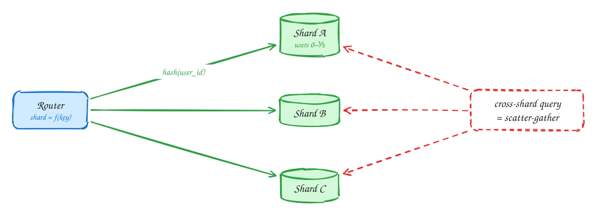

# Sharding

*Split data across machines when one can't hold it or keep up with the writes, but only then.*

1. Pick a **shard key** from the hottest access pattern so most queries hit one shard. Hash for even spread; range for range scans.
2. Queries that don't include the shard key hit every shard. That is the cost you accept.

> [!WARNING]
> **Biggest mistake: sharding too early:** One Postgres handles ~10–50k TPS and multiple TB. Shard when the calculation says so.

> [!NOTE]
> **Hot spots:** Even with hashing, one hot key overloads one shard: key splitting, caching, or buffering.

## Checklist

1. Has the calculation shown one primary isn't enough after caching and replicas?
2. Pick the shard key from the hottest query, so most requests hit one shard.
3. Hash for even spread; ranges only if you need range scans on the key.
4. Plan for hot keys and for rebalancing (many logical partitions, or consistent hashing).
5. Accept that queries without the shard key fan out to every shard.

## In the interview

> [!TIP]
> "Writes outgrow one primary, so I'll shard by hash of user_id: every hot query includes it. Cross-user analytics can scatter-gather or run on a warehouse."

## Related

- Pattern: [Scaling writes](../patterns/scaling-writes.md)
