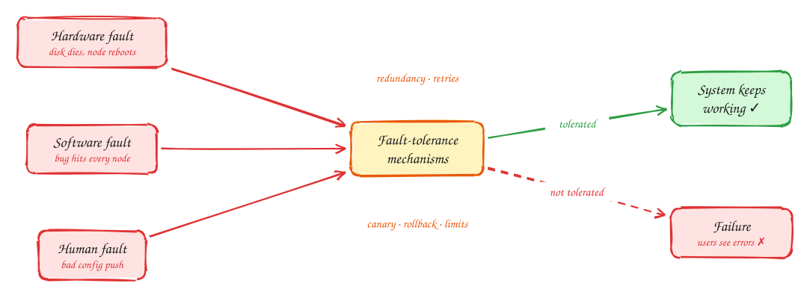
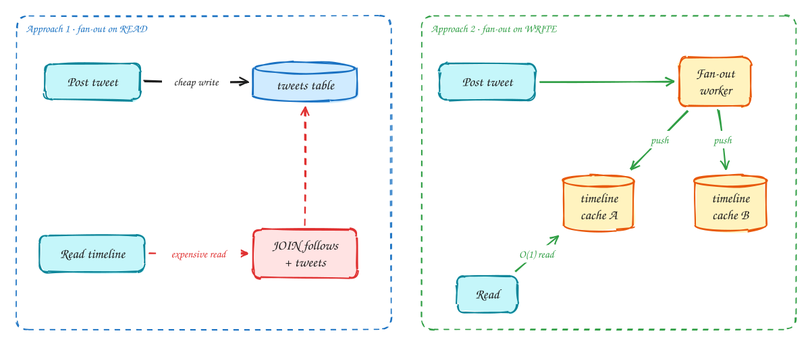
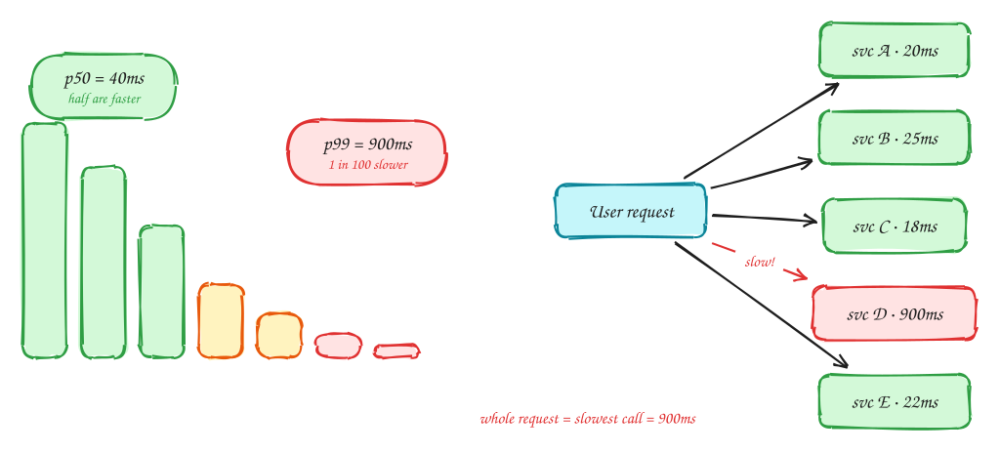

# DDIA Chapter 1: Reliable, Scalable, Maintainable

Intermediate

> These DDIA pages are study notes in our own words and diagrams, connecting the book to interview problems. They don't replace the book; *Designing Data-Intensive Applications* by Martin Kleppmann is worth reading in full.

> [!TIP]
> **One-page sketchnote:** [DDIA 1 · RELIABLE, SCALABLE, MAINTAINABLE on a single page](../sketchnotes/ddia-01.svg), for revision or printing.

## TL;DR

The three words every NFR discussion comes back to. This chapter gives them precise meaning: reliability means tolerating faults, scalability means describing load and performance with numbers, and maintainability means keeping the system easy to run and change.

**Key ideas:** faults vs failures · load parameters · p99 latency · tail amplification · scale up vs out

## Fault ≠ failure

*Reliability*

"Reliable" doesn't mean nothing ever goes wrong. In any system bigger than one machine, something is **always** going wrong: a disk dies, a server reboots, a network cable gets unplugged, someone deploys a bug. The book separates two words to make this precise.

- A **fault** is one part misbehaving: one disk, one server, one bad config value.
- A **failure** is the system as a whole stopping working for users: the site is down, or orders are lost.

You can't prevent faults, so a reliable system is one that keeps working **despite** them:

1. A fault happens, for example one of three database replicas dies.
2. Mechanisms built in advance absorb it. The load balancer stops sending traffic to the dead node, a replica takes over, and clients retry the requests that were in flight.
3. Users notice nothing, or maybe one slow request. The fault never became a failure.

That is the mindset for every design: for each component, ask "what happens when this breaks?" and make sure the answer isn't "the whole system stops".

> [!NOTE]
> **Scale makes faults routine:** a disk fails at roughly 2–5% per year. That sounds rare, but with 10,000 disks you should expect **about one disk to die every day**. At scale, failure handling is everyday work, not a rare emergency.

> [!WARNING]
> **The most dangerous faults are in software.** Hardware faults are mostly independent: two disks rarely die in the same minute. A software bug is **correlated**: the same bug runs on every server, so it hits them all at once. Examples are a bad deploy, a leap-second bug, or a dependency that every service calls. Adding replicas doesn't help, because every replica runs the same bug. Defences: staged rollouts (canaries), fast rollback, and limits on how much a single change can affect.

## Describing load: the Twitter timeline

*Scalability · load parameters*

"Will it scale?" can't be answered until you say **what is growing**. "Lots of users" isn't specific enough. You need **load parameters**: the few numbers that actually stress your system, such as requests per second, the read-to-write ratio, or how many followers a post goes out to.

The book's example is Twitter around 2012. Users posted about **4.6k tweets a second** on average (12k at peak), but home timelines were read about **300k times a second**. Reads outnumbered writes by about 65 to 1, and that ratio shaped the whole design.

There are two ways to build a home timeline:

1. **Compute it when someone reads it (fan-out on read).** Posting a tweet is cheap: insert one row. But every time a user opens the app, the database must find everyone they follow, fetch their recent tweets and merge them by time.
2. At 300k timeline reads a second, each one a big join across follows and tweets, the database can't keep up.
3. **Compute it when someone writes (fan-out on write).** When a user tweets, a background worker inserts the tweet ID into a cached timeline for **each of their followers**.
4. Now reading a timeline is a single cache lookup, which is very cheap. The cost has moved to write time: a user with 200 followers causes 200 cache writes per tweet. That's fine, because reads are far more common than writes.

But one load parameter breaks approach 2: the **number of followers per user**. A celebrity with 30 million followers would trigger 30 million cache writes per tweet. So Twitter uses a **hybrid**: normal users' tweets are fanned out on write, and celebrities' tweets are fetched at read time and merged in.

The lesson isn't really about Twitter. Find the number that decides the design (here, the read:write ratio and the fan-out per post) and design around it.

> [!TIP]
> **Say this in the interview:** "The load parameter that matters here is fan-out per post, not total users. That number decides push vs pull."

## Describing performance: percentiles and tail latency

*Scalability · performance*

Once you know the load, you need to say how fast is fast enough. The natural instinct is to use the **average** response time. That's a mistake, because averages hide the users having a bad time.

1. Response times aren't all similar. Most requests are fast, but there is a **long tail** of slow ones: a cache miss, a GC pause, a retransmitted packet. A 50 ms average can hide 1 in 100 requests taking 2 seconds.
2. So use **percentiles**. Sort all response times. The **p50** (median) is what a typical request sees. The **p99** is the time that 99% of requests beat, so 1 in 100 is slower. The slowest requests often belong to your most valuable users, the ones with the most data, the biggest carts and the most history.
3. **Tail latency amplification** makes the tail matter even more. Loading one page often calls many backend services in parallel: profile, recommendations, cart, ads, and so on.
4. The page can't render until the **slowest** of those calls returns. Even if each backend is slow only 1% of the time, a page that calls 100 of them is slow most of the time.

> [!NOTE]
> **The math:** the chance that all 100 calls are fast is 0.99¹⁰⁰ ≈ 0.37. So **63% of page loads hit at least one slow call**. This is why each service's p99 matters more than its average.

Two common defences: give each backend call a tight timeout and show the page without that piece if it is late, and use **hedged requests**: if a call hasn't returned by the p95 time, send the same request to a second replica and use whichever answer comes first.

> [!TIP]
> **Say this in the interview:** "I'll set the SLO on p99, not average. Because the page fans out to several services, the tail compounds, so I'll add timeouts and hedged requests."

## Scaling up vs scaling out, and maintainability

*Scalability · maintainability*

When load grows past what one machine can handle, there are two basic moves. **Scaling up** means buying a bigger machine. **Scaling out** means spreading the work across many machines. The second sounds more impressive, but it brings all the hard problems in this book: replication lag, partial failure, distributed transactions. So start simple, and scale out only the parts that need it.

The chapter's third word, **maintainability**, is a reminder that most of a system's cost comes **after** launch: running it, debugging it and changing it for years. The book splits it into three parts, at the bottom of this table.

| Choice | What it means | When it wins |
|---|---|---|
| Scale up (vertical) | Bigger machine: more cores, RAM, NVMe | Simple, no distribution bugs. A single Postgres box handles 10–50k TPS. Start here. |
| Scale out (horizontal) | More machines, shared-nothing | When one box is not enough or you need fault tolerance. Stateless services scale out easily; stateful ones (databases) are hard. |
| Elastic | Add or remove capacity automatically | Unpredictable load. Manual scaling is simpler and has fewer surprises. |
| Operability | Easy for ops to keep running | Monitoring, good defaults, predictable behaviour, runbooks. |
| Simplicity | Remove accidental complexity | Good abstractions, for example SQL hiding storage and concurrency. |
| Evolvability | Easy to change later | Loose coupling, schema evolution (Ch 4), tests. |

> [!WARNING]
> **Over-scaling:** there is no general-purpose "scalable architecture". A system for 100k requests a second of 1 KB reads looks nothing like one for 3 uploads a minute of 2 GB files, even though both are "large scale". **Design for the load parameters you calculated**, not for a generic idea of scale.

## In the interview

> [!IMPORTANT]
> **Interviewer asks:** "How will this scale?"  
> → Name the **load parameter** (reads/sec, fan-out, data size), calculate it, then say which component breaks first.

> [!IMPORTANT]
> **Interviewer asks:** "What's your latency target?"  
> → **p99 < 200ms** for reads, not averages. Mention tail amplification if requests fan out.

> [!IMPORTANT]
> **Interviewer asks:** "What if a node dies?"  
> → Separate fault from failure: "A node dying is a fault. Replicas plus health checks mean it never becomes a failure."

> [!TIP]
> **Say this in the interview:** "Before choosing components, let me pin down the load parameters: DAU, read:write ratio, and peak QPS, because they decide whether we need any distribution at all."

---

[Ch 2: Data models](02-data-models.md) →
