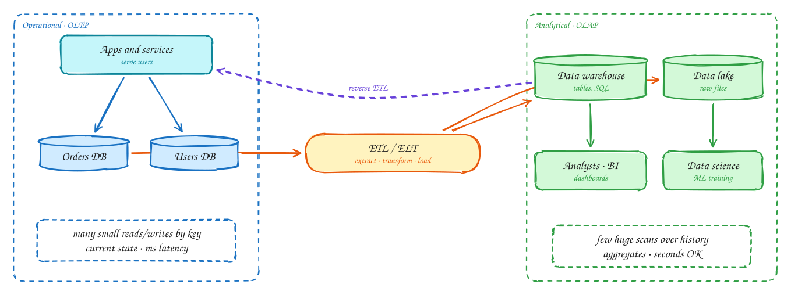
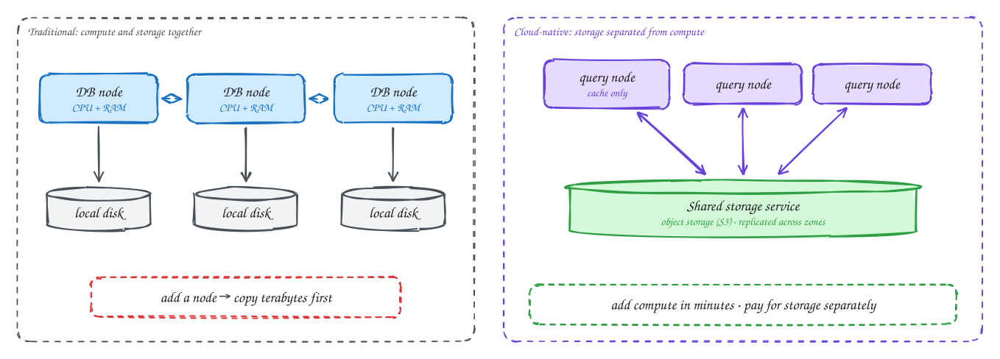

# DDIA Chapter 1: Trade-Offs in Data Systems Architecture

Beginner

> These DDIA pages are study notes in our own words and diagrams, following the **2nd edition** of *Designing Data-Intensive Applications* by Martin Kleppmann and Chris Riccomini. They connect the book to interview problems and don't replace it; the book is worth reading in full.

> [!TIP]
> **One-page sketchnote:** [DDIA 1 · TRADE-OFFS IN DATA SYSTEMS ARCHITECTURE on a single page](../sketchnotes/ddia-01.svg), for revision or printing.

## TL;DR

There are no perfect data systems, only trade-offs. Before choosing a database, decide four things: is this an **operational** system (serving users) or an **analytical** one (answering questions about the business)? Which data is the **source of truth**, and which is **derived** from it? Will you run it yourself or rent it as a **cloud service**? And do you need **more than one machine** at all? Finally, remember that the data is often about people, and the law has a say in how you keep it.

**Key ideas:** OLTP vs OLAP · data warehouse · ETL · data lake · system of record vs derived data · cloud-native · separation of storage and compute · reasons to distribute · microservices · GDPR

## Operational vs analytical systems

*OLTP vs OLAP*

**Why there are two kinds.** Picture a hotel booking site. The booking service runs queries like "fetch booking 8812" or "mark room 512 as taken": each touches a handful of rows, by key, and must answer in milliseconds while thousands of users click at once. Now the finance team asks "what was our revenue per city per month over the last three years?" That query reads **every booking ever made**, but only two or three columns of each. Run it on the booking database at noon and it competes with customers for disk and CPU, and the site slows down.

The two workloads want opposite things, so they get separate systems:

| | Operational (OLTP) | Analytical (OLAP) |
|---|---|---|
| Who uses it | Customers, through the app | Analysts, dashboards, data scientists |
| Typical query | Read or write a few records by key | Scan millions of rows, aggregate a few columns |
| Writes | Constant small inserts and updates | Bulk loads (or a stream) from other systems |
| Data shown | Current state | History over time |
| Size | Gigabytes to terabytes | Terabytes to petabytes |
| Speed target | Milliseconds | Seconds to minutes is fine |

**How data gets from one to the other:**

1. Each operational database keeps serving the app. Nobody runs big reports on it.
2. A pipeline copies its data into a **data warehouse**, a database built for analytical queries (Chapter 4 explains why it stores data by column). The classic pipeline is **ETL**: *extract* from the source, *transform* it into a clean, analysis-friendly schema, *load* it. Cloud warehouses often do **ELT** instead: load the raw data first and transform it inside the warehouse with SQL, because warehouse compute is cheap and elastic.
3. Analysts query the warehouse through BI tools and dashboards without ever touching production.

Three more pieces you'll hear about:

- **Data lake.** Data scientists often want the raw data, not the warehouse's tidy tables: raw logs, images, text for training models. A data lake is just a big store of files (usually object storage such as S3) in whatever format they arrived. The book calls the idea the "sushi principle": raw data is better, because you can't recover information that a transformation threw away.
- **HTAP.** Some databases (hybrid transactional/analytical processing) try to serve both workloads. They help for analytics that must be fresh to the second, but large companies still keep a separate warehouse, because it combines data from **many** operational systems.
- **Reverse ETL.** Results computed in the warehouse (a churn score, a recommendation list) are copied *back* into operational systems so the app can use them.

> [!TIP]
> **Say this in the interview:** "Dashboards and reports won't query the production database. I'll stream changes out with CDC into a warehouse, so analytical scans never compete with user traffic."

## Systems of record vs derived data

**Why the distinction matters.** A real application keeps the same facts in several places: the bookings table, a Redis cache of hot bookings, an Elasticsearch index for search, a warehouse table for reports. When they disagree, which one is right? If you haven't decided, every bug becomes an argument.

**How to think about it:**

- The **system of record** (source of truth) holds the authoritative version. Each fact is written there first, once. If another copy disagrees, the system of record wins.
- **Derived data** is computed from it: caches, search indexes, materialized views, warehouse tables, ML models. If you lose a derived dataset, you can rebuild it by reprocessing the source.

Derived data is redundant by design. That's fine: it exists because one storage layout can't serve every kind of read well. The skill is keeping it in sync, which is the topic of Chapters 11 to 13 (CDC, batch and stream processing).

> [!NOTE]
> "System of record" is a role, not a product. The same Postgres could be the source of truth for bookings and hold a derived table of daily totals.

## Cloud services vs self-hosting

*Build vs buy*

**Why it's a real decision.** For every component you can run the software yourself (on your own servers or on rented VMs), or pay a cloud provider to run it as a managed service (Amazon RDS, DynamoDB, BigQuery, Snowflake). Neither is always right. The question is **what you want your team to spend its time on**.

| | Cloud service | Self-hosting |
|---|---|---|
| Getting started | Minutes. No hardware, no installs. | Weeks: hardware, setup, tuning. |
| Operations | Provider handles patching, backups, failover. | Your team does, and needs the expertise. |
| Load that varies | Scale up and down; pay for what you use. | You buy for the peak; it sits idle the rest of the time. |
| Steady, predictable load | Often **more expensive** at large scale. | Cheaper once the team and hardware exist. |
| Control | Can't fix the provider's bugs or outages; limited tuning. | Full control, full responsibility. |
| Lock-in | Moving off a proprietary API is costly. | Open-source software moves with you. |
| Data location | Data lives with a third party, which matters for some regulation. | You decide where it lives. |

**Cloud-native systems.** The more interesting change isn't "the same database, on someone else's server". It's databases redesigned around cloud building blocks. The key move is **separating storage from compute**:

1. In a traditional database, each node stores its data on **its own local disk**. Adding a node means copying terabytes to it first, and a node's disk dies with the node.
2. In a cloud-native database (Snowflake, Amazon Aurora, many newer systems), the data lives in a **shared storage service**, often object storage like S3 that is already replicated across availability zones. Compute nodes keep only a cache.
3. So compute nodes are nearly stateless. You can add ten for a big query and remove them an hour later, and you pay for storage and compute separately.

The catch: "local" disks in the cloud are usually **virtual disks** reached over the network, so their latency is less predictable than a physical disk's. And cloud services are **multitenant**: your workload shares hardware with other customers, so performance can vary.

**Operations don't disappear.** With managed services, ops work shifts rather than vanishes. Capacity planning becomes **cost optimisation** (an elastic bill can grow as fast as the load). You still own the choice of services, how they fit together, monitoring, and security.

## Distributed vs single-node systems

**Why distribute at all.** One modern server has dozens of cores, terabytes of RAM and fast SSDs, and it is far simpler to run than a cluster. Reasons that genuinely force you onto several machines:

- **Inherent distribution.** Users' phones and your servers are different machines; two companies' systems talk over a network.
- **Requests between services.** Different teams' data lives in different systems.
- **Fault tolerance and high availability.** If one machine must not take the service down, you need redundancy.
- **Scalability.** The data or the load outgrows one machine.
- **Latency.** Users worldwide are served faster by a server near them.
- **Elasticity.** Add machines for peaks, release them afterwards.
- **Specialised hardware.** GPUs for ML, machines with lots of RAM for caches.
- **Legal compliance.** Some laws require data about a country's residents to stay in that country.
- **Sustainability.** Run batch work where and when electricity is cleanest.

**The price.** Every network call can fail or time out (Chapter 9), and you can't tell whether the request happened. A slow service slows its callers. Keeping data consistent across machines is hard (Chapters 6–10). Troubleshooting needs **observability**: distributed tracing (for example OpenTelemetry) to follow one request across services. So the advice is: **if one node will do, use one node**, and distribute when one of the reasons above actually applies.

**Microservices and serverless.** Splitting an application into services, each with its own database, owned by one team, lets teams deploy independently. The book frames microservices as mainly **a technical solution to a people problem**: they help large organisations move without coordinating every change, and they cost a small team more than they give. **Serverless** (functions as a service) goes further: you hand the provider your code and it runs and scales it, billing per invocation.

> [!WARNING]
> **Interview trap:** proposing ten microservices and a sharded cluster for an app with 1,000 users. Start with what the numbers need, and split when a specific reason (team ownership, independent scaling, fault isolation) appears.

## Data systems, law and society

**Why architects must care.** Much of the data we store is **about people**, and laws like the EU's GDPR give them rights over it, such as the **right to erasure**: a user can ask you to delete their data.

**How it bites the architecture:**

- Many systems in this book are built on **immutable, append-only logs** (Kafka topics, event sourcing, backups, warehouse snapshots). "Delete this user from everywhere" is hard when data was designed never to be deleted, and copies exist in every derived system. Plan deletion from the start: know where every copy goes, and consider **crypto-shredding** (encrypt each user's data with their own key, then delete the key).
- **Data minimisation:** collect and keep only what you need. Storing everything forever is not free: it costs money, and every stored record is a liability if it leaks.
- Industry rules add their own constraints, for example PCI DSS for card payments, or SOC 2 audits for B2B services.

Chapter 14 returns to the ethics behind these rules.

## In the system design interview

> [!IMPORTANT]
> **Interviewer asks:** "Where do the analytics/dashboards read from?"
> → Not the OLTP database. CDC or ETL into a warehouse (or a lakehouse on object storage), where column storage makes scans cheap.

> [!IMPORTANT]
> **Interviewer asks:** "Which store is the source of truth?"
> → Name one system of record per fact. Caches, search indexes and counters are derived and rebuildable from it.

> [!IMPORTANT]
> **Interviewer asks:** "Managed service or run it yourselves?"
> → Managed by default for a small team or variable load; self-host when load is large and steady, or control and data location matter. Mention lock-in.

> [!IMPORTANT]
> **Interviewer asks:** "How do you handle a user's deletion request?"
> → Track every copy of personal data (including derived stores and logs), delete or anonymise it everywhere, and use per-user encryption keys for immutable logs and backups.

## Self-check

Try to answer before you open each one.

Why not run the monthly revenue report directly on the bookings database?

The report scans every booking but only a few columns, and it competes with customer traffic for disk and CPU, slowing the site. A warehouse holds a copy in a column-oriented layout made for such scans, kept away from production.

What is the difference between ETL and ELT, and why do cloud warehouses favour ELT?

ETL transforms data before loading it into the warehouse; ELT loads the raw data first and transforms it inside the warehouse with SQL. Cloud warehouse compute is elastic and cheap, and keeping the raw data lets you change transformations later.

Your search index and your database disagree about a product's price. Which is right, and how do you fix the index?

The database, because it is the system of record; the index is derived data. Rebuild or re-sync the index from the database (for example by replaying its change stream).

What does separating storage from compute buy a cloud-native database?

Data lives in a shared, replicated storage service, so compute nodes are nearly stateless: you can add or remove them in minutes without copying data, scale and pay for storage and compute independently, and lose a node without losing data.

## Related

- [SQL vs NoSQL](../101/sql-vs-nosql.md) · [Storage types](../101/storage-types.md) · [Observability](../101/observability.md)
- [Ad click aggregator](../problems/ad-click-aggregator.md) and [Metrics monitoring](../problems/metrics-monitoring.md) for analytical pipelines in practice
- [Monolith vs microservices](../core-concepts/monolith-vs-microservices.md) · [Disaster recovery and multi-region](../core-concepts/disaster-recovery.md)

---

[Ch 2: Defining nonfunctional requirements](02-nonfunctional-requirements.md) →
