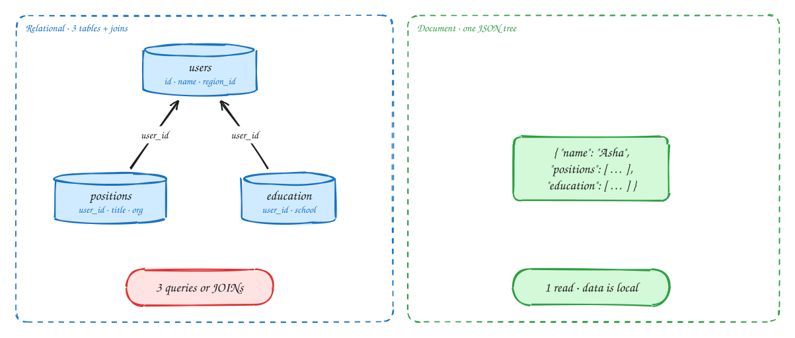
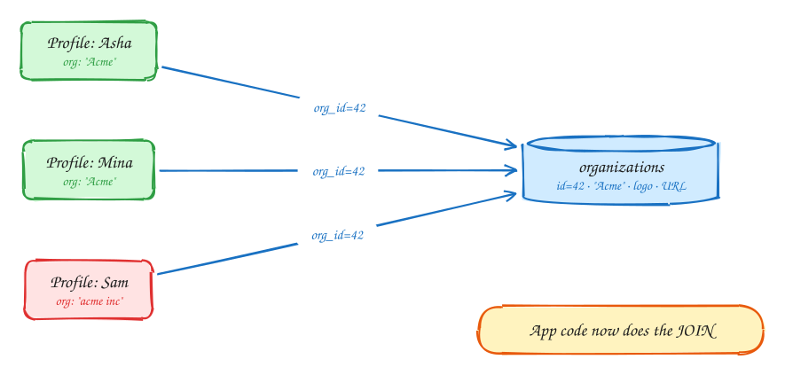
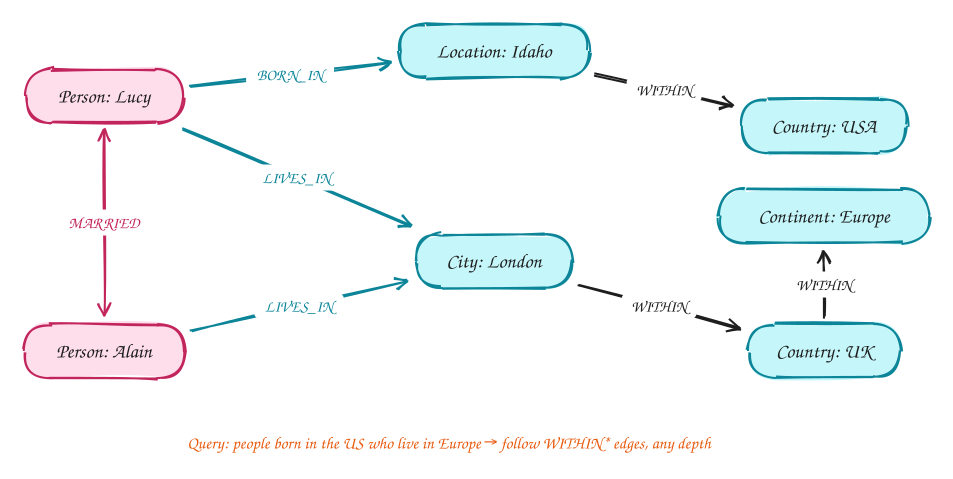

# DDIA Chapter 2: Data Models & Query Languages

Intermediate

> These DDIA pages are study notes in our own words and diagrams, connecting the book to interview problems. They don't replace the book; *Designing Data-Intensive Applications* by Martin Kleppmann is worth reading in full.

> [!TIP]
> **One-page sketchnote:** [DDIA 2 · DATA MODELS & QUERY LANGUAGES on a single page](../sketchnotes/ddia-02.svg), for revision or printing.

## TL;DR

The shape of your data decides which database fits. Trees of data that are read together (one-to-many) suit documents. Data full of references (many-to-many) suits relational. Data where relationships are the point suits graphs.

**Key ideas:** relational · document · graph · normalization · schema-on-read · locality

## One LinkedIn profile, two models

*Relational vs document*

Take one LinkedIn-style profile: a name, a headline, several past jobs, a few schools and some contact details. How should it be stored?

1. **Relational:** split the profile into tables, with `users` holding one row per person, `positions` one row per job, `education` one row per school, each pointing back with `user_id`. To show the page, you **join** them back together. In your code, though, a profile is one object with nested lists. Translating between that object and the tables is boilerplate (it's why ORMs exist), and the book calls the mismatch **impedance mismatch**.
2. **Document:** store the whole profile as one JSON document, with the jobs and schools nested inside it. One read returns everything the page needs, because all of it is stored together on disk. This is called **locality**. The structure in the database matches the object in your code.

The document model fits well here because of the data's **shape**: a profile is a **tree**. One person has many jobs (one-to-many), each job belongs to exactly one profile, and you usually load the whole profile at once.

> [!NOTE]
> **When the document model wins:** the data forms a tree, you nearly always load the whole tree together, and there are few references from one document to another. Examples: a resume, a product page, an order with its line items.

## Where documents break: many-to-one and many-to-many

*Normalization*

Look at the profile again. "Worked at **Acme Corp**". Is the company name just text in the profile, or a link to a company that exists on its own?

1. If you store `"company": "Acme Corp"` as text in every profile, the same company is copied into thousands of documents.
2. Copies drift apart. One says "Acme Corp", another "ACME Corporation", a third has a typo. If Acme renames itself or changes its logo, you must find and update every document that mentions it, and you'll miss some.
3. The fix is to **normalize**: store the company once, with an ID, and put only `company_id: 42` in each profile. Many profiles now point to one company. That is a **many-to-one** relationship. Add "people can endorse each other's skills" and you have **many-to-many**.
4. Now, to display a profile, you need the company names, which means a **join**. Document databases traditionally have weak join support, so your application code ends up doing it: fetch the profile, collect the company IDs, fetch the companies, stitch them together.

That is the real trade-off. Documents are great while the data is a self-contained tree. As soon as the data is full of **references** between records, you are doing joins anyway, and the relational model, which was built for joins, wins again. Most real applications start as trees and grow references over time.

> [!TIP]
> **Say this in the interview:** "Bookings reference hotels, users and rooms, which is many-to-many, so I'll use Postgres. Each hotel's static content is one tree read as a whole, so it can live in a document store or as cached JSON."

## Schema-on-write vs schema-on-read

*Schema flexibility*

Document databases are often called "schemaless", but that isn't quite true. The real question is **when** the structure of your data is checked.

- **Schema-on-write** (relational): the database enforces the structure when you write. Every row in `users` has the same columns, and inserting a row that doesn't fit fails immediately.
- **Schema-on-read** (document): the database accepts any shape, and your **reading code** interprets it. If old documents have `name` and new ones have `first_name` and `last_name`, the code that reads them must handle both.

It is like static versus dynamic typing in programming languages: neither is always better, and the table shows where each fits.

|  | Schema-on-write (relational) | Schema-on-read (document) |
|---|---|---|
| Analogy | Static typing: checked at compile time | Dynamic typing: checked at run time |
| Change a field | ALTER TABLE + migration (fast in Postgres; MySQL used to copy the whole table) | Just write new docs; code handles both old and new shapes |
| Good for | Uniform records with stable structure | Heterogeneous items: different shapes per type, or external data you don't control |
| Locality | Rows are spread across tables (but see Postgres JSONB, Spanner interleaving) | Whole doc stored together; rewrites the whole doc on update, so keep docs small |
| Joins | Native, optimized by query planner | Weak or none; done in application |

> [!WARNING]
> **"NoSQL is schemaless" is misleading.** There is always a schema; with documents it is **implicit**, spread through every piece of code that reads the data. You still pay for changing it, just later and in more places, often as `if field missing then …` branches that stay forever.

## Graph model: when relationships are the data

*Property graphs*

Some data is mostly **connections**: who knows whom, which account sent money to which, which place is inside which region. You can store connections in tables, but the questions you ask, like "friends of friends of friends" or "everything inside Europe, however deeply nested", need a variable number of joins. A **graph** model makes the connections themselves the main thing.

1. A graph has **vertices** (things: people, places, accounts) and **edges** (relationships: LIVES_IN, KNOWS, WITHIN). Both can carry properties, such as a name or a date.
2. Real-world structure is irregular. Boise is WITHIN Idaho, which is WITHIN the USA. A French city is WITHIN a département, WITHIN a region, WITHIN France. The depth differs from place to place.
3. Anything can connect to anything. A new kind of relationship is just a new edge label; no schema change is needed.
4. That makes recursive questions easy. "Find people born in the USA and now living in Europe" follows WITHIN edges **any number of hops** up from each city. In a graph query language like Cypher that's one short pattern. In SQL it needs a recursive common table expression, which is long and hard to get right.

> [!NOTE]
> **In interviews:** graph databases come up for fraud rings, "people you may know" and knowledge graphs. Most interview problems don't need one: a follows table in Postgres, or adjacency lists in Redis, handle one or two hops perfectly well.

## In the interview

| Data shape | Pick | Interview example |
|---|---|---|
| Lots of cross-references, need transactions | Relational (Postgres) | Bookings, payments, inventory, users |
| Self-contained tree, read whole | Document (Mongo, DynamoDB item, JSONB) | Hotel content, product catalog page, chat message |
| Relationships are the query | Graph (Neo4j) or adjacency list | Social graph, recommendations, fraud |
| Huge write volume, simple key access | Wide-column (Cassandra) | Chat history, metrics, activity logs |

> [!TIP]
> **Say this in the interview:** "I start from access patterns. The two hot queries are X and Y, and both are key lookups with one join, so Postgres with the right indexes covers it. I'd only move to Cassandra if write volume passes about 50k/sec."

---

← [Ch 1: Reliable, scalable, maintainable](01-reliability-scalability-maintainability.md) · [Ch 3: Storage and retrieval](03-storage-and-retrieval.md) →
